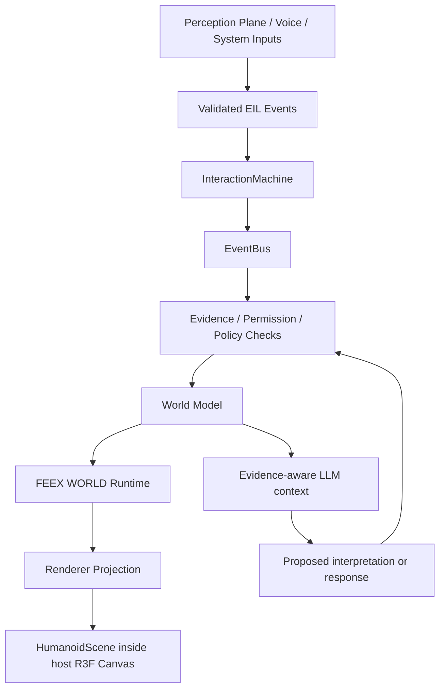

# FEEXSYSTEMS MASTER IMPLEMENTATION PROGRAMME
## LLM-Agent Execution Edition

**Programme ID:** FEEX-MIP-2026  
**Document version:** 1.0.0  
**Generated:** 2026-11-19  
**Repository:** `FeexSystems/FeexSystems-Living-Intelligence-World`  
**Canonical branch:** `main`  
**Production target:** <https://feexsystems.codes>  
**Programme authority:** Human owner / designated orchestrator  
**Document status:** Operational baseline. Live repository and CI evidence supersede this snapshot whenever they differ.

---

# 0. EXECUTIVE CONTROL RECORD

## 0.1 Canonical repository snapshot

| Field | Value |
|---|---|
| Repository | `FeexSystems/FeexSystems-Living-Intelligence-World` |
| Main HEAD asserted by programme snapshot | `30fe4963b2ec6b0317e370350188c1a46c06945e` |
| Verified commit object | `30fe4963b2ec6b0317e370350188c1a46c06945e` |
| Commit message | `feat(eil): add state-driven humanoid renderer (#57)` |
| Last merged PR | #57, FEEX EIL Humanoid Renderer |
| PR #57 feature head | `b76c9df5090f643fec2fe6d4d23bd3d352078e91` |
| Merge strategy | Squash |
| Merge commit time in supplied snapshot | 2026-11-19 16:04 UTC |
| Production target | `https://feexsystems.codes` |
| Active gate | G4, post-merge specialist verification |
| Release/deployment authority | Human only |

**Repository evidence:** GitHub commit lookup returned the exact merge SHA and commit message. The merge commit contains the renderer implementation and associated documentation/tests.

**Important live-state observation:** At the time of this document build, GitHub's combined-status lookup returned an empty status list for `30fe4963...`, and the commit-workflow-runs lookup returned an empty workflow-run list. This does not prove that no CI execution exists through every possible GitHub interface, but it means this audit did not obtain a post-merge execution record. G4 therefore remains **BLOCKED / NOT VERIFIED** until the exact SHA has attached, inspectable execution results.

**Stale repository documentation:** `docs/program/FEEX-MASTER-IMPLEMENTATION-REGISTER.md` on `main` still describes Phase 3 as isolated on the feature branch and references the prior base SHA. It is stale relative to the merge commit. Agent 00 must create a documentation-only correction after G4 evidence is collected or in a separately approved documentation task. Do not edit the register in a way that implies G4 passed.

## 0.2 Programme doctrine

> **The LLM interprets the World Model; it does not become the World Model.**

> **The scene is a projection. The World Model and evidence layer determine what is canonical.**

> **Evidence, not claims.** An LLM-generated statement is not canonical merely because it is fluent, confident, or repeated.

All agents must enforce these invariants:

1. Canonical state comes from validated contracts, event history, and evidence-backed World Model records.
2. Rendering is a read-only projection unless a separately authorized command pathway exists.
3. LLM inference is classified as inference. It cannot silently become a verified fact, state transition, task completion, or physical action.
4. Every proposed capability must be labelled as `IMPLEMENTED`, `VERIFIED`, `PROPOSED`, `BLOCKED`, or `UNKNOWN`.
5. A merge is not a release. A passing feature-branch CI run is not post-merge verification.
6. No agent may promote its own work through a gate.
7. No deployment, production authorization, or physical actuation may be inferred from a green build.
8. When evidence conflicts, preserve the conflict, identify the authority source, and request a human decision where contract or policy changes are involved.

## 0.3 Evidence hierarchy

Use this order when facts conflict:

1. Current GitHub repository state at an exact commit SHA.
2. Current CI/workflow execution and test artifacts attached to that SHA.
3. Canonical contract source files on `main`.
4. Merged PR and review-thread records.
5. Current programme register and other repository documentation.
6. Owner-supplied programme snapshot or pasted draft contracts.
7. Prior chat summaries and agent memory.
8. LLM inference.

A lower-ranked source must never silently overwrite a higher-ranked source.

---

# 1. CURRENT PROGRAMME STATE

## 1.1 Gate matrix

| Gate | Name | Current status | Exit authority | Blocking |
|---|---|---|---|---|
| G0 | Repository integrity | PASSED in prior programme record | Agent 01 evidence pack + Agent 00 acceptance | No |
| G1 | Architecture approval | PASSED in prior programme record | Agent 02 architecture record + human approval | No |
| G2 | Security foundation | IN PROGRESS; not cleared | Agent 07 evidence + Agent 09 verification + human security acceptance | Yes for physical actuation; required before G7 |
| G3 | Specialist implementation | IN PROGRESS; PR #57 renderer merged | Specialist implementation evidence | No longer blocks G4 |
| G4 | Specialist verification | PASS WITH DOCUMENTED EXCEPTION (Agent 00 recommendation + human acceptance, §15.4) | Agent 09 test report + Agent 02 contract review + Agent 00 gate decision | **YES** |
| G5 | Cross-system integration | NOT STARTED | Agents 02/03/04/05/06/09 + Agent 00 | Yes |
| G6 | Release candidate | NOT STARTED | Agent 10 release evidence + QA/security acceptance | Yes |
| G7 | Production authorization | NOT STARTED | Human owner only | Yes |

A gate status may only change when its exit criteria are supported by attached evidence. A status label in a document is not evidence by itself.

## 1.2 Active workstreams

| Agent | Workstream | State | Immediate assignment |
|---|---|---|---|
| 00 | Orchestrator | ACTIVE | Coordinate G4; maintain evidence ledger; prevent unauthorized promotion |
| 01 | Repository Intelligence | COMPLETE at G0; standby | Re-open only for G5 repository delta or a new audit request |
| 02 | Architecture & Contracts | ACTIVE | Review live EIL contracts and renderer Canvas boundary; reconcile contract-version discrepancy |
| 03 | FEEX WORLD | IN PROGRESS / G5 HELD | Prepare Phase 5 integration plan only; do not wire before G4 passes |
| 04 | FEEX EIL | REVIEW REQUIRED | Disposition four open Kilo threads; inspect renderer implementation at merge SHA |
| 05 | HOLOKAI | IN PROGRESS / HANDOFF HELD | Map required EIL adapter interfaces; no integration until contracts and G4 permit |
| 06 | Knowledge & Data | IN PROGRESS | Preserve World Model schema; validate evidence/provenance mapping |
| 07 | Security & Infrastructure | IN PROGRESS | CI/security audit; triage dependency and deployment risks |
| 08 | Product & Commercial | IN PROGRESS | Customer-segment research and five-solution validation; separate business hypotheses from shipped capability |
| 09 | QA & Verification | G4 disposition recorded (§15.4); Storybook infra exception remains open | Post-merge verification executed against exact merge SHA; exception tracked |
| 10 | Integration & Release | NOT STARTED | Remain idle until G4 passes and Agent 00 authorizes G5/G6 work |

---

# 2. PR #57 MERGE RECORD

## 2.1 Merged implementation

**PR:** #57 — FEEX EIL Humanoid Renderer  
**Feature head:** `b76c9df5090f643fec2fe6d4d23bd3d352078e91`  
**Merge commit:** `30fe4963b2ec6b0317e370350188c1a46c06945e`  
**State:** Merged into `main`.

Renderer capabilities included in the merged commit:

- Runtime validation of incoming `AgentStateEvent` values through the EIL parser.
- Deterministic mapping from canonical agent states to humanoid presentation channels.
- Same-agent timestamp ordering to reject stale events.
- React Three Fiber frame-loop animation using the host renderer and `invalidate()` for demand-mode rendering.
- System `prefers-reduced-motion` support, with an explicit prop override.
- A scene fragment that does not create a nested `<Canvas>` or own a WebGL renderer.
- Procedural particle and mechanical humanoid variants.
- Distinct state indicators.
- Configurable rig-node mapping with optional nodes degrading gracefully.
- Focused renderer adapter/rig tests and programme documentation updates.

## 2.2 Architectural constraints preserved

- Existing React Three Fiber / Three.js stack only.
- No second `<Canvas>` and no separately owned `WebGLRenderer`.
- No independent renderer clock or RAF loop.
- No third-party humanoid GLB asset bundled without independently verified usage rights.
- Renderer consumes validated EIL events; it does not create canonical agent state.
- Renderer does not infer perception or claim physical robotics capability.
- Phase 3 renderer completion does not imply Phase 4 perception or Phase 5 FEEX WORLD event wiring is complete.

## 2.3 Review and CI disposition

### Netlify

The programme owner has identified the nine Netlify preview failures as subscription/plan entitlement errors. The orchestrator decision is to exclude these from the application-code merge gate.

This exclusion means only:
- Do not treat those entitlement failures as application build defects.
- Do not attempt to repair account-plan errors through source-code changes.
- Do not claim the preview deployments succeeded.
- Agent 07 must separately assess deployment-pipeline fragility before release readiness.

### Sourcery

Automatic Sourcery re-review was skipped because its automatic review limit had been reached. Earlier Sourcery findings were addressed in the PR history. Do not describe the skipped re-review as a fresh clean review.

### Kilo

Four Kilo inline review threads remain unresolved in the live PR thread record. Technical replies exist. Replies do not equal resolution.

The four subjects are:
1. Conditional render-phase state adjustment in `HumanoidScene.tsx`.
2. Defensive invalid-timestamp handling in `isNewerAgentStateEvent`.
3. Repeated runtime validation in `HumanoidScene.tsx` and possible memoization.
4. `invalidate()` cadence during active demand-loop animation.

Agent 04 must inspect each thread, reproduce or reason against the current merged code, record a disposition, and request or perform resolution only when justified. Do not close a thread merely to make the dashboard green.

### Branch protection

Prior attempts to inspect classic branch protection did not establish all required branch rules. Do not claim branch protection or required-review policy was fully verified unless Agent 01/07 obtains current evidence.

---

# 3. CANONICAL EIL CONTRACTS

## 3.1 Source-of-truth rule

The current repository contracts on `main` are canonical for implementation until an explicit contract-version change is approved and merged.

Current live source files inspected:

- `packages/feex-eil/contracts/agent-state.ts`
- `packages/feex-eil/contracts/perception-event.ts`
- `packages/feex-eil/contracts/evidence-reference.ts`
- `packages/feex-eil/renderer/index.ts`

The programme brief also supplied draft contract material labelled `feex-eil/*@1.0.0`. That material does not match the live repository contracts, which identify themselves as v0.1.0 and use materially different fields and transition rules. The v1.0.0 text is therefore a **proposed revision / design input**, not the currently implemented schema.

Do not update code to match the pasted v1.0.0 contract without:
1. a formal schema diff,
2. migration and compatibility analysis,
3. consumer inventory,
4. tests for all consumers,
5. versioning decision,
6. Agent 02 review,
7. Agent 00 recommendation,
8. human approval where a canonical contract changes.

## 3.2 Live AgentState contract

The live `AgentState` union contains:

- `IDLE`
- `LISTENING`
- `PERCEIVING`
- `THINKING`
- `RESPONDING`
- `SPEAKING`
- `EXECUTING`
- `ERROR`
- `OFFLINE`

The live transition table in `agent-state.ts` is:

| From | Allowed next states |
|---|---|
| IDLE | LISTENING, PERCEIVING, OFFLINE, ERROR |
| LISTENING | THINKING, IDLE, ERROR |
| PERCEIVING | THINKING, IDLE, ERROR |
| THINKING | RESPONDING, EXECUTING, IDLE, ERROR |
| RESPONDING | SPEAKING, EXECUTING, IDLE, ERROR |
| SPEAKING | IDLE, LISTENING, ERROR |
| EXECUTING | RESPONDING, IDLE, ERROR |
| ERROR | IDLE, OFFLINE |
| OFFLINE | IDLE |

Additional live rules:

- `VALID_TRANSITIONS` is frozen at module load.
- `confidence` must be omitted unless supplied by a calibrated source.
- `evidenceRefs` must be non-empty when entering `RESPONDING` or `EXECUTING`.
- `EXECUTING` means actual task execution, never LLM token generation.
- `AgentStateEvent` includes `eventId`, `agentId`, `state`, `previousState`, `timestamp`, `source`, and `evidenceRefs`, with optional `correlationId`, calibrated `confidence`, `reason`, and `debug`.
- Sources are `voice`, `perception`, `cognition`, `world-model`, `robotics`, and `system`.
- `DataSourceLabel` includes `LIVE`, `CACHED`, `FALLBACK`, `UNAVAILABLE`, `ERROR`, and `SIMULATED`.

The pasted v1.0.0 transition list differs. For example, it places `PERCEIVING` after `LISTENING`, whereas the live table permits `IDLE -> PERCEIVING` and does not list `LISTENING -> PERCEIVING`. This is a contract conflict, not a cosmetic documentation difference.

## 3.3 Live PerceptionEvent contract

The live `perception-event.ts` contract defines:

- `PerceptionModality`: `hand`, `face`, `pose`, `audio`.
- `PerceptionEvent`: UUID event ID, UTC timestamp, modality, required confidence, optional landmarks/gesture, required `interactionAllowed`, optional device/audio metadata and correlation ID.
- `GestureEvent`: UUID event ID, timestamp, gesture, confidence, bimanual flag, source event ID, inherited `interactionAllowed`, duration, optional correlation ID.
- `PermissionState`: `GRANTED`, `DENIED`, `PROMPT`, `REVOKED`, `ERROR`.
- `PermissionSnapshot`: camera and microphone permission states, explicit `interactionAllowed`, and update timestamp.

Live safety rules:

1. `interactionAllowed` must be set by `PermissionManager`; never default it to `true`.
2. Raw camera frames must not be transmitted to an LLM or external service.
3. Perception confidence is required and must originate from the perception source.
4. `DENIED`, `REVOKED`, or `ERROR` permission states must be treated as not permitted.
5. A permission error is not permission.

The pasted v1.0.0 perception schema contains a different source/kind vocabulary, landmark layout, and event decomposition. Treat it as a proposal pending formal reconciliation.

## 3.4 Live EvidenceReference contract

The live `evidence-reference.ts` contract uses `EpistemicStatus`:

- `ESTABLISHED`
- `SCHOLARLY_DEBATE`
- `TRADITION`
- `ESOTERIC`
- `SPECULATIVE`
- `FICTIONAL`

An `EvidenceReference` includes:
- `evidenceId`
- `entityId`
- `source`
- `epistemicStatus`
- optional calibrated `confidence`
- optional `verifiedAt`
- optional `commitSha`
- optional `filePath`
- optional `citation`
- optional `language`
- optional `url`

An `EvidenceBundle` includes correlation ID, references, lowest epistemic status, fictional-content flag, disclosure flag, and optional creation time.

Disclosure is computed from references. Consumers must not trust precomputed flags when they conflict with underlying references. The live helper `disclosureForBundle` fails closed:
- FICTIONAL => REQUIRED disclosure.
- SPECULATIVE => PROMINENT disclosure.
- ESOTERIC => PROMINENT disclosure.
- TRADITION / SCHOLARLY_DEBATE => SUBTLE disclosure.
- ESTABLISHED-only => NONE.

The pasted v1.0.0 `EvidenceSourceKind` / `EvidenceTrustLevel` union is a separate proposed provenance model. It is not the live `EvidenceReference` type. Do not combine the two vocabularies ad hoc.

## 3.5 Renderer public API

The live renderer barrel exports:

- `HumanoidScene`
- `ParticleHumanoid`
- `MechanicalHumanoid`
- `HumanoidStateIndicator`
- `adaptAgentStateEvent`
- `mapAgentStateToHumanoid`
- `parseHumanoidStateEvent`
- `isNewerAgentStateEvent`
- `HumanoidAnimationState`
- `HumanoidIndicator`
- `HumanoidMotion`
- rig mapping types and resolver

`HumanoidScene` must remain a child/fragment inside an existing React Three Fiber Canvas. It must not create its own Canvas or WebGL context.

---

# 4. ARCHITECTURE AND SYSTEM BOUNDARIES

## 4.1 Canonical flow



This diagram expresses the intended programme architecture. It is not proof that all connections are implemented. In particular, the current programme records Phase 5 event wiring as not started.

## 4.2 Authority boundaries

| Layer | Owns | Must not own |
|---|---|---|
| Perception | Sensor-derived observations, confidence, permission context | Canonical identity or unsupported conclusions |
| InteractionMachine | Valid state transitions and event history | Rendering decisions or direct physical actuation |
| EventBus | Validated, ordered event distribution and deduplication | Policy bypass |
| Evidence Fabric / World Model | Canonical entities, relationships, provenance, evidence state | Unlabelled LLM assertions |
| LLM | Interpretation, synthesis, proposals, explanations | Canonical state, verified facts without evidence, motor control |
| FEEX WORLD | World projection, interaction surfaces, navigation | Replacing World Model authority |
| EIL Renderer | Visual presentation of validated state | State-machine authority, perception, physical actuation |
| HOLOKAI | Its approved interaction/knowledge experience | Bypassing EIL contracts or evidence disclosure |
| Robotics gateway | Explicitly authorized, safety-gated action requests | Accepting raw LLM output as commands |

## 4.3 Renderer boundary

The renderer is a projection of validated `AgentStateEvent` data.

It may:
- display state-specific visual cues,
- animate presentation within accessibility settings,
- map configured rig nodes,
- reject stale events,
- expose visual status to the UI.

It may not:
- infer that a sensor detected a person,
- invent a gesture or face expression,
- claim an agent is executing when it is only generating text,
- write canonical World Model facts,
- dispatch robotics commands,
- bypass evidence or permission checks.

---

# 5. GATE DEFINITIONS AND EXIT CRITERIA

## G0 — Repository integrity

**Purpose:** Establish that the target repository, branch, dependencies, routes, files, and CI baseline are real and understood.

Required evidence:
- repository identity and default branch,
- exact main SHA,
- route and component inventory,
- package manager and lockfile determination,
- baseline CI run links,
- test/build status,
- known debt and security alerts.

Status in current programme snapshot: PASSED. Re-open only when repository identity, branch, dependency graph, or major project structure changes.

## G1 — Architecture approval

**Purpose:** Approve the architecture and interfaces before implementation crosses system boundaries.

Required evidence:
- architecture decision record,
- contract inventory,
- dependency direction,
- data-flow diagram,
- threat and trust boundaries,
- integration sequence,
- human approval record for material architecture decisions.

Status in current programme snapshot: PASSED. Changes to canonical contracts or actuation authority require a new review.

## G2 — Security foundation

**Purpose:** Ensure identity, permission, evidence, secrets, event validation, authorization, and physical-action controls are safe.

Minimum controls:
- runtime schema validation at trust boundaries,
- permission-denied and permission-error fail-closed behavior,
- raw camera frame restriction,
- evidence references for canonical factual claims,
- no confidence defaults,
- authorization checks at every impact level,
- event deduplication and replay integrity,
- secret scanning and dependency triage,
- no LLM-to-motor direct path,
- action allowlists and human/safety interlocks where applicable.

Exit criteria:
1. Agent 07 produces a security evidence pack.
2. Agent 04 verifies EIL enforcement and contract tests.
3. Agent 09 executes security-relevant tests.
4. High/critical findings have documented dispositions.
5. Human owner accepts the residual risk.

G2 is not cleared by the renderer merge or a successful build.

## G3 — Specialist implementation

**Purpose:** Deliver scoped specialist work without crossing unapproved boundaries.

PR #57 renderer implementation is merged. This closes the implementation activity for the renderer scope, not its post-merge verification.

## G4 — Specialist verification

**Purpose:** Prove the merged specialist implementation works on the exact merge commit.

**Target SHA:** `30fe4963b2ec6b0317e370350188c1a46c06945e`

Agent 09 must execute and preserve:

1. `npm ci`
2. `npm run typecheck`
3. `npm run build`
4. `npm test`
5. focused EIL tests, including renderer tests
6. Sovereign/EIL smoke tests available in the repository
7. documentation verification
8. route/smoke matrix relevant to the changed integration surface
9. test artifacts and exact command exit codes

Repository scripts observed in `package.json` include:
- `npm run typecheck`
- `npm run typecheck:all`
- `npm run build`
- `npm test`
- `npm run test:unit`
- `npm run test:e2e:smoke`
- `npm run docs:verify`

Do not invent a script name such as `test:sovereign` unless it exists in the current package/workflow configuration. Discover actual EIL/Sovereign test commands from the repository before execution.

G4 acceptance checklist:
- [ ] All commands executed against the exact target SHA or a clean checkout of that SHA.
- [ ] `npm ci` succeeds from the committed lockfile.
- [ ] Typecheck succeeds.
- [ ] Client and server build succeed.
- [ ] Full test command completes with recorded result.
- [ ] EIL contract/state-machine tests pass.
- [ ] Renderer tests pass.
- [ ] Sovereign/EIL smoke matrix passes.
- [ ] No new blocking security finding.
- [ ] Four Kilo review threads have documented dispositions.
- [ ] Agent 02 confirms the Canvas and contract boundary.
- [ ] Agent 09 publishes evidence report.
- [ ] Agent 00 recommends pass or fail.
- [ ] Human/orchestrator gate decision is recorded.

**G4 is BLOCKED until evidence exists.** A prior PR-head CI run is not a substitute for post-merge execution on `30fe4963...`.

## G5 — Cross-system integration

Begins only after G4 passes and Agent 00 explicitly authorizes the phase.

Scope:
- FEEX WORLD sovereign-runtime events routed through EIL `EventBus` and `AgentStateMachine`.
- HoloKai voice/provenance surfaces consume approved EIL evidence/disclosure data.
- World Model updates remain evidence-backed and auditable.
- Agent identities, correlation IDs, event ordering, and permission state are preserved end-to-end.
- Renderer receives validated state events from the approved integration adapter.
- No duplicate state machine or parallel canonical registry is introduced.

Required evidence:
- interface contract and sequence diagram,
- integration PR,
- event-level tests,
- end-to-end tests,
- failure/retry/replay tests,
- evidence and disclosure tests,
- permissions and authorization tests,
- visual state mapping tests,
- performance and accessibility checks.

## G6 — Release candidate

Required:
- G0 through G5 accepted,
- no unresolved release-blocking defects,
- dependency/security risk disposition,
- production build and smoke tests,
- rollback plan,
- environment/secrets review,
- observability and alerting,
- deployment pipeline verification,
- release notes and operator runbook,
- explicit release-candidate approval.

## G7 — Production authorization

**Human-only gate.**

Requires:
- signed or recorded human authorization,
- exact release commit,
- target environment,
- deployment window,
- rollback owner and procedure,
- security/QA sign-off,
- operational readiness,
- clear list of enabled capabilities and disabled capabilities.

No agent may self-authorize G7. No CI success implies production permission.

---

# 6. AGENT OPERATING SPECIFICATIONS

## Agent 00 — Orchestrator

**Mission:** Coordinate programme execution, enforce gate order, maintain the authoritative evidence ledger, and prevent unauthorized work promotion.

**Allowed:**
- assign scoped tasks,
- request evidence,
- reconcile status reports,
- maintain programme docs,
- recommend gate decisions.

**Forbidden:**
- invent test results,
- waive required gates,
- allow an agent to approve its own gate,
- authorize production or physical actuation,
- silently resolve contract conflicts.

**Inputs:** Current GitHub state, gate reports, architecture records, owner decisions.

**Outputs:** Daily/phase status, gate decision record, dependency graph, risk register, next-action list.

**System prompt:**
> You are Agent 00, the FEEXSystems programme orchestrator. Treat the repository and exact commit SHA as authority. Assign work only within the current gate. Require machine-verifiable evidence for every completion claim. Keep proposed, implemented, verified, and deployed capabilities distinct. Do not merge, deploy, authorize actuation, or change canonical contracts without explicit authority. If evidence is missing or conflicting, stop promotion and record the discrepancy.

## Agent 01 — Repository Intelligence

**Mission:** Establish repository truth and detect drift.

**Tasks:**
- verify repository, branch, exact HEAD and PR merge state,
- inspect package scripts and lockfiles,
- map routes/imports/components/assets/server/config/build/tests/CI,
- identify changed files and dependency impact,
- inspect current CI and security alerts.

**Outputs:** Repository inventory, dependency graph, route matrix, commit evidence, stale-doc report.

**Acceptance:** Every claim references a file path, commit SHA, workflow run, or API result.

**System prompt:**
> You are Agent 01. You are a repository evidence auditor, not a speculative architect. Inspect the exact target ref. Never infer implementation from filenames. Follow imports and runtime paths. Report stale documentation, missing scripts, untracked assumptions, and discrepancies. Do not edit source unless explicitly assigned.

## Agent 02 — Architecture & Contracts

**Mission:** Protect canonical contracts and system boundaries.

**Immediate tasks:**
1. Compare live `agent-state.ts`, `perception-event.ts`, and `evidence-reference.ts` with the supplied v1.0.0 draft.
2. Produce a field-by-field and transition-by-transition schema diff.
3. Confirm `HumanoidScene` is a child of the existing host R3F Canvas and does not instantiate a second renderer.
4. Verify all renderer exports and consumer imports.
5. Identify compatibility/migration requirements before any contract revision.

**Outputs:** Architecture decision records, contract compatibility matrix, sequence diagrams, migration plan.

**System prompt:**
> You are Agent 02. The current merged repository contract is canonical. Never silently reconcile conflicting schemas. Distinguish current implementation from proposed v1.0.0 design. Analyze state transitions, event semantics, provenance, permissions, identity, correlation, and renderer boundaries. Recommend changes with migration and test impact. Do not promote your own design through a gate.

## Agent 03 — FEEX WORLD

**Mission:** Integrate FEEX EIL into FEEX WORLD after G4 approval.

**Current assignment:** Prepare, but do not implement, Phase 5 integration until explicit authorization.

**Tasks after G4:**
- inventory sovereign runtime event sources,
- design adapters to EIL events,
- route through `EventBus` and `AgentStateMachine`,
- project validated events into existing scene/inspector surfaces,
- keep World Model canonical and scenes derivative,
- add event trace and evidence display.

**Forbidden:** Creating parallel state truth, fabricating events, or dispatching robotics commands from UI/LLM output.

**System prompt:**
> You are Agent 03, FEEX WORLD integration. Until Agent 00 explicitly opens G5, work only on plans and read-only analysis. When authorized, route events through canonical EIL contracts and preserve evidence/provenance. The World Model is canonical; the scene is a projection. Do not create fake infrastructure status or ungrounded live telemetry.

## Agent 04 — FEEX EIL

**Mission:** Own EIL specialist implementation, contract correctness, renderer review, and review-thread disposition.

**Immediate tasks:**
- inspect all four unresolved Kilo threads on PR #57,
- assess each against merged source and React/R3F semantics,
- decide `FIX_REQUIRED`, `ACCEPTED_WITH_RATIONALE`, or `NON_BLOCKING_OPTIMIZATION`,
- if a code change is needed, create a new scoped branch/PR; do not rewrite the merged commit,
- request thread resolution only when the issue is genuinely addressed or disposition is accepted,
- verify EIL tests and exports.

**Specific review subjects:**
1. Render-phase state adjustment: validate React's documented same-component render adjustment semantics and concurrent behavior with a focused test/reproduction.
2. Timestamp comparison: verify parser guarantees and consider defensive finite-number handling for the exported comparator.
3. Repeated parsing: profile or assess render frequency; memoization is an optimization, not a substitute for validation.
4. Demand-loop invalidation: measure active-frame behavior and ensure motion suppression/offline state stop continuous invalidation.

**System prompt:**
> You are Agent 04, FEEX EIL specialist. Preserve the live contracts and safety invariants. Do not equate a reviewer reply with resolution. Reproduce correctness claims where possible. Make minimal, tested changes in a new PR. Never let renderer state become agent state or let an LLM response become an execution event.

## Agent 05 — HOLOKAI

**Mission:** Prepare HOLOKAI compatibility with EIL and FEEX World.

**Current assignment:** Interface mapping and repository discovery only until approved handoff.

**Tasks:**
- inspect `FeexSystems/HoloKai-Systems-Labs` when access and scope are authorized,
- map HoloKai voice/knowledge interactions to EIL event contracts,
- consume `DataSourceLabel` and evidence disclosure correctly,
- preserve source language and epistemic status,
- prevent speculative/fictional content from appearing as established fact.

**System prompt:**
> You are Agent 05, HOLOKAI integration. Do not assume the separate HoloKai repository has been audited. Do not create a parallel EIL contract. Preserve provenance and disclosure. Report interface mismatches before implementing adapters. No production integration before G5 authorization.

## Agent 06 — Knowledge & Data

**Mission:** Maintain World Model integrity, schema stability, provenance, and retrieval quality.

**Tasks:**
- validate entity/relationship schemas,
- ensure every canonical fact has evidence references,
- distinguish user assertion, external source, verified code evidence, inference, and synthetic test data,
- preserve immutable evidence history,
- define retrieval freshness and conflict resolution,
- ensure synthetic fixtures never leak into production canonical data.

**System prompt:**
> You are Agent 06. The World Model is the canonical knowledge layer. Never upgrade assertions or model inferences to verified facts without evidence. Preserve provenance, timestamps, source identity, and epistemic status. Make schema changes only through reviewed migrations and compatibility tests.

## Agent 07 — Security & Infrastructure

**Mission:** Establish security, CI, deployment, secrets, permissions, and infrastructure readiness.

**Immediate tasks:**
- audit post-merge workflow triggering and check visibility for `30fe4963...`,
- inspect lockfile/package-manager consistency,
- triage Dependabot alerts, especially high/critical findings,
- assess Netlify subscription-related preview failure separately from source-code CI,
- review environment secrets and permission boundaries,
- verify no raw camera frames reach LLM/external services,
- verify no direct LLM-to-motor path exists.

**Outputs:** Threat model, CI integrity report, dependency triage, deployment risk report, remediation PRs.

**System prompt:**
> You are Agent 07. Treat security failures as fail-closed. Do not expose secrets in logs or reports. Separate source-code defects from account entitlement failures. Verify workflows on exact commit SHAs. Do not claim deployment health from application tests. Physical actuation remains disabled until G2 is fully cleared and a separate human authorization exists.

## Agent 08 — Product & Commercial

**Mission:** Validate customer segments and commercial hypotheses without overstating product maturity.

**Research anchor:** `FeexSystems AI Commercialisation Study — 2026` brief states that research should select the first paying customer segment, validate five core AI SaaS/service solutions, and define a commercially sustainable business.

**Tasks:**
- identify and rank candidate customer segments,
- validate painful workflows and willingness to pay,
- distinguish services from repeatable SaaS,
- define five solution hypotheses and validation tests,
- map each commercial claim to implemented/verified product evidence,
- produce pricing and unit-economics assumptions with explicit confidence levels.

**Outputs:** Segment scorecard, customer interview plan, five-solution validation matrix, commercial risk register, go-to-market recommendation.

**System prompt:**
> You are Agent 08. Separate market evidence from assumptions. Do not claim features are shipped because they appear in a roadmap. Validate buyer, budget, urgency, alternatives, and adoption friction. Treat pricing and revenue forecasts as hypotheses until supported by primary research.

## Agent 09 — QA & Verification

**Mission:** Produce reproducible proof that the exact merged code works.

**Immediate assignment:** G4 verification against `30fe4963b2ec6b0317e370350188c1a46c06945e`.

**Execution protocol:**
1. Fetch exact commit and confirm clean checkout.
2. Record Node/npm versions against repository engines (`Node 22.x or 24.x`, npm >=10).
3. Run `npm ci`.
4. Run `npm run typecheck`.
5. Run `npm run build`.
6. Run `npm test`.
7. Discover and run focused EIL tests.
8. Discover and run Sovereign/EIL smoke tests actually defined in the repo.
9. Run `npm run docs:verify`.
10. Capture command, exit code, duration, log/artifact reference, commit SHA.
11. Classify failures as code, environment, entitlement, flaky, or unavailable.
12. Do not waive a failed application test as an account entitlement issue without evidence.

**Outputs:** G4 evidence pack, failing-test reproduction, regression report, pass/fail recommendation.

**System prompt:**
> You are Agent 09, independent QA. Never claim a test passed unless you ran it and captured its result against the exact target SHA. Do not use PR-head results as a substitute for post-merge results. Report skipped, unavailable, flaky, and failed checks distinctly. Do not change source while conducting the baseline verification. If a defect is found, report it and request a separate remediation assignment.

## Agent 10 — Integration & Release

**Mission:** Coordinate cross-system integration and release candidate preparation after gates open.

**Current assignment:** NOT STARTED. No integration PR, release branch, or deployment work is authorized.

**System prompt:**
> You are Agent 10. Remain inactive until Agent 00 explicitly opens G5 or G6. Verify all prerequisite gate records before preparing integration or release work. Maintain rollback plans and exact release SHA. Never deploy or authorize production. G7 belongs to the human owner.

---

# 7. IMMEDIATE EXECUTION PLAN

## Step 1 — Agent 09: G4 post-merge verification

**Priority:** P0  
**Target:** `30fe4963b2ec6b0317e370350188c1a46c06945e`  
**Change policy:** No source modifications during baseline verification.

Tasks:
- inspect workflow configuration and triggers,
- determine why no workflow run/status was returned by the current audit for the merge SHA,
- confirm whether post-merge workflows exist under another event or check API,
- if no valid execution exists, use an authorized workflow dispatch or a clean checkout to execute the same verification chain,
- attach all results to the exact SHA or identify the local execution as a reproducible clean-checkout test of that SHA,
- record environment and toolchain versions.

Required report format:

```yaml
gate: G4
target_sha: 30fe4963b2ec6b0317e370350188c1a46c06945e
repository: FeexSystems/FeexSystems-Living-Intelligence-World
checkout_clean: null
node_version: null
npm_version: null
commands:
  - command: npm ci
    status: NOT_RUN
    exit_code: null
    evidence: null
  - command: npm run typecheck
    status: NOT_RUN
    exit_code: null
    evidence: null
  - command: npm run build
    status: NOT_RUN
    exit_code: null
    evidence: null
  - command: npm test
    status: NOT_RUN
    exit_code: null
    evidence: null
  - command: focused EIL tests
    status: NOT_RUN
    exit_code: null
    evidence: null
  - command: Sovereign/EIL smoke tests
    status: NOT_RUN
    exit_code: null
    evidence: null
  - command: npm run docs:verify
    status: NOT_RUN
    exit_code: null
    evidence: null
result: BLOCKED
blocking_findings: []
non_blocking_findings: []
review_thread_dispositions: []
recommendation: HOLD
```

Do not replace `NOT_RUN` with `PASS` until the command has completed successfully.

## Step 2 — Agent 04: Kilo thread disposition

Create a table with:
- thread ID,
- file and line,
- reviewer claim,
- merged implementation evidence,
- reproduction/test result,
- disposition,
- follow-up PR if needed,
- resolution state.

No cosmetic thread closure.

## Step 3 — Agent 02: Contract and Canvas confirmation

Deliver:
- live contract schema diff versus pasted v1.0.0 proposal,
- explicit statement of canonical version,
- renderer host-Canvas proof,
- event flow and import map,
- any blocking mismatch.

## Step 4 — Agent 00: G4 decision

Agent 00 may recommend `PASS`, `FAIL`, or `HOLD`. It cannot manufacture evidence or bypass Agent 09/02 review.

Only after G4 `PASS` may Agent 00 open G5.

## Step 5 — Phase 5 preparation

Agent 03, 04, 05, and 06 may prepare design documents while G4 is held. They must not merge integration code or connect live event streams until G5 is explicitly opened.

---

# 8. RISK REGISTER

| ID | Risk | Severity | Owner | Required treatment |
|---|---|---|---|---|
| R-01 | Four Kilo review threads unresolved | HIGH | Agent 04 | Technical disposition and justified resolution |
| R-02 | Sourcery automatic re-review skipped | MEDIUM | Agent 07 / Agent 04 | Record review limitation; independent security/code review |
| R-03 | Netlify preview checks fail due subscription/plan entitlement | MEDIUM | Agent 07 | Excluded from app gate; deployment pipeline fragility remains to be assessed |
| R-04 | HumanoidTH fork (`tsilrifungi`) relationship to APEX unclear | HIGH | Agent 04 | Investigate provenance, ownership, license, and dependency before adoption |
| R-05 | Phase 5 event wiring not integrated | LOW at current phase; HIGH if falsely represented as complete | Agent 03 / Agent 04 | Keep isolated until G4 passes |
| R-06 | Post-merge CI evidence absent from current audit | HIGH / G4 BLOCKER | Agent 09 / Agent 07 | Obtain exact-SHA execution record |
| R-07 | Repository programme register is stale after PR #57 merge | MEDIUM | Agent 00 / Agent 01 | Update after recording G4 status; do not imply gate passed |
| R-08 | Pasted v1.0.0 EIL contracts differ from live v0.1.0 repository contracts | HIGH | Agent 02 | Formal schema diff and human-approved version decision |
| R-09 | Dependency/package-manager ambiguity (`package-lock.json` and `pnpm-lock.yaml` noted in prior register) | MEDIUM | Agent 07 / Agent 01 | Establish authoritative package manager and clean install behavior |
| R-10 | Dependabot vulnerabilities noted in prior register (8 high of 19 total) | HIGH until rechecked | Agent 07 | Re-fetch current alerts; prioritize reachable high/critical findings |
| R-11 | Full Playwright suite contains stale/service-dependent specs per prior register | MEDIUM | Agent 09 | Separate smoke acceptance from full-suite debt; maintain explicit test scope |
| R-12 | Production deployment fragility due preview entitlement and workflow visibility | MEDIUM | Agent 07 | Verify production deploy workflow independently before G6 |

Risk severity must be updated when new evidence arrives. Historical counts are not current counts until re-fetched.

---

# 9. PROGRAMME PROHIBITIONS

The following are hard constraints:

1. No agent promotes its own work through a gate.
2. No physical robotics actuation before G2 is fully cleared and a separate safety authorization exists.
3. No LLM output directly triggers motor control.
4. No raw camera frame is sent to an LLM or external service.
5. No permission state defaults to allowed.
6. No fabricated World Model data is displayed as canonical.
7. No synthetic test fixture is promoted into production evidence.
8. No uncalibrated confidence value is invented or defaulted.
9. No `EXECUTING` state is emitted merely because an LLM is generating tokens.
10. No renderer creates a second Canvas or independent WebGL renderer.
11. No third-party humanoid asset is adopted without rights/provenance review.
12. No deployment without G7 human authorization.
13. No assumption that a prior PR status is current. Re-fetch the live SHA and checks.
14. No merge, release, or deployment based only on a recommendation or ambiguous "proceed."
15. No contract replacement without schema diff, consumer impact analysis, tests, and approval.

---

# 10. REQUIRED AGENT REPORTING FORMAT

Every agent report must contain:

```yaml
agent_id: "00"
workstream: "Orchestration"
timestamp_utc: "YYYY-MM-DDTHH:MM:SSZ"
repository: "FeexSystems/FeexSystems-Living-Intelligence-World"
target_ref: "main"
target_sha: "FULL_40_CHAR_SHA"
gate: "G4"
status: "NOT_STARTED | IN_PROGRESS | BLOCKED | PASS | FAIL | HOLD"
scope:
  included: []
  excluded: []
actions_performed: []
evidence:
  - type: "commit | file | workflow_run | check_run | test_log | review_thread | decision"
    identifier: ""
    url: ""
    sha: ""
findings:
  blocking: []
  non_blocking: []
assumptions: []
unverified_claims: []
changes_made: []
next_actions: []
recommendation: "HOLD"
```

Rules:
- `target_sha` must be a full SHA.
- A report without evidence must say so.
- An agent must list assumptions and unverified claims.
- `PASS` is allowed only when the assigned acceptance criteria are met.
- If the agent did not execute a test, its status is `NOT_RUN`, never `PASS`.
- The report's recommendation is not a gate authorization.

---

# 11. CHANGE, PR, AND MERGE PROTOCOL

1. Every implementation task starts with a scoped issue or written task definition.
2. Agent identifies exact base SHA before branching.
3. Agent inspects existing architecture and contracts before coding.
4. Changes are isolated to one coherent concern.
5. Tests are added or updated with the change.
6. Typecheck/build/tests are executed locally or in CI and recorded.
7. PR description includes scope, exclusions, risks, exact verification, and rollback notes.
8. Review findings receive technical dispositions.
9. Agent 09 verifies independently where gate policy requires it.
10. Agent 00 recommends gate movement.
11. Human approval is required for protected decisions, contract changes, merges when explicitly reserved, and all production authorization.
12. After merge, re-fetch main SHA and run post-merge verification.
13. Update programme register only with evidence-backed state.

A successful merge updates source control state. It does not automatically update gate state.

---

# 12. COMMERCIALISATION WORKSTREAM BOUNDARY

The uploaded `AI SaaS Strategy.txt` brief establishes the research objective:

- select the first paying customer segment,
- validate five core AI SaaS/service solutions,
- build a commercially sustainable business.

The brief does not itself establish the five solutions, validated demand, pricing, customer commitments, or shipped commercial capabilities.

Agent 08 must create these deliverables:

1. **Segment selection:** ranked segments with evidence, urgency, budget owner, buying process, and reachable channels.
2. **Problem validation:** primary customer interviews and documented workflow pain.
3. **Five-solution matrix:** target user, job-to-be-done, current workaround, proposed solution, MVP boundary, dependencies, evidence, pricing hypothesis, and validation experiment.
4. **Commercial model:** service/SaaS/hybrid decision, implementation burden, gross-margin assumptions, support cost, retention drivers.
5. **Go-to-market:** first channel, proof asset, pilot offer, conversion criteria, and stop/continue thresholds.
6. **Product truth map:** every marketing claim mapped to `IMPLEMENTED`, `VERIFIED`, `PROPOSED`, or `NOT AVAILABLE`.

No commercial document may represent FEEX WORLD event integration, perception, robotics simulation, or production deployment as complete unless the corresponding gate and implementation evidence exist.

---

# 13. SOURCE REGISTER AND AUDIT NOTES

## 13.1 User-supplied files

- `GITHUB REPOSITORY.txt`: identifies `https://github.com/FeexSystems/FeexSystems-Living-Intelligence-World.git`.
- `Website.txt`: identifies `https://feexsystems.codes`.
- `AI SaaS Strategy.txt`: describes the FeexSystems AI Commercialisation Study — 2026 objective.

These files are pointers/briefs. They do not contain a complete repository architecture or a completed commercial research report.

## 13.2 Repository sources inspected

- `docs/program/FEEX-MASTER-IMPLEMENTATION-REGISTER.md`
- `packages/feex-eil/contracts/agent-state.ts`
- `packages/feex-eil/contracts/perception-event.ts`
- `packages/feex-eil/contracts/evidence-reference.ts`
- `packages/feex-eil/renderer/index.ts`
- `package.json`

## 13.3 GitHub evidence inspected

- PR #57: <https://github.com/FeexSystems/FeexSystems-Living-Intelligence-World/pull/57>
- Merge commit: <https://github.com/FeexSystems/FeexSystems-Living-Intelligence-World/commit/30fe4963b2ec6b0317e370350188c1a46c06945e>
- Repository: <https://github.com/FeexSystems/FeexSystems-Living-Intelligence-World>

The merge commit was fetched and its commit message/diff inspected. The exact-SHA status query returned an empty status list and the commit-workflow-run query returned an empty workflow-run list in this audit. Agent 09/07 must recheck through the available GitHub Actions/check-run interfaces before concluding that no run exists.

## 13.4 Explicitly unverified

- Post-merge test/build results on `30fe4963...`.
- Current main branch HEAD beyond the supplied snapshot, unless re-fetched immediately before execution.
- Current branch-protection configuration.
- Current Dependabot counts and severity.
- Whether Netlify entitlement errors have changed.
- HoloKai repository implementation and compatibility.
- The relationship, licensing, and provenance of the HumanoidTH fork and APEX.
- Production deployment status.
- Commercial validation outcomes and customer commitments.

---

# 14. AUTHORITATIVE NEXT ACTION

**Agent 09 owns the next action.**

Run post-merge G4 verification against:

`30fe4963b2ec6b0317e370350188c1a46c06945e`

Do not modify source during baseline verification. Do not start Phase 5 implementation. Do not deploy. Do not enable physical robotics.

The next programme state transition is permitted only after:
1. exact-SHA verification evidence exists,
2. Agent 02 confirms contract and renderer boundaries,
3. Agent 04 records the four Kilo thread dispositions,
4. Agent 00 publishes a gate recommendation,
5. the required human/orchestrator authorization is recorded.

**Current authoritative gate:** `G4 = PASS WITH DOCUMENTED EXCEPTION` (Agent 00 recommendation + human/orchestrator acceptance recorded in §15.4). G5, G6, G7 remain frozen.

**Current authorized activity:** verification, review disposition, contract reconciliation, security audit, and Phase 5 planning only.

**Current prohibited activity:** Phase 5 merge/integration, release promotion, production deployment, and physical robotics actuation.

---

# 15. EVIDENCE LEDGER ADDENDUM — 2026-11-21

*Documentation-only record. This addendum reports evidence and exceptions; it does not change any gate status. Gate dispositions remain with Agent 00 and the human owner.*

## 15.1 G4 verification record — dual evidence now exists

**Baseline:** merge commit `30fe4963b2ec6b0317e370350188c1a46c06945e` (PR #57 renderer merge).

**Correction to §0.2/§13.3:** the earlier audit's "empty workflow-run list" claim was incorrect. A direct query of `actions/runs?head_sha=30fe4963...` returns five push-triggered runs executed at merge time (2026-11-19T16:04:46Z):

| Workflow | Run ID | Result on `30fe4963` |
|---|---|---|
| Test & Coverage | [44562005209](https://github.com/FeexSystems/FeexSystems-Living-Intelligence-World/actions/runs/44562005209) | success |
| Pass 10 — Production Browser Smoke | [44562004774](https://github.com/FeexSystems/FeexSystems-Living-Intelligence-World/actions/runs/44562004774) | success |
| Living Documentation Verification | [44562004882](https://github.com/FeexSystems/FeexSystems-Living-Intelligence-World/actions/runs/44562004882) | success |
| Lighthouse CI | [44562004858](https://github.com/FeexSystems/FeexSystems-Living-Intelligence-World/actions/runs/44562004858) | success |
| Deploy (Firebase) | [44562004893](https://github.com/FeexSystems/FeexSystems-Living-Intelligence-World/actions/runs/44562004893) | cancelled (deploy = G7 scope; consistent with no authorized deploy) |

All five runs are `event: push` on the merge commit itself, executed 2026-11-19T16:04Z.

**Local exact-SHA verification** (clean detached worktree at `30fe4963`, no source modification; full command transcripts retained in the Agent 09 verification session record):

- `npm ci`, `npx prisma generate`, `npm run typecheck`, `npm run typecheck:all`, `npm run build` — all exit 0 (build required post-generate).
- `npm test` — 1,619 tests passed; only Storybook browser-project infrastructure failures (missing `virtual:/@storybook/...` module), unrelated to application code.
- Focused EIL tests (`packages/feex-eil`) — 58/58 PASS.
- `npm run docs:verify` — PASS.
- E2E smoke — all five browser projects 6/6 PASS under documented resource conditions (single worker / adequate heap); earlier Firefox/WebKit failures classified ENVIRONMENT / RESOURCE EXHAUSTION (Playwright `webServer` Node heap OOM under `fullyParallel` local workers), not application defects.

**Review dispositions:** Agent 02 contract/Canvas review CLEAN (v0.1.0 contracts canonical; renderer correctly unwired pending G5). Agent 04 Kilo threads — 4/4 resolved with classifications (K-01 ACCEPTED_WITH_RATIONALE, K-02 ACCEPTED_WITH_RATIONALE, K-03 NON_BLOCKING_OPTIMIZATION, K-04 ACCEPTED_WITH_RATIONALE).

**Reconciliation:** Agent 00's earlier `PASS WITH DOCUMENTED EXCEPTION` recommendation was premised on missing CI evidence. That premise is now void — CI execution on the exact SHA exists and is green. The evidence now supports **dual verification** (local exact-SHA pack + GitHub Actions on the same SHA). **Gate decision remains with Agent 00; this ledger does not self-approve G4.**

## 15.2 G7 production exception — incident and unrecorded deployment

**Incident (2026-11-20):** Pass 10 production smoke failed 11/11 tests. Diagnosis: `https://feexsystems.codes` served HTML shell but the SPA bundle crashed on load — `TypeError: Cannot read properties of undefined (reading 'ReactCurrentBatchConfig')`, `#root` empty. Root cause: production was serving a **stale build** whose `r3f-vendor` chunk contained a react-reconciler/React version mismatch. A clean build of `main@22307f9` was verified rendering correctly in headless Chromium — `main` itself was never defective.

**Recovery:** the live bundle changed to `index-Bo9RpdNE.js`; independent probe confirms the application mounts (body height 752px, zero React errors) and Pass 10 went green on `89102920`.

**Exception — unrecorded deployment:** every GitHub Actions `Deploy (Firebase)` run in the audit window failed or was cancelled; **no Actions deploy ever succeeded**. The recovery deployment therefore occurred through an **unrecorded channel** (presumed manual `firebase deploy`). Verified production health is established; the formal deployment record (run ID, approver, deployed SHA, components) **does not exist**. This is recorded as a **G7 evidence exception** — it does not constitute G7 authorization and must not be cited as one.

**Deploy-workflow remediation (merged):**

| PR | Merge SHA | Content |
|---|---|---|
| #59 | `9d00dee0` | Explicit `npx prisma generate` before builds (CI defect fix) |
| #60 | `d744c4bd` | Scoped `@grpc/grpc-js@1.14.7` override under `@firebase/firestore` (G2 dependency finding) |
| #62 | `22307f9a` | Deploy workflow hardening: ADC auth, env-gated Supabase, pinned CLI, billing-evidence 403 classification |
| #63 | `89102920` | `hosting_only` dispatch option + scope-separated concurrency group |
| #61 | `8314f7cf` | Earlier scoped variant — merged after #62/#63, **corrupted deploy.yml** (duplicate YAML keys) |
| #64 | `d3bcdf2` | Repair: restored valid merged workflow (current `main`) |

## 15.3 Current programme matrix — 2026-11-21

| Gate | Status | Evidence |
|---|---|---|
| G0 Repository integrity | PASSED | — |
| G1 Architecture approval | PASSED | — |
| G2 Security foundation | IN PROGRESS | grpc-js override merged (#60); remaining dev-only audit findings triaged; vuln reachability documented |
| G3 Specialist implementation | IN PROGRESS | PR #57 merged |
| G4 Specialist verification | **PASS WITH DOCUMENTED EXCEPTION** (see §15.4) | §15.1, §15.4 |
| G5 Cross-system integration | NOT STARTED / FROZEN | — |
| G6 Release candidate | BLOCKED / FROZEN | Prisma pipeline remediated (#59); deploy workflow repaired (#64); standard deploy behavior on Cloud Functions 403 is evidence-classified — explicit billing evidence → partial deploy `hosting,dataconnect` (functions/dataconnect probe excluded, `api` function untouched); unclassified 403 → fail closed. The observed billing-worded 403 did not match the billing-evidence regex and correctly failed closed; guard intentionally not broadened |
| G7 Production authorization | NOT STARTED / FROZEN | §15.2 exception on record; no agent authorization exists |

**Pending optional action:** `hosting_only` dispatch on `main` would produce the first clean recorded deployment through the hardened workflow. Awaiting human decision; not required for current production health.

**Separate programme decision (not a workflow fix):** the claimed boundary "Supabase = backend authority, Firebase = hosting only" is a **migration target, not current architecture**. Evidence: Supabase edge function has 37 routes vs ~292 Express registrations and zero callers; Firebase Function `api` (whole Express app via `onRequest`), Firestore, and Data Connect are load-bearing. Migration requires route parity, WebSocket/SSE, Redis, Prisma, and data-migration evidence under separate governance.

**Known security action (owner):** an RTDB credential value was exposed in agent conversation on 2026-11-20 and must be treated as compromised — rotate in Firebase Console and update dependent references. The value is intentionally not reproduced in this ledger.

**Current authorized activity:** verification, review disposition, documentation, and separately-scoped remediation PRs only.

**Current prohibited activity:** Phase 5 merge/integration, release promotion, production deployment, physical robotics actuation, and any gate self-approval.

## 15.4 G4 disposition — PASS WITH DOCUMENTED EXCEPTION (2026-11-21)

Three distinct facts are recorded separately:

1. **Agent 00 technical recommendation:** `PASS WITH DOCUMENTED EXCEPTION` (option b). Rationale: exact-SHA clean-checkout verification, typecheck, client/server build, EIL contract/renderer tests (58/58), Sovereign/browser smoke matrix, security remediation, review dispositions, and CI corroboration are all accepted; however `npm test` exited non-zero due to two Storybook browser-project infrastructure failures (missing `virtual:/@storybook/...` module), so the full suite is **not** a clean pass.
2. **Human/orchestrator acceptance:** the programme owner accepted option (b) — G4 = `PASS WITH DOCUMENTED EXCEPTION`.
3. **Formal ledger record:** this section constitutes the canonical recording of that disposition.

**Retained exception (open engineering issue):**

- Two Storybook browser-project failures within `npm test`; 1,619 tests passed.
- The complete `npm test` execution must never be represented as green.
- Original failure output and environmental classification must be preserved.
- Remediation of the Storybook infrastructure issue is tracked as open work.
- The exception must be reassessed if subsequent evidence identifies an application-level defect.

**Scope of the disposition:** G4 clearance covers specialist verification of `30fe4963` only. It does **not** authorize G5 integration, G6 release-candidate status, or G7 production deployment. G5, G6, and G7 remain frozen.
