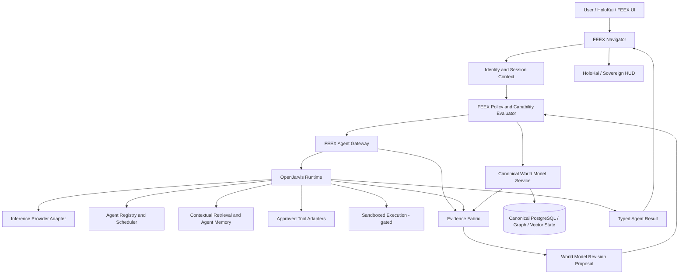
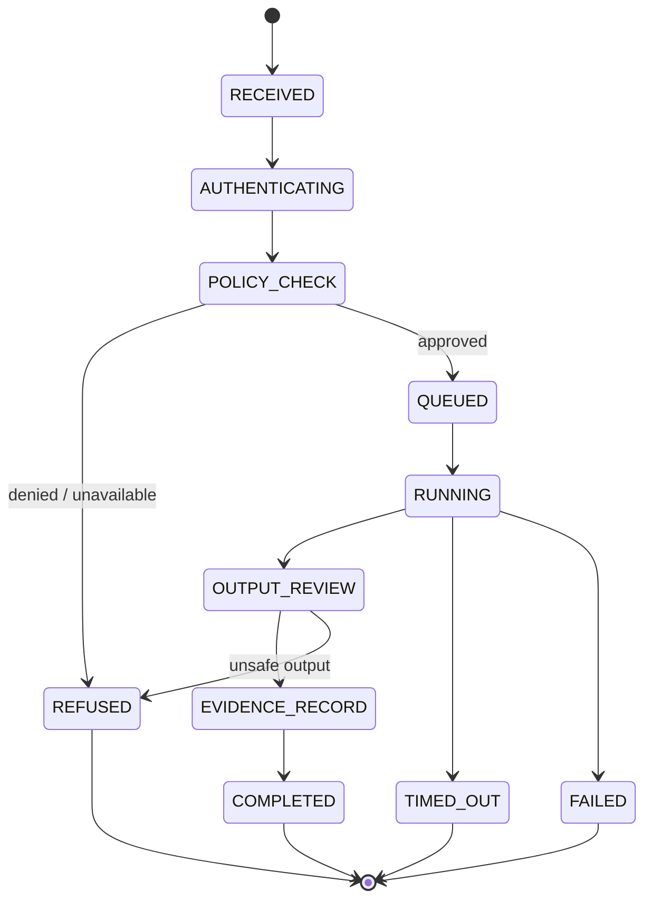

# FEEXSYSTEMS × OpenJarvis — Mega LLM Agent Implementation Plan

**Document:** FEEX-OPENJARVIS-MIP-001 · **Version:** 1.0.0 · **Date:** 2026-11-23  
**Repository:** `FeexSystems/FeexSystems-Living-Intelligence-World`  
**Inspected baseline:** `main@6d1babdafc431a414736f6fedf8fb4d998c6cf07`  
**Status:** Approved direction for planning; OpenJarvis runtime adoption is not implemented by this document.

---

## 0. Mission and governing decision

Adopt **OpenJarvis as a replaceable inference and agent-execution substrate**, while FEEXSYSTEMS retains authority over identity, policy, canonical knowledge, evidence, user experience, and consequential actions.

> **The LLM interprets the World Model; it does not become the World Model.**

The first visible increment is an OpenJarvis adoption preview in the existing humanoid landing-page simulation. That preview is static architecture disclosure, explicitly marked **SIMULATED** and **NOT CONNECTED**. It must not imply a deployed OpenJarvis service, active model, live agent, connected memory, MCP tool, or robotics system.

### Outcomes

1. Preserve the World Model as the sole canonical authority for entities, relationships, facts, provenance, and temporal revisions.
2. Put a FEEX-owned Agent Gateway between Navigator/policy and OpenJarvis.
3. Adopt provider-neutral inference, agent registry/scheduling, traces, and selected retrieval capabilities only after security review.
4. Isolate OpenJarvis memory from canonical World Model storage.
5. Anchor consequential agent actions and outputs to Evidence Fabric records.
6. Start HoloKai with retrieval-only behavior.
7. Keep the landing humanoid client-only, read-only, ephemeral, and simulated.
8. Preserve all release, deployment, and physical-actuation restrictions.

### Non-goals

- Replacing the World Model with model context, agent memory, embeddings, or OpenJarvis state.
- Direct database access from an LLM or OpenJarvis agent.
- Direct LLM-to-motor, actuator, ROS 2, Isaac, GPIO, or hardware command paths.
- Claiming the landing simulation is a live OpenJarvis integration.
- Adding an unapproved HoloKai backend, EIL transport, persistence service, or robotics adapter in the first slice.
- Changing G6/G7, authorizing deployment, promoting production, or enabling hardware.
- Treating an agent's own report, tests, or gate recommendation as independent approval.

---

## 1. Repository baseline and evidence discipline

The inspected `main` SHA was:

```text
6d1babdafc431a414736f6fedf8fb4d998c6cf07
```

Relevant source surfaces:

- `client/landing/components/HumanoidHeroOverlay.tsx`
- `client/landing/components/HumanoidHeroCanvas.tsx`
- `client/components/sovereign/EILProjectionSlot.tsx`
- `client/lib/eil/useEILAgentRuntime.ts`
- `client/lib/eil/projectionConfig.ts`
- `packages/feex-eil/contracts/`
- `packages/feex-eil/interaction/`
- `packages/feex-eil/renderer/`
- `client/components/sovereign/HoloKaiVoiceModal.tsx`
- `server/routes/world-model.ts`
- `docs/program/FEEX-MASTER-IMPLEMENTATION-REGISTER.md`

The master register describes the landing humanoid as a client-only showcase: lazy WebGL projection, capability and kill-switch gating, ephemeral local EIL state, SIMULATED disclosure, and no network, persistence, or actuation surface.

HoloKai currently has a browser speech surface and consumes the generic `POST /api/world-model/navigator` endpoint. That is an existing Navigator integration, not proof of a dedicated HoloKai agent backend or a deployed cultural-archive agent fleet.

EIL contracts, state-machine code, and renderer projection exist. The inspected local runtime is in-process and ephemeral. It is not a distributed event bus, durable event store, remote perception plane, tool executor, or actuator integration.

Earlier records mention an `npm ci` failure in CI run #68. Treat that as historical until current exact-SHA Actions evidence proves it remains a blocker. Re-fetch main, workflow runs, and check-runs before each gate decision. A merge, source review, or smoke test does not prove a production build or full-suite pass.

### Evidence labels

- **VERIFIED:** supported by a specific source, commit, test run, or independent observation.
- **IMPLEMENTED:** code exists; acceptance may still be pending.
- **PROPOSED:** architecture/work not yet implemented.
- **SIMULATED:** deterministic/local demonstration without external execution.
- **MODEL-INFERRED:** generated interpretation, not canonical fact.
- **CACHED:** previously retrieved data with an explicit freshness indicator.
- **UNAVAILABLE:** required source/runtime cannot be reached.
- **ERROR:** operation failed; no success may be implied.

Never promote PROPOSED, SIMULATED, MODEL-INFERRED, UNAVAILABLE, or ERROR into VERIFIED.

---

## 2. OpenJarvis adoption matrix

Upstream: https://github.com/open-jarvis/OpenJarvis

Pin an audited upstream release/commit, dependency graph, license, and build provenance before adoption. Do not use a floating branch or unpinned image in production.

| Capability | FEEX decision | FEEX mapping | Conditions |
|---|---|---|---|
| Inference engine abstraction | ADOPT | Sovereign Engine provider adapter | Provider-neutral; secrets server-side; timeout/fallback rules |
| Agent registry/scheduler | ADOPT BEHIND GATEWAY | Navigator task routing | FEEX identity, policy, quota, and capabilities remain authoritative |
| Agent framework | ADOPT SELECTIVELY | HoloKai and later domain agents | Reviewed manifests and bounded tools |
| Trace/telemetry | ADOPT WITH MAPPING | Evidence Fabric | Translate to FEEX event contract; upstream trace is not canonical evidence |
| Local memory | ADOPT WITH ISOLATION | Contextual retrieval | Agent/tenant namespaces; never canonical writes |
| FAISS/BM25/ColBERT-style retrieval | EVALUATE | Navigator/HoloKai retrieval | Preserve source IDs/provenance; similarity is not truth |
| MCP/external tools | ADOPT AFTER AUTH REVIEW | Omni-Command | Per-tool allowlist, auth on every path, scoped credentials |
| Sandboxed code execution | ADOPT AFTER GATE 1 | Development agents/future tools | All sandbox hardening controls pass first |
| Memory supersession | ISOLATE | Agent-local memory only | Canonical revisions through Navigator + Evidence review |
| Streaming guardrails | ISOLATE + FIX | HoloKai/Navigator output | Inspect/redact before consumer delivery |
| OpenAI-compatible API | ADOPT AS ADAPTER OPTION | FEEX provider abstraction | No browser-side provider credentials |

### Upstream audit findings to revalidate

The previous OpenJarvis source audit identified these concerns in the inspected version. Revalidate them against the exact upstream commit selected for adoption; do not assume every future release retains or fixes them.

| Finding | Risk | Required proof |
|---|---|---|
| Streaming output scanned after tokens are yielded | Sensitive content may reach consumer before block/redaction | Cross-chunk adversarial tests prove pre-delivery inspection |
| Sandbox resource controls incomplete in inspected runner path | Resource exhaustion/privilege exposure | CPU, memory, PID, non-root, capabilities, rootfs, seccomp/AppArmor tests |
| Empty mount roots allow non-blocked paths | Not a true allowlist | Empty roots reject all mounts; traversal/symlink tests |
| `max_concurrent` not enforced in inspected path | Concurrency exhaustion | Semaphore/queue enforcement and contention tests |
| Capability defaults unsuitable for shared workloads | Cross-user/tool misuse | FEEX deny-by-default policy and negative tests |
| Regex scanner misses international/contextual secrets | PII/secret leakage | Extended corpus and fail-closed scanner-error tests |

---

## 3. Target architecture

FEEX owns the control plane. OpenJarvis supplies a replaceable execution plane.



### Authority boundaries

1. Navigator resolves intent and routes tasks; it does not delegate policy authority to the model.
2. Identity supplies authenticated actor, tenant, and session context.
3. Policy decides whether an operation is permitted.
4. Agent Gateway validates contracts, enforces limits, correlates traces, and mediates tools.
5. OpenJarvis performs bounded inference and agent execution.
6. Evidence Fabric records provenance and action metadata.
7. World Model service remains the only canonical write path.
8. HoloKai and UI render validated results with truthful labels.
9. EIL validates interaction/presentation boundaries; contract presence is not physical-action authorization.

### Deployment shape

- OpenJarvis runs as a private service/worker, never in the browser.
- FEEX Agent Gateway is the only FEEX ingress.
- OpenJarvis has no credentials for canonical World Model writes.
- Memory uses a separate agent/tenant namespace.
- Provider keys stay in server-side secret management.
- Network egress is denied by default and opened only for approved providers/tools.
- Every task has a request ID, trace ID, deadline, and cancellation path.
- Runtime kill switch is independent of UI visibility.
- Landing page remains static and makes no gateway calls.

---

## 4. Contracts and service boundaries

Reconcile all proposals against live repository schemas before implementation. Do not duplicate or silently replace EIL contract versions.

### Agent manifest

```ts
type AgentManifest = {
  agentId: string;
  displayName: string;
  version: string;
  owner: string;
  purpose: string;
  status: "enabled" | "disabled" | "quarantined";
  inputSchemaRef: string;
  outputSchemaRef: string;
  allowedTools: string[];
  allowedDataClasses: string[];
  capabilityProfile: string;
  maxRuntimeMs: number;
  maxTokens?: number;
  memoryNamespace: string;
  retentionPolicyRef: string;
  humanApprovalActions: string[];
};
```

Manifest configuration is not authorization. Evaluate permissions for every invocation.

### Invocation envelope

```ts
type AgentInvocation = {
  requestId: string;
  traceId: string;
  tenantId: string;
  actorId: string;
  agentId: string;
  taskType: string;
  issuedAt: string;
  expiresAt: string;
  worldModelRevision?: string;
  input: unknown;
  evidenceRefs: string[];
  capabilityGrantRef: string;
  disclosureMode: "evidence-backed" | "model-inferred" | "simulated";
};
```

Validate at every trust boundary. Reject expired, replayed, malformed, cross-tenant requests. The client cannot choose its own capability grant. Never accept model-supplied actor identity or allow the model to widen its own tools, memory, timeout, or data scope.

### Result envelope

```ts
type AgentResult = {
  requestId: string;
  traceId: string;
  agentId: string;
  status: "completed" | "refused" | "failed" | "timed_out";
  result: unknown;
  evidenceRefs: string[];
  provenance: Array<{
    sourceId: string;
    sourceType: string;
    locator: string;
    retrievedAt: string;
  }>;
  disclosure: "evidence-backed" | "model-inferred" | "simulated" | "unavailable";
  startedAt: string;
  completedAt: string;
  runtimeVersion: string;
  modelProvider?: string;
  modelId?: string;
  errorCode?: string;
};
```

Never fabricate `evidenceRefs`. If upstream output lacks stable references, return none and label the result MODEL-INFERRED or UNAVAILABLE as appropriate.

### Evidence event

Minimum metadata: `eventId`, `traceId`, `agentId`, `actorId`, `tenantId`, `actionType`, `authorizationRef`, `worldModelRevision`, `inputDigest`, `outputDigest`, `evidenceRefs[]`, `runtimeVersion`, `schemaVersion`, `label`, `timestamp`, and optional `previousEventHash`/signature metadata.

Do not store raw prompts, credentials, biometric data, or sensitive output by default. Use a reviewed digest strategy, keyed HMAC where appropriate, and explicit redaction/retention rules. A plain hash does not establish identity or prevent privileged database alteration.

### World Model revision proposal

Agents submit proposals, never direct mutations:

```ts
type WorldModelRevisionProposal = {
  proposalId: string;
  traceId: string;
  entityId: string;
  operation: "create" | "revise" | "supersede" | "link";
  proposedPatch: unknown;
  sourceRefs: string[];
  epistemicStatus: "draft" | "verified" | "disputed";
  authorAgentId: string;
  authorizationRef: string;
  createdAt: string;
};
```

Canonical commit is a separate FEEX service operation after policy, evidence, and required human review.

---

## 5. Sequential security gates

Every gate needs a named reviewer, exact target SHA/runtime version, tests, evidence links, and rollback. A later gate cannot compensate for an earlier failure.

### Gate 0 — Baseline and reproducibility

- Re-fetch default branch and exact SHA.
- Re-fetch Actions runs/check-runs for that SHA.
- Confirm package manager/lockfile authority from live repository metadata.
- Clean install; typecheck; unit tests; targeted EIL tests; build; relevant browser tests.
- Preserve full logs and known infrastructure exceptions.
- Do not change source during baseline-only investigation.
- Do not call unexecuted tests PASS.

**Exit:** reproducible exact-SHA baseline and current debt recorded.

### Gate 1 — Runtime and sandbox isolation

- Pin OpenJarvis source, dependencies, image digests, and build toolchain.
- Non-root execution; drop unnecessary capabilities.
- Read-only root filesystem where compatible.
- CPU, memory, PID, disk, process, wall-clock limits.
- Seccomp/AppArmor or equivalent mandatory confinement.
- Network disabled by default; explicit egress allowlist.
- Explicit mount allowlist; empty roots means reject all mounts.
- Canonicalize paths and resolve/check symlinks.
- Enforce concurrency with semaphore or queue.
- Kill/reap children on timeout/cancellation.
- Prevent privileged mode, host socket, host PID namespace, and host filesystem exposure.
- Per-tenant scratch area with quotas and cleanup.
- Test traversal, symlink escape, resource exhaustion, cancellation, concurrency.

**Exit:** sandbox threat model approved and negative tests pass.

### Gate 2 — Inference, output, and secret protection

- Buffer protected output before delivery.
- Incremental scanning with cross-chunk context.
- Redact/block before forwarding, never after a token has leaked.
- Scanner errors fail closed for protected output.
- Test Rust/Python fallback paths.
- Extend international PII and provider-specific secret detection.
- Test prompt injection in user, retrieved, and tool content.
- Separate policy from untrusted retrieved documents.
- Prevent tool output from modifying policy/capabilities.
- Bound output size, token use, recursion, tool calls.
- Voice synthesis receives only approved final text.

**Exit:** no protected output reaches consumer before inspection.

### Gate 3 — Memory integrity and tenant separation

- Memory is contextual, agent-scoped, tenant-scoped, and non-canonical.
- No direct writes to World Model tables, graph, vector index, or canonical evidence.
- Record origin, timestamp, retention class, and source references.
- Preserve historical facts; use supersession rather than destructive overwrite.
- Detect contradictions between memory and World Model.
- World Model wins; conflicting memory is flagged for review.
- Enforce tenant isolation, retention, export, deletion, and legal hold.
- Test stale/poisoned memory, cross-tenant retrieval, contradiction.

**Exit:** memory cannot mutate or silently supersede canonical facts.

### Gate 4 — API identity, capabilities, and consequential actions

- Authenticate every frontend, MCP, streaming, and background path.
- Authorize every tool call at gateway/tool boundary.
- Deny by default for shared users.
- Bind capability grants to actor, tenant, agent, tool, resource, action, expiry, revocation.
- Per-user/agent/tool rate limits and budgets.
- Human confirmation for consequential actions.
- Append-only audit trail.
- SECURITY.md and vulnerability disclosure process.
- Fail closed when identity, policy, or required audit service is unavailable.

**Exit:** unauthorized/cross-tenant operations denied in negative tests.

### Gate 5 — Evidence and World Model authority

- Every agent action has trace ID.
- Every external output has evidence/disclosure label.
- Every state-changing proposal has source refs and authorization.
- Never synthesize evidence from counts, summaries, model metadata, or confidence.
- Canonical writes are performed only by World Model service.
- Every write has author, timestamp, source, authorization, and revision history.
- Preserve history and supersession.
- UI distinguishes VERIFIED, MODEL-INFERRED, SIMULATED, CACHED, UNAVAILABLE, ERROR.

**Exit:** trace from user request to agent/tool/proposal/policy/canonical commit is verifiable.

No shared-user OpenJarvis workload until Gates 0–5 are closed and a human approves exact version, scope, data classes, rollback, and owner.

---

## 6. Agent portfolio and lifecycle

| Agent | Role | Initial permission |
|---|---|---|
| Navigator Router | Task classification and agent selection | Read-only task metadata |
| Retrieval Agent | Source-grounded answers | Approved read-only retrieval |
| Evidence Auditor | Trace/source/label completeness | Read-only evidence metadata |
| Memory Curator | Contextual memory suggestions/conflict flags | Agent-local memory |
| Code Assistant | Repository analysis and proposed changes | Read-only first; sandbox after Gate 1 |
| Security Reviewer | Threat model, tool, policy, dependency review | Read-only |
| Test Planner | Contract-based test design | Read-only |
| Release Evidence Agent | Exact-SHA CI evidence collection | Read-only CI metadata |
| HoloKai Retrieval | Multilingual archive retrieval | Approved archive sources |
| HoloKai Ingestion | Classification/chunking/staging | Quarantine only |
| HoloKai Companion | Conversational guide | Retrieval-only first; no physical control |

Lifecycle:



An LLM token stream is not task execution. A submitted tool request is not completion. Tool success is not canonical mutation. Renderer animation is not perception or actuation. An agent cannot approve its own grant or evidence.

---

## 7. HoloKai delivery sequence

### H1 — Retrieval-only agent

- Preserve existing browser speech and Navigator endpoint until a separately approved API contract replaces it.
- Use FEEX Agent Gateway as future server-side boundary.
- Typed request includes actor, tenant, language, query, and approved data scope.
- Retrieve only from approved archive/World Model sources.
- Preserve stable source IDs and locators.
- Return citations and disclosure labels.
- No invented evidence references.
- Separate model interpretation from evidence-backed facts.
- Explicit fallback/cache/unavailable states.

### H2 — Multilingual and cultural authority

- Detect language before inference and record it in Evidence event.
- Evaluate Masakhane resources where available and licensed.
- Low model confidence in a language produces LOW_CONFIDENCE, not silent English substitution.
- Preserve original text and translation provenance.
- Sacred/restricted classifications are hard access gates.
- Preserve ownership, consent, license, attribution, and withdrawal requirements.
- No oral-history/media ingestion without rights and consent evidence.

### H3 — Ingestion staging

- Quarantine submissions.
- Validate type, malware, size, metadata, ownership, consent, license.
- Classify content/sensitivity.
- Chunk with stable offsets and parent identity.
- Embed only approved content.
- Store chunks, model/version, and provenance in non-canonical staging/retrieval store.
- Cultural authority review before archive publication.
- Evidence event for each pipeline stage.
- No direct canonical writes.

### H4 — Companion voice experience

- Companion Agent handles conversational context and voice/visual response only.
- Feed actual browser speech lifecycle callbacks into EIL.
- No optimistic LISTENING/SPEAKING.
- RESPONDING requires evidence under live EIL contract.
- SPEAKING requires confirmed playback.
- Keep response generation separate from presentation state.
- No motor commands in text response.
- No physical robotics adapter in H1–H4.

---

## 8. Humanoid landing-page OpenJarvis adoption preview

### Objective

Explain the intended FEEX/OpenJarvis topology inside the existing humanoid showcase without suggesting that a runtime is connected.

### Display contract

| Row | Required value |
|---|---|
| Header | OPENJARVIS // ADOPTION PREVIEW |
| Disclosure | SIMULATED |
| Runtime | NOT CONNECTED |
| Intelligence | OPENJARVIS / PROPOSED |
| Routing | FEEX NAVIGATOR / POLICY GATE |
| Memory | CONTEXTUAL / ISOLATED |
| Evidence | FABRIC ANCHOR / NOT CONNECTED |
| World Model | CANONICAL / READ ONLY |
| EIL / Actuation | LOCAL SIMULATION / DISABLED |
| Footer | NO LIVE AGENT REQUESTS · NO PERSISTENCE · NO HARDWARE CONTROL |

### UI constraints

- No controls implying live agent invocation.
- No fake model names, latency, token counts, throughput, agent IDs, or health telemetry.
- No fabricated confidence or planetary metrics.
- No OpenJarvis/Navigator/Evidence/World Model API calls from landing showcase.
- Pointer-transparent overlay; hero CTA remains usable.
- Preserve lazy loading, visibility, WebGL, reduced-motion, save-data, low-power, coarse-pointer, global-motion, and `EIL_PROJECTION_ENABLED` gates.
- Preserve host Canvas and existing EILProjectionSlot.
- No second Canvas, independent renderer loop, storage, network, WebSocket, SSE, Firebase, or hardware surface.
- If projection kill switch is false, humanoid and OpenJarvis panel are both absent.

### Future live-state replacement

Only after backend adoption and approval may a typed FEEX status API supply live state. It must authenticate normally, provide freshness timestamps, and render UNAVAILABLE/ERROR on failure. Do not infer health from a UI render. Keep SIMULATED mode separate.

### Acceptance criteria

1. SIMULATED and NOT CONNECTED are visible.
2. World Model is labelled CANONICAL / READ ONLY.
3. Memory is CONTEXTUAL / ISOLATED.
4. Evidence Fabric is labelled NOT CONNECTED.
5. Actuation is DISABLED.
6. No OpenJarvis/agent API request.
7. No persistent browser storage.
8. Hero CTA remains usable.
9. Capability/reduced-motion gates remain effective.
10. `EIL_PROJECTION_ENABLED=false` removes both humanoid and panel.
11. Existing landing tests remain green.
12. No marketing copy describes the preview as deployed integration.

---

## 9. FEEX Agent Gateway

Responsibilities:

- Authenticate actor and tenant.
- Resolve only allowlisted agents.
- Validate task schema and request size.
- Evaluate capabilities and data scope.
- Attach World Model revision used for retrieval.
- Enforce timeout, budget, rate, and concurrency.
- Generate request/trace IDs.
- Send minimum necessary context to OpenJarvis.
- Sanitize and validate tool outputs.
- Run output guardrails before delivery.
- Emit Evidence events.
- Return typed result and disclosure.
- Refuse unsupported/unauthorized actions.

Proposed route shape (not authorization to implement):

```text
POST /api/agents/invoke
GET  /api/agents/registry
GET  /api/agents/requests/:requestId
GET  /api/agents/traces/:traceId
POST /api/agents/proposals/:proposalId/review
```

Do not add routes until authentication middleware, route inventory, API versioning, rate limiting, service ownership, and tests are reviewed.

Failure semantics:
- Identity/policy unavailable: refuse.
- Required evidence service unavailable: refuse consequential action.
- OpenJarvis unavailable: explicit UNAVAILABLE/FALLBACK.
- Provider unavailable: explicit fallback label.
- Timeout: cancel and record timeout.
- Tool failure: typed error, no success-shaped response.
- Scanner failure: fail closed for protected output.
- World Model conflict: return conflict; never overwrite.

---

## 10. Memory and retrieval architecture

| Store | Authority | Write policy |
|---|---|---|
| World Model PostgreSQL/graph | Canonical | FEEX service only after policy/evidence review |
| Evidence Fabric | Provenance/audit | Approved evidence service |
| OpenJarvis memory | Contextual | Agent/tenant scoped; never canonical |
| Vector index | Search projection | Rebuildable from approved source records |
| Agent working context | Ephemeral | Per-request and bounded |
| Sandbox filesystem | Temporary | Explicit mounts, quota, cleanup |
| Browser local state | UI preference only | No agent memory or canonical facts |

Retrieval rules:
- Retrieve canonical data through FEEX-owned read APIs.
- Preserve source ID, revision, timestamp, locator.
- Vector similarity is not proof.
- Resolve conflicts against current World Model revision.
- Detect stale source revisions.
- Never combine tenant namespaces.
- Exclude secrets/restricted content from generic memory.
- Apply access policy before retrieval and before response disclosure.
- Model/provider metadata is reproducibility metadata, not evidence.

---

## 11. Observability and operations

Track request status, queue wait, execution duration, timeouts, cancellations, provider/model selection, token/cost budget where available, tool calls, sandbox resource usage, blocked/redacted output, retrieval source IDs/freshness, Evidence emission success, policy denials, and quota events.

Do not log raw prompts, secrets, personal data, restricted archive material, or full tool output by default.

Required operations:
- separate liveness/readiness;
- circuit breakers;
- per-agent/provider/tool kill switches;
- global OpenJarvis kill switch;
- queue drain/cancellation;
- incident response and credential rotation;
- rollback to existing FEEX provider path;
- explicit runtime owner and on-call path.

---

## 12. Test strategy

### Unit
Schema validation; grant scope/expiry; actor/tenant binding; label derivation; missing evidence; memory conflict; fallback/timeout; cross-chunk scanner; sandbox allowlist/concurrency; HoloKai language/disclosure; landing panel/kill switch.

### Integration
Gateway → fake OpenJarvis runtime; policy denial blocks invocation; provider timeout; tool output revalidation; memory cannot write World Model; revision proposal requires evidence/approval; evidence outage blocks consequential action; cross-tenant retrieval denied; HoloKai returns source IDs or explicitly says none exist.

### Browser
Humanoid only mounts when capability gates pass; preview only appears with projection; SIMULATED/NOT CONNECTED labels visible; no network/storage/Firebase/WebSocket/SSE; CTA usable; reduced-motion and low-power gates work; route change unmounts; no SPEAKING without playback; no physical actuation claim.

### Security
Prompt injection; malicious tool output; path traversal; symlink escape; resource exhaustion; process/container escape; unauthorized tool call; replayed/expired grants; tenant crossover; memory poisoning; chunk-boundary secret leak; scanner failure; evidence outage.

### Repository commands
Use live scripts after inspecting package.json. Current inspected package scripts include `npm ci`, `npm run typecheck`, `npm run typecheck:all`, `npm run build`, `npm run test:unit`, `npm run test:e2e:smoke`, and `npm run docs:verify`. A smoke pass is not a full-suite pass. Typecheck is not a build. Record exact commands and exit codes.

---

## 13. Phased delivery roadmap

Effort ranges are planning estimates, not calendar commitments.

| Phase | Work | Exit condition |
|---|---|---|
| 0 | Exact-SHA baseline | CI/build/test evidence and debt recorded |
| 1 | OpenJarvis upstream audit | Pin, license, dependency, provenance, threat model reviewed |
| 2 | FEEX gateway design | Contracts/auth/policy accepted |
| 3 | Sandbox and inference hardening | Gates 1–2 pass |
| 4 | Memory and multi-user controls | Gates 3–4 pass |
| 5 | Evidence integration | Gate 5 trace verified |
| 6 | HoloKai retrieval-only | Source-grounded response and fallback tested |
| 7 | HoloKai ingestion staging | Rights/consent/cultural gates enforced |
| 8 | HoloKai companion voice | Evidence-gated lifecycle |
| 9 | EIL simulation | Simulated perception-to-cognition only |
| 10 | Robotics safety research | Independent review; no actuation implied |
| 11 | Restricted shared-user pilot | All gates closed and human approval |
| 12 | Production decision | Separate G6/G7 authorization |

The landing preview is an isolated visual deliverable. It does not close security gates or authorize HoloKai execution.

---

## 14. Work packages

**WP-01 Upstream pin:** exact OpenJarvis commit, license, dependency graph, SBOM, runtime requirements, disabled features, upgrade/rollback policy.

**WP-02 Adapter:** server-only OpenJarvis adapter behind FEEX interface; existing FEEX provider path retained; typed envelopes, timeout, cancellation, retry budget, circuit breaker; fake runtime tests before real provider.

**WP-03 Gateway:** authentication, agent allowlist, capabilities, tenant scope, quotas, traces, tool mediation, evidence events, refusal semantics.

**WP-04 Security:** close Gates 1–5 with threat model, abuse cases, negative tests, security runbook.

**WP-05 HoloKai retrieval:** approved source registry, stable citations, language metadata, low-confidence and restricted-content handling.

**WP-06 HoloKai ingestion:** quarantine, consent/license/ownership, malware validation, provenance, embeddings only after approval, cultural review, no canonical writes.

**WP-07 Landing preview:** static OpenJarvis disclosure, explicit SIMULATED/NOT CONNECTED, Navigator policy gate, isolated memory, Evidence disconnected, World Model read-only, actuation disabled, preserve gates, no API/SDK/storage.

**WP-08 Verification:** tests, exact-SHA evidence, rollback, PR report, master register update only after proof.

---

## 15. Kill switches and rollback

Independent controls:
1. Existing landing `EIL_PROJECTION_ENABLED`.
2. Server-side OpenJarvis runtime switch.
3. Per-agent switch.
4. Per-tool switch.
5. Per-provider switch.
6. Agent-memory write switch.
7. World Model proposal switch.
8. Shared-user workload switch.

Rollback restores the last safe FEEX provider path, drains/cancels in-flight jobs, preserves evidence, and prevents unreviewed retries. Hiding the landing projection does not stop a server runtime; the server kill switch is separate.

---

## 16. Governance and human approval

Explicit human approval required for: production OpenJarvis pin, new providers/data classes, new tools/MCP, World Model schema/write changes, EIL contract changes, restricted archive ingestion, shared-user execution, physical hardware, release/deployment/promotion, and G6/G7 state changes.

A PR merge is not deployment authorization. Green CI is not security certification. A simulation is not a live system.

---

## 17. MASTER PROMPT — COPY INTO THE IMPLEMENTATION LLM

```text
ROLE
You are the FEEXSYSTEMS OpenJarvis Integration Engineering Agent.

MISSION
Implement the approved OpenJarvis adoption architecture in small, verifiable work packages. OpenJarvis is a replaceable inference and agent-execution substrate. FEEXSYSTEMS owns identity, policy, canonical World Model state, Evidence Fabric, user experience, and consequential authorization.

AUTHORITATIVE REPOSITORY
FeexSystems/FeexSystems-Living-Intelligence-World

STARTING BASELINE
The plan was prepared against main@6d1babdafc431a414736f6fedf8fb4d998c6cf07. This is not a guarantee that main still points there. Re-fetch main and record the full current SHA before acting.

NON-NEGOTIABLE INVARIANTS
1. World Model is the only canonical authority.
2. Models interpret; they never directly mutate canonical state.
3. Agent memory is contextual and cannot supersede World Model facts.
4. Consequential agent actions require actor identity, authorization, trace ID, and evidence provenance.
5. Never fabricate evidence IDs, confidence, metrics, runtime status, or deployment claims.
6. No direct LLM-to-motor or actuator path.
7. Physical actuation remains prohibited without separate human safety authorization.
8. Landing humanoid remains client-only, read-only, ephemeral, and SIMULATED.
9. OpenJarvis preview says SIMULATED and NOT CONNECTED until a real approved backend exists.
10. G6/G7, release promotion, production deployment, and hardware operation remain frozen/prohibited unless separately authorized.

FIRST TASK
Inspect current repository SHA, master register, landing humanoid files, EIL contracts, HoloKai client, World Model routes, workflows, and tests. Reconcile this plan against live source. Do not assume historical paths or old CI statuses are current.

WORK METHOD
- Inspect imports, routes, components, assets, server/config, build, tests, CI in that order.
- Dependency evidence is authoritative; filenames are clues only.
- Use a dedicated branch from exact inspected SHA.
- One coherent change per commit.
- Never edit main directly.
- Do not merge or deploy without explicit authorization.
- No destructive commands.
- No dependencies without documented need and approval.
- No browser-side OpenJarvis SDKs or secrets.
- No new transport/persistence in landing showcase.
- No new EIL routes/persistence without separate approval.

OPENJARVIS ADOPTION
1. Pin upstream commit/release; inspect license and dependencies.
2. Revalidate upstream security findings against pinned code.
3. Build server-only adapter behind FEEX Agent Gateway.
4. Keep Navigator and policy authoritative.
5. Use deny-by-default capabilities.
6. Isolate memory by tenant and agent.
7. Prevent direct canonical database access.
8. Require Evidence Fabric for consequential actions.
9. Start HoloKai with retrieval-only behavior.
10. Keep ingestion quarantined until rights, consent, and cultural review pass.

HUMANOID LANDING PREVIEW
Static architecture disclosure only:
- OPENJARVIS / PROPOSED
- RUNTIME / NOT CONNECTED
- NAVIGATOR / POLICY GATE
- MEMORY / CONTEXTUAL / ISOLATED
- EVIDENCE FABRIC / NOT CONNECTED
- WORLD MODEL / CANONICAL / READ ONLY
- EIL / LOCAL SIMULATION
- ACTUATION / DISABLED
- NO LIVE AGENT REQUESTS
Preserve all visibility/capability/reduced-motion/save-data/low-power/coarse-pointer/global-motion/EIL_PROJECTION_ENABLED gates. Keep overlay pointer-transparent and CTA usable. No network, storage, transport, Firebase, or hardware.

SECURITY GATES
Gate 0: exact-SHA baseline/reproducibility.
Gate 1: sandbox, limits, mount allowlist, concurrency, seccomp/AppArmor, non-root.
Gate 2: pre-delivery scanning, chunk-boundary protection, secrets/PII, prompt injection.
Gate 3: memory integrity, tenant separation, contradiction, retention.
Gate 4: auth, capabilities, rate limits, human confirmation, audit.
Gate 5: Evidence Fabric and canonical World Model boundary.
No shared-user execution until gates independently verified and human-approved.

TESTING
Run applicable tests and record exact commands/exit codes. Never claim unrun tests. Include negative security tests. Smoke is not full suite. Typecheck is not production build. Merge is not deployment authorization.

REPORT
Include repo/full SHA, branch, changed paths, scope, actions, evidence links, tests executed/not executed, security findings, assumptions, unverified claims, rollback, blockers, recommendation PASS/FAIL/HOLD. Never self-approve a gate.

STOP AND HOLD IF
- main SHA changed and safe rebase is unclear;
- live contracts contradict the plan;
- auth/evidence contracts are unknown;
- work requires canonical writes or physical actuation;
- upstream license/provenance is unclear;
- security gate fails;
- required verification cannot run;
- task implies deployment or promotion.

FINAL RULE
Build a governed agent system, not an autonomous authority. FEEXSYSTEMS remains the control plane and source of truth.
```

---

## 18. Agent report template

```yaml
agent_id: ""
workstream: ""
timestamp_utc: ""
repository: "FeexSystems/FeexSystems-Living-Intelligence-World"
base_ref: "main"
base_sha: ""
head_ref: ""
head_sha: ""
phase: ""
gate: ""
status: "NOT_STARTED | IN_PROGRESS | BLOCKED | PASS | FAIL | HOLD"
scope:
  included: []
  excluded: []
actions_performed: []
changed_paths: []
evidence:
  - type: "commit | file | workflow_run | check_run | test_log | review | decision"
    identifier: ""
    url: ""
    sha: ""
tests:
  executed: []
  not_executed: []
findings:
  blocking: []
  non_blocking: []
security:
  controls_verified: []
  controls_not_verified: []
assumptions: []
unverified_claims: []
rollback: []
next_actions: []
recommendation: "HOLD"
```

PASS requires evidence for every acceptance criterion. Unexecuted checks are NOT_RUN. An agent recommendation is not human authorization.

---

## 19. Definition of done

- [ ] Exact OpenJarvis commit pinned; license/provenance reviewed.
- [ ] FEEX Agent Gateway implemented and independently reviewed.
- [ ] OpenJarvis inaccessible directly from browser.
- [ ] Sandbox and inference gates pass.
- [ ] Memory and multi-user gates pass.
- [ ] Evidence Fabric contract verified.
- [ ] World Model writes remain FEEX-service-only.
- [ ] HoloKai retrieval returns verifiable source references.
- [ ] Cultural/consent restrictions enforced for ingestion.
- [ ] Tool permissions are least-privilege and revocable.
- [ ] Negative security tests pass.
- [ ] Kill switches and rollback verified.
- [ ] Exact-SHA CI/build/test evidence recorded.
- [ ] Human review approves shared-user scope separately.
- [ ] G6/G7 remain frozen until separately authorized.
- [ ] Physical actuation remains prohibited absent separate safety authorization.

Landing-preview DoD is separate: SIMULATED/NOT CONNECTED disclosure, accurate architecture labels, no external calls or persistence, preserved kill switches, and passing browser acceptance.

---

## 20. Final decision

**ADOPT OpenJarvis as a governed, replaceable runtime. Do not adopt it as the authority.**

FEEX Navigator owns intent and policy. OpenJarvis owns bounded inference and agent execution. Evidence Fabric records provenance. The World Model remains canonical. HoloKai begins retrieval-only. The humanoid landing page explains the intended topology through static simulation disclosure. EIL remains an interaction/presentation boundary, not physical control.

**Sequence: prove the boundary → secure the runtime → anchor evidence → launch retrieval → expand only through review.**
```
