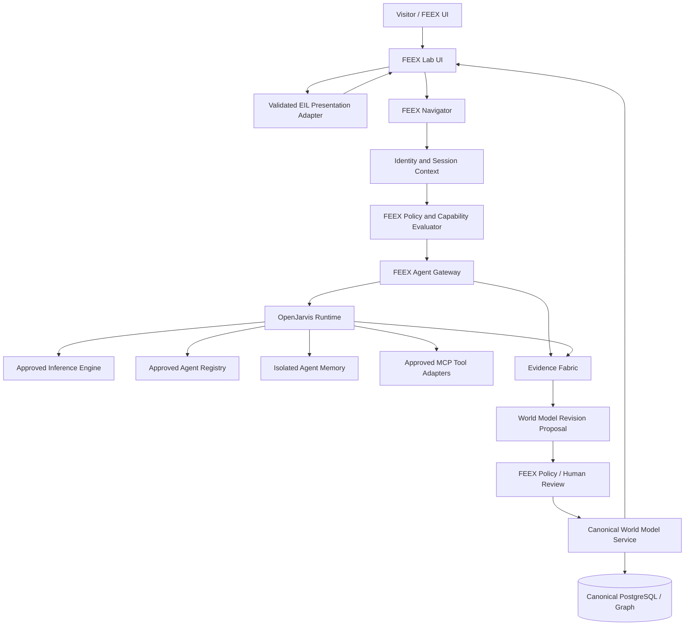
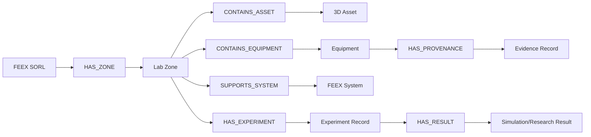

# FEEX Sovereign Research & Operations Laboratory

## FEEX MetaHuman Humanoid + Monochromatic 3D Environment

### Final Mega Implementation Plan for LLM Coding, Design, 3D, and Systems Agents

**Document ID:** FEEX-SORL-MIP-001\
**Version:** 1.0.0\
**Prepared:** 2026-11-23\
**Repository:** `FeexSystems/FeexSystems-Living-Intelligence-World`\
**Branch audited:** `main`\
**Audited HEAD:** `de1e9a63c30b75227fda46b7ed39b92cd0b06181`\
**Status:** Implementation directive; not a claim that the target
environment, MetaHuman asset, or OpenJarvis runtime has already been
implemented.

------------------------------------------------------------------------

# 0. Executive implementation directive

Transform the current FEEX humanoid showcase into a complete,
explorable, interactive **FEEX Sovereign Research & Operations
Laboratory**.

The primary deliverable is not a character standing beside a prop. It is
a coherent, high-quality 3D research facility with a single canonical
FEEX humanoid character, clearly defined operational zones, real
interface interactions, a validated state/presentation pipeline, asset
provenance, and a documented path toward controlled agent integration.

The experience must preserve FEEXSYSTEMS' governing principle:

> **The LLM interprets the World Model; it does not become the World
> Model.**

The 3D scene is a projection. The World Model and Evidence Fabric remain
the canonical source of truth. The humanoid is an embodied interface and
visual representation, not an independent authority.

## 0.1 Final visual and character direction

**Character identity**

-   Young Black African male.
-   Rich, natural dark-brown skin with realistic skin shading and
    texture detail.
-   Neck-length dreadlocks, with a deliberate, well-groomed silhouette.
-   Anatomically credible human proportions and facial structure.
-   Calm, intelligent, composed expression.
-   Photoreal MetaHuman-level anatomical and facial quality.
-   Restrained cybernetic details: titanium, graphite, obsidian, and
    precision-machined components.
-   Cybernetics should look integrated and engineered, not like a bulky
    combat robot.
-   Wardrobe: monochromatic technical clothing, tailored black/graphite
    research attire, subtle engineered seams, no loud branding.
-   The character must remain recognisably human. Do not revert to the
    faceless geometric robot, masked low-poly synthetic, or
    amber-visor-only identity.

**Character presentation**

-   The humanoid is the primary guide and operator interface inside the
    lab.
-   It can appear in a neutral idle pose, acknowledge a visitor, turn
    toward a selected zone, gesture toward a workstation, inspect an
    object, explain a system, and perform a clearly simulated walk
    between waypoints.
-   It may display a listening or speaking pose only when supported by
    the relevant application/voice lifecycle events.
-   It must never imply that a simulated animation is real perception,
    autonomous decision-making, live telemetry, or physical robotics.

**Environment**

-   Complete advanced research and operations facility.
-   Cinematic, architecturally credible, technically legible, and
    explorable.
-   Monochromatic noir design system only.
-   The laboratory is the main scene. Chairs, desks, instruments,
    terminals, storage, and other props are subordinate assets inside
    it.

## 0.2 Required implementation outcomes

1.  Replace the current synthetic robot visual identity with the
    approved young Black African male character direction.
2.  Create a complete 3D laboratory with six operational zones.
3.  Consolidate the duplicated landing-page humanoid presentations into
    one coherent character and one landing-page 3D stage.
4.  Preserve the existing React Three Fiber / Three.js architecture and
    the existing EIL contract boundaries.
5.  Preserve the EIL kill switch, reduced-motion behavior, capability
    gates, error fallback, and explicit simulation disclosure.
6.  Keep the current procedural synthetic GLB as a rollback/reference
    artifact until the new asset passes acceptance.
7.  Use MetaHuman as the preferred character authoring route, subject to
    an explicit licensing/export gate.
8.  Use Blender as the scene assembly, optimization, and reproducible
    asset-authoring layer.
9.  Use BlendSwap MCP for licensed environment assets, not for
    generating the primary humanoid.
10. Keep OpenJarvis disconnected until the separate security and
    integration gates are approved.
11. Keep robotics simulation separate from physical robotics. No
    physical actuation is authorized.
12. Produce visual, functional, accessibility, performance, provenance,
    and exact-SHA CI evidence.

------------------------------------------------------------------------

# 1. Repository audit: evidence-backed current state

## 1.1 Repository identity and audited revision

-   Repository:
    [FeexSystems/FeexSystems-Living-Intelligence-World](https://github.com/FeexSystems/FeexSystems-Living-Intelligence-World)
-   Default branch observed: `main`
-   Branch HEAD observed during audit:
    `de1e9a63c30b75227fda46b7ed39b92cd0b06181`
-   The HEAD commit is a merge of `origin/main` into
    `feat/humanoid-hero-scene`.
-   GitHub reported the `main` branch as **not protected** at the time
    of inspection. The implementation agents must not use that as
    permission to push directly to `main`; use a feature branch and
    reviewed PR.

## 1.2 Existing landing scene composition

The repository's landing composition already establishes the desired
sequence:

1.  `HumanoidHeroScene` --- Scene 01.
2.  `HeroScene` --- Scene 02, cinematic video (`hero.webm`).
3.  Galaxy sequence and the remaining landing sections.

The Scene 01 humanoid architecture is present in:

-   `client/landing/scenes/HumanoidHeroScene.tsx`
-   `client/landing/components/humanoid/HumanoidStage.tsx`
-   `client/landing/components/humanoid/HumanoidModel.tsx`
-   `client/landing/components/humanoid/HumanoidLighting.tsx`
-   `client/landing/components/humanoid/HumanoidFallback.tsx`
-   `client/landing/config/humanoid.config.ts`
-   `client/landing/hooks/useHumanoidState.ts`

The scene has a semantic DOM overlay, interaction buttons, a model
status inspector, loading/error handling, reduced-motion handling, and
explicit `LOCAL VISUAL SIMULATION` / `NO PHYSICAL ACTUATION` language.

## 1.3 Current character asset

Current configuration:

``` ts
export const HUMANOID_MODEL = {
  src: "/models/feex-sovereign-synthetic.glb",
  position: [0.55, 0, 0] as [number, number, number],
  rotationY: -0.28,
  targetHeight: 1.9,
};
```

Current asset:

-   `public/models/feex-sovereign-synthetic.glb`
-   Approximately 205,812 bytes.
-   43 mesh/nodes.
-   One skin with 17 joints.
-   Four clips: `Idle`, `Aware`, `Acknowledge`, `Explain`.
-   Five materials: `Obsidian`, `Graphite`, `BrassInlay`, `Honeycomb`,
    `GlyphAccent`.
-   Approximately 1,100 triangles.
-   One embedded procedural honeycomb texture.
-   The current model is a stylized, faceless/geometric synthetic robot.
    It does not satisfy the newly approved human character direction.

Reproducible authoring source:

-   `scripts/authoring/feex_sovereign_synthetic.py`
-   `scripts/authoring/feex-sovereign-synthetic.blend`
-   `scripts/authoring/render-check.png`
-   `docs/program/FEEX-SYNTHETIC-AUTHORING-REPORT.md`
-   `docs/program/FEEX-SYNTHETIC-ASSET-PROVENANCE.md`
-   `docs/program/FEEX-SYNTHETIC-ACCEPTANCE-REPORT.md`
-   `docs/program/FEEX-SYNTHETIC-BASELINE-AUDIT.md`

The existing synthetic asset is first-party authored and has recorded
provenance. Preserve it until the new character is accepted. Do not
delete or overwrite it during the first implementation phase.

## 1.4 Existing browser runtime

`HumanoidModel.tsx` currently:

-   Loads the configured GLB with `GLTFLoader`.
-   Creates one `THREE.AnimationMixer`.
-   Builds animation actions from the GLB's clips.
-   Cross-fades between clips.
-   Finds a bone named `Head` for additive pointer gaze.
-   Normalizes the model to a configured target height.
-   Applies a restrained glyph material pulse.
-   Disposes mixer actions on unmount.

`HumanoidStage.tsx` currently:

-   Owns the Scene 01 React Three Fiber `<Canvas>`.
-   Uses a bounded DPR range (`dpr={[1, 2]}`).
-   Pauses its render loop when the scene is not visible or reduced
    motion is requested.
-   Uses a model error boundary and an honest fallback.
-   Keeps the semantic UI in the DOM rather than making the 3D model the
    only interface.

These are useful foundations. Extend them instead of creating an
unrelated renderer.

## 1.5 Existing deterministic local interaction state

`useHumanoidState.ts` owns a local deterministic state machine:

-   `idle`
-   `attention`
-   `observe`
-   `welcome`
-   `explain`
-   `disabled`

The interactions are driven by explicit UI events and fixed timers. They
do not infer agent cognition. This separation must remain.

## 1.6 Important architectural duplication to resolve

The repository currently contains a second humanoid presentation path:

-   `client/landing/components/HumanoidHeroOverlay.tsx`
-   `client/landing/components/HumanoidHeroCanvas.tsx`
-   `client/components/sovereign/EILProjectionSlot.tsx`
-   `packages/feex-eil/renderer/HumanoidScene.tsx`
-   `client/lib/eil/useEILAgentRuntime.ts`

`HumanoidHeroCanvas` creates a second R3F `<Canvas>` and renders the
procedural `ParticleHumanoid` / `MechanicalHumanoid` path through
`EILProjectionSlot`. It has its own ephemeral local EIL runtime and an
OpenJarvis adoption preview.

The existing landing sequence places `HumanoidHeroScene` before
`HeroScene`; `HeroScene` also imports the EIL humanoid overlay. This
creates two different humanoid render paths, two presentation/state
paths, and more than one landing-page WebGL canvas.

**Required architectural correction**

-   Scene 01 becomes the single primary FEEX humanoid + laboratory
    experience.
-   Scene 02 remains the cinematic video scene.
-   Remove the second landing-page humanoid Canvas by consolidating the
    EIL presentation into the Scene 01 character adapter.
-   Do not remove the EIL contracts, local runtime, evidence validation,
    or `EILProjectionSlot` from the `/world` and sovereign surfaces.
-   Reuse one shared humanoid asset/renderer abstraction across surfaces
    where appropriate, but mount it inside each surface's existing host
    Canvas.
-   Never nest a Canvas or create an independent RAF loop inside a
    renderer fragment.
-   The landing scene should have one 3D stage, one character instance,
    one authoritative presentation resolver, and one coherent
    interaction model.

## 1.7 Existing EIL contracts and safety boundaries

Relevant code:

-   `packages/feex-eil/contracts/`
-   `packages/feex-eil/interaction/`
-   `packages/feex-eil/renderer/HumanoidScene.tsx`
-   `packages/feex-eil/renderer/HumanoidStateAdapter.ts`
-   `packages/feex-eil/renderer/presentation-state.ts`
-   `client/lib/eil/projectionConfig.ts`
-   `client/lib/eil/useEILAgentRuntime.ts`
-   `client/components/sovereign/EILProjectionSlot.tsx`

Verified architectural properties in the repository:

-   `AgentStateEvent` is validated before it reaches the renderer.
-   Events are accepted in timestamp order for the same agent.
-   `presentation-state.ts` defines a nine-state presentation vocabulary
    and fail-closed resolution.
-   `ERROR` / `OFFLINE` resolve to `UNAVAILABLE`.
-   `RESPONDING` and `SPEAKING` have evidence/playback constraints in
    the planner.
-   `EXECUTING` remains unplannable in the current Phase 5 record.
-   The local runtime is in-process and ephemeral. It is not a
    distributed event bus, durable event store, remote perception
    system, tool executor, or actuator integration.
-   The renderer is a projection. It does not own canonical agent state.
-   The EIL kill switch is `EIL_PROJECTION_ENABLED`.

Preserve those semantics. The new MetaHuman model must be a new renderer
target, not a new state authority.

## 1.8 OpenJarvis current state

The repository already contains:

`docs/program/FEEX-OPENJARVIS-LLM-AGENT-MEGA-IMPLEMENTATION-PLAN.md`

That document records OpenJarvis as a proposed, replaceable
inference/agent execution substrate behind a FEEX-owned gateway. It
explicitly says the OpenJarvis runtime is not connected by the plan and
that the landing preview is static disclosure only.

Current `HumanoidHeroCanvas.tsx` also states that OpenJarvis is not
connected.

**Do not mark OpenJarvis connected.** Keep the existing OpenJarvis plan
as the authority for its security gates. This document extends the
visual/embodiment scope; it does not waive the OpenJarvis sandbox,
identity, memory, output inspection, or policy gates.

## 1.9 Audit gaps and unresolved decisions

1.  The original `FEEX-SOVEREIGN-SYNTHETIC-IMPLEMENTATION-PLAN v2.1.0`
    is referenced by the audit and acceptance records, but the plan
    source itself was not located in the inspected repository paths. The
    reports and source code are the evidence available.
2.  The new human MetaHuman identity intentionally supersedes the
    previous v2.1.0 non-human-passing synthetic design direction. Record
    that as an explicit human-approved design decision in the new
    implementation PR.
3.  MetaHuman export and non-Unreal runtime licensing must be reviewed
    before shipping any MetaHuman-derived mesh, groom, DNA, or animation
    asset in the browser. Do not infer redistribution rights from a DCC
    export feature.
4.  OpenRigLogic is a native C++ / Python library. It is not a drop-in
    React or browser runtime. Use it in the authoring/validation
    pipeline only unless a separately reviewed WASM/browser port is
    designed and proven.
5.  No complete Research & Operations Laboratory scene or lab
    interaction system was found in the inspected humanoid paths. The
    environment described below is proposed work, not existing
    functionality.

------------------------------------------------------------------------

# 2. Target product experience

## 2.1 Experience definition

**Name:** FEEX Sovereign Research & Operations Laboratory\
**Short name:** FEEX SORL\
**Role:** The primary 3D environment for FEEX Sovereign Humanoid
demonstration, research, system inspection, agent interaction, and World
Model exploration.

The lab should feel like a real advanced research facility with a
digital operations layer, not a generic sci-fi game level.

### Spatial composition

Recommended first production blockout:

-   Approximate footprint: 30 m × 24 m.
-   Main floor height: 0 m.
-   Main ceiling height: 5--6 m.
-   Central atrium / operations floor.
-   Six named research zones connected by visible circulation paths.
-   One main entry camera and one humanoid presentation position.
-   Workstations and equipment are placed at human scale.
-   Large glass partitions, acoustic panels, dark structural frames,
    recessed linear lighting, matte surfaces, and precise monochrome
    signage.
-   Keep navigation corridors wide enough for the humanoid and visitor
    camera.

The exact dimensions are a starting blockout, not an immutable
constraint. Adjust after scale review in Blender.

## 2.2 Six laboratory zones

  -------------------------------------------------------------------------------
  Zone ID                  Zone name       Purpose          Primary interactions
  ------------------------ --------------- ---------------- ---------------------
  `command-centre`         Sovereign       FEEX World       Inspect ecosystem,
                           Command Centre  Model,           open World Model
                                           Navigator,       node, view
                                           evidence, system provenance, focus
                                           status           command wall

  `humanoid-bay`           Humanoid        FEEX MetaHuman   Greet, inspect
                           Research Bay    staging,         character, switch
                                           character rig,   approved animation,
                                           animation,       view rig/asset
                                           interaction      metadata

  `robotics-sim`           Robotics &      Digital twin,    Select simulated
                           Simulation Lab  simulated robot  robot, inspect scene
                                           systems, sensor  state, run
                                           visualizations   deterministic
                                                            simulation scenario

  `ai-research`            AI Research     Agent            Inspect agent
                           Wing            orchestration,   manifest, view
                                           model            model/provider
                                           evaluation,      status, open
                                           inference and    trace/evaluation view
                                           trace            
                                           visualization    

  `bio-research`           Bio-Research /  Botanical and    Inspect botanical
                           HoloKai Wing    scientific       asset, open HoloKai
                                           research context knowledge record,
                                                            view
                                                            evidence/provenance

  `engineering-workshop`   Engineering     Fabrication,     Inspect equipment,
                           Workshop        equipment,       open asset record,
                                           prototyping,     view Blender/GLB
                                           asset            provenance
                                           preparation      
  -------------------------------------------------------------------------------

The zones must be connected spatially and semantically. A zone is not
just a label floating over an empty room. Each zone requires a coherent
cluster of architecture, equipment, signage, lighting, and an
interaction target.

## 2.3 Scene hierarchy

``` text
FEEX_SORL
├── Architecture
│   ├── MainShell
│   ├── StructuralFrames
│   ├── GlassPartitions
│   ├── FloorAndCeiling
│   ├── DoorsAndThresholds
│   └── LightingChannels
├── Zones
│   ├── SovereignCommandCentre
│   ├── HumanoidResearchBay
│   ├── RoboticsSimulationLab
│   ├── AIResearchWing
│   ├── BioResearchWing
│   └── EngineeringWorkshop
├── Equipment
│   ├── CommandWall
│   ├── Workstations
│   ├── DisplayPanels
│   ├── SimulationPod
│   ├── ResearchTables
│   ├── StorageAndCabinets
│   └── LabInstruments
├── FEEXHumanoid
│   ├── CharacterRoot
│   ├── BodyRig
│   ├── FaceRig
│   ├── HairGroom
│   ├── Wardrobe
│   ├── CyberneticDetails
│   └── AnimationController
├── Interaction
│   ├── ZoneHotspots
│   ├── EquipmentInspectors
│   ├── WaypointGraph
│   └── VisitorControls
└── Presentation
    ├── CameraRig
    ├── EnvironmentLighting
    ├── NoirAtmosphere
    └── LoadingAndFallback
```

## 2.4 Visual hierarchy

1.  The laboratory architecture establishes the world.
2.  The FEEX humanoid is the primary living focal point.
3.  Each zone communicates a clear purpose.
4.  Workstations and equipment support the purpose of the zone.
5.  The UI provides context, controls, and evidence.
6.  Decorative particles and holograms are minimal and subordinate.

No floating UI clutter, random particle storms, glowing circuit-board
floors, or excessive sci-fi ornamentation.

------------------------------------------------------------------------

# 3. Strict FEEXSYSTEMS monochromatic noir design system

This is a hard constraint. Do not introduce amber, brass, gold, cyan,
teal, blue, purple, green, or red as decorative accents.

## 3.1 Palette tokens

``` ts
export const FEEX_NOIR = {
  void: "#030303",
  black: "#050505",
  surface0: "#090909",
  surface1: "#101010",
  surface2: "#171717",
  graphite: "#242424",
  steel: "#3A3A3A",
  zinc: "#71717A",
  muted: "#A1A1AA",
  silver: "#D4D4D8",
  white: "#F5F5F5",
  pureWhite: "#FFFFFF",
  border: "rgba(255,255,255,0.14)",
  borderStrong: "rgba(255,255,255,0.28)",
  glass: "rgba(10,10,10,0.72)",
  glassStrong: "rgba(5,5,5,0.88)",
  emissive: "#EDEDED",
} as const;
```

## 3.2 Materials

  -----------------------------------------------------------------------
  Material                Use                     Direction
  ----------------------- ----------------------- -----------------------
  Obsidian ceramic        Main architectural      Near-black, low sheen
                          surfaces                

  Graphite composite      Structural frames,      Dark grey, satin
                          equipment               

  Brushed titanium        Character cybernetics   Neutral silver,
                          and machine details     controlled highlights

  Smoked glass            Partitions and display  Dark translucent grey
                          surfaces                

  Black anodized          Frames, rails,          Matte black
  aluminium               workstation structures  

  Satin chrome            Small precision details Restrained neutral
                                                  reflection

  Neutral emissive        Status lines, signage,  White only
                          minimal interface       
                          accents                 
  -----------------------------------------------------------------------

Avoid mirror-polished chrome across large surfaces. Avoid gold/brass
inlays inherited from the old synthetic model. Replace the old
`BrassInlay` and amber `GlyphAccent` with neutral titanium/silver and a
restrained white emissive detail.

## 3.3 Typography

Use the existing FEEX typography direction:

-   Syne: display and major architectural labels.
-   Space Grotesk: UI and body text.
-   JetBrains Mono: telemetry, identifiers, technical metadata, status
    labels.

Use uppercase technical labels sparingly. Keep interface text readable
at 100% zoom and on mobile.

## 3.4 Lighting

-   Neutral white key light.
-   Soft grey fill.
-   Neutral white rim light.
-   Dark ambient base.
-   White emissive only for active indicators.
-   Physically plausible falloff and restrained volumetrics.
-   No coloured rim lighting.
-   Avoid overexposed white floors and walls.
-   Use local pools of light to establish zone hierarchy.

## 3.5 UI design

-   Black glass panels with white/grey typography.
-   Thin white/grey borders.
-   No coloured card fills.
-   No decorative gradients that introduce colour.
-   Use monochrome icons.
-   Status differences must be communicated with text, shape, and icon,
    not colour alone.
-   Use existing Tailwind, shadcn/Radix, and Lucide patterns already in
    the repository. Do not add another UI component framework.

------------------------------------------------------------------------

# 4. Character production: FEEX Sovereign Humanoid

## 4.1 Character specification

**Working asset identity:** `FEEX_Sovereign_Humanoid_01`

**Visual brief**

A young Black African male research guide and systems operator. He has
rich dark skin, neck-length dreadlocks, realistic facial anatomy, calm
focused eyes, natural facial proportions, and a composed expression. His
design should communicate intelligence, precision, and quiet authority.

He wears a fitted black technical research outfit with graphite panels,
subtle seam construction, and restrained titanium details. Cybernetic
elements are integrated around selected areas such as the neck, temple,
wrist, or forearm. They must not obscure his humanity or turn the design
into a full robot.

**Do not:**

-   Replace his face with a mask or opaque visor.
-   Remove natural skin or hair.
-   Use a faceless head.
-   Turn the character into a low-poly robot.
-   Add gold/brass or coloured emissive accents.
-   Exaggerate body proportions.
-   Add weapons, combat armour, or militarized styling.
-   Treat the character as a physical robot.

## 4.2 MetaHuman authoring route

Preferred character authoring stack:

1.  Unreal Engine 5.6+ / current supported version.
2.  MetaHuman Creator integrated in Unreal Engine.
3.  MetaHuman Animator for facial/body performance authoring where
    required.
4.  MetaHuman DCC Export to supported external DCC tools.
5.  MetaHuman for Maya or MetaHuman for Houdini where the specific
    workflow is needed.
6.  OpenRigLogic for native rig/DNA evaluation in a supported authoring
    or validation toolchain.
7.  Blender for final scene assembly, asset validation, browser
    optimization, and GLB export where the license and export path
    permit it.

Official references:

-   MetaHuman documentation:
    https://dev.epicgames.com/documentation/en-us/metahuman/metahuman-documentation
-   MetaHuman Creator:
    https://dev.epicgames.com/documentation/en-us/metahuman/metahuman-creator
-   Character creation:
    https://dev.epicgames.com/documentation/en-us/metahuman/creating-a-character
-   MetaHuman Animator:
    https://dev.epicgames.com/documentation/en-us/metahuman/metahuman-animator
-   MetaHuman Export Tool:
    https://dev.epicgames.com/documentation/metahuman/metahuman-creator-export-tool-in-unreal-engine
-   MetaHuman for Maya:
    https://dev.epicgames.com/documentation/en-us/metahuman/metahuman-for-maya
-   MetaHuman for Houdini:
    https://dev.epicgames.com/documentation/metahuman/metahuman-for-houdini
-   OpenRigLogic docs: https://epicgames.github.io/OpenRigLogic/
-   OpenRigLogic source: https://github.com/EpicGames/OpenRigLogic

## 4.3 Licensing gate: mandatory before browser distribution

MetaHuman has official licensing and DCC export terms. The existence of
a DCC export feature does not itself establish that every exported asset
can be redistributed through a web application.

Before the MetaHuman-derived GLB is committed to `public/` or delivered
through the website:

1.  Identify the exact MetaHuman creation path and Unreal Engine
    version.
2.  Identify the governing EULA and MetaHuman Content Addendum accepted
    by the account.
3.  Review whether the intended external DCC processing and browser
    delivery are permitted.
4.  Review restrictions for the character mesh, textures, groom, DNA,
    rig, and animation separately.
5.  Record the reviewed terms and a written approval/disposition in the
    asset provenance record.
6.  If browser distribution is not clearly permitted, create a
    first-party original character mesh/rig with the approved visual
    direction and use MetaHuman only for permitted internal reference or
    Unreal-only presentation.

Relevant legal references:

-   MetaHuman license page: https://www.metahuman.com/license
-   MetaHuman Creator EULA: https://www.unrealengine.com/eula/mhc
-   Unreal Engine / MetaHuman Content EULA:
    https://www.unrealengine.com/eula/content
-   Unreal Engine EULA change log:
    https://www.unrealengine.com/eula-change-log/unreal

**Do not let an agent infer licensing permission. This is a human/legal
gate.**

## 4.4 OpenRigLogic placement

OpenRigLogic provides native C++ libraries and Python bindings for
MetaHuman DNA and RigLogic evaluation.

Use it for:

-   Rig/DNA inspection in a supported native or Python authoring tool.
-   Facial rig evaluation and validation during authoring.
-   Offline baking/validation of approved animation outputs where the
    toolchain supports it.
-   Reproducible character validation scripts.

Do not assume OpenRigLogic can be imported directly into the React
browser bundle. The browser renderer should consume standard supported
glTF assets, skeletal animation, and morph-target animation. A WASM port
would be a separate engineering project with its own licensing,
compatibility, and performance review.

## 4.5 Groom and dreadlock strategy

The neck-length dreadlocks are a defining part of the silhouette.
Preserve them in every LOD.

For the web runtime:

-   Author a high-quality groom in the MetaHuman-supported pipeline.
-   Create a browser-appropriate representation: optimized hair cards,
    mesh strips, or a validated low-cost groom mesh.
-   Do not rely on a strand-based Unreal groom being directly supported
    by the browser glTF pipeline.
-   Keep the dreadlock silhouette and length consistent across LODs.
-   Avoid excessive transparent overdraw.
-   Use a stable dark material with subtle roughness variation.
-   Do not use expensive real-time hair physics in the first release.
-   Add subtle head-parented secondary motion only if it is stable and
    does not create performance or motion-sickness issues.

## 4.6 Facial rig and expression

The new character must support human expression. The old model has no
facial rig/blendshapes by design; that limitation is not acceptable for
the final human character.

Target facial controls:

-   Blink left/right.
-   Jaw open.
-   Smile / neutral.
-   Brow raise.
-   Brow lower.
-   Eye look direction.
-   Viseme or phoneme channels for speech, if a permitted animation
    pipeline supplies them.

Use morph targets / blend shapes where the export path supports them.
Validate the exported morph target names and animation tracks in Blender
and Three.js before browser integration.

Do not claim lip sync from an audio stream unless the runtime has a
real, verified viseme/phoneme or audio-to-face signal. Otherwise label
the motion as a local animation preview.

## 4.7 Body rig and animation clip contract

Target clips:

  -----------------------------------------------------------------------
  Clip                    Purpose                 Trigger
  ----------------------- ----------------------- -----------------------
  `Idle`                  Neutral                 Default
                          breathing/weight shift  

  `Aware`                 Gentle head/eye         Explicit local presence
                          orientation toward a    intent
                          visitor                 

  `Listen`                Attentive listening     Valid listening state
                          pose                    

  `Think`                 Restrained cognition    Valid thinking state
                          pose                    

  `Acknowledge`           Greeting /              Visitor presses GREET
                          acknowledgement         

  `Explain`               Open-hand explanatory   Visitor requests
                          gesture                 explanation or
                                                  validated response

  `Inspect`               Lean/turn toward a      Explicit inspect
                          selected workstation    interaction

  `Point`                 Point toward a selected Explicit
                          zone or display         navigation/zone
                                                  selection

  `Walk`                  Short waypoint-based    User-approved in-scene
                          simulated locomotion    navigation

  `Speak`                 Speech body/facial pose Confirmed audio
                                                  playback lifecycle

  `Unavailable`           Safe neutral/held pose  EIL ERROR/OFFLINE
  -----------------------------------------------------------------------

The final clip list must be exported into the GLB and verified against
the runtime config. Missing clips must fall back to `Idle` and emit a
development diagnostic. Never silently map a missing clip to a
fabricated state.

------------------------------------------------------------------------

# 5. Laboratory environment production

## 5.1 Authoring pipeline

``` text
Visual brief + approved monochrome design tokens
        |
        v
Blender blockout (real-world scale)
        |
        v
Zone architecture + structural systems
        |
        v
Equipment and asset placement
        |
        v
Lighting, materials, signage, collision proxies
        |
        v
Scene validation + asset manifest
        |
        v
GLB export per logical scene chunk
        |
        v
glTF Transform optimization
        |
        v
React Three Fiber integration
        |
        v
Visual/performance/accessibility verification
```

Use Blender 5.2.1 or the repository's currently validated Blender
version. The existing synthetic report records Blender 5.2.1 LTS.
Reconfirm the installed version before writing scripts.

## 5.2 Asset strategy

Use three asset sources, in this order:

1.  First-party Blender-authored architecture and critical FEEX assets.
2.  BlendSwap assets with a reviewed license and complete provenance.
3.  Poly Haven CC0 models, HDRIs, and textures where they fit the noir
    art direction.

Do not use random unlicensed model downloads. Every third-party asset
must have its author, source URL, declared license, license URL, file
format, file hash, date acquired, modification history, and approved use
recorded.

### BlendSwap

-   Website: https://blendswap.com/
-   Developer API/MCP docs: https://blendswap.com/3d-mcp-api/docs
-   MCP endpoint: `https://blendswap.com/api/mcp`
-   API base: `https://blendswap.com/api/v1`

Use BlendSwap for:

-   Laboratory equipment.
-   Workstation components.
-   Scientific instruments.
-   Furniture and seating.
-   Storage systems.
-   Mechanical components.
-   Architectural details.
-   Non-proprietary props.

Do not use BlendSwap as the primary human character generator.

**Important BlendSwap conditions from its published documentation:**

-   Asset licenses are uploader-declared and are not independently
    verified by BlendSwap.
-   Inspect the asset's full metadata and license before download.
-   The documented free allowance is 7 downloads per day on the base
    account, then 10 credits per download; check the live balance and
    current terms before any download.
-   Download links are time-limited.
-   Studio generation tools are charged; quote first and obtain explicit
    approval before spending credits.

### Poly Haven

-   Models: https://polyhaven.com/models
-   HDRIs: https://polyhaven.com/hdris
-   Textures: https://polyhaven.com/textures
-   License: https://polyhaven.com/license

Poly Haven states its assets are CC0. Still record the asset URL, asset
name, hash, and source metadata in the FEEX asset registry.

## 5.3 Blender scene organization

Use collections with stable names:

``` text
FEEX_SORL_MASTER
├── 00_REFERENCE
├── 01_ARCHITECTURE
│   ├── FLOOR
│   ├── WALLS
│   ├── CEILING
│   ├── STRUCTURE
│   ├── GLASS
│   └── DOORS
├── 02_ZONES
│   ├── COMMAND_CENTRE
│   ├── HUMANOID_BAY
│   ├── ROBOTICS_SIM
│   ├── AI_RESEARCH
│   ├── BIO_RESEARCH
│   └── ENGINEERING_WORKSHOP
├── 03_EQUIPMENT
├── 04_FURNITURE
├── 05_SIGNAGE
├── 06_LIGHTING
├── 07_COLLISION
├── 08_HUMANOID
├── 09_CAMERAS
└── 10_EXPORT
```

Use semantic object names. Avoid `Cube.001`, `Mesh.002`, and unnamed
collections in the final scene.

## 5.4 Scene chunking

Do not export the entire facility as one unmanageable monolithic GLB if
that prevents zone-level loading.

Suggested chunks:

``` text
public/models/lab/
├── feex-sorl-shell.glb
├── feex-sorl-command-centre.glb
├── feex-sorl-humanoid-bay.glb
├── feex-sorl-robotics-sim.glb
├── feex-sorl-ai-research.glb
├── feex-sorl-bio-research.glb
├── feex-sorl-engineering-workshop.glb
├── feex-sorl-equipment-common.glb
└── feex-sorl-collision.glb
```

The exact chunking should follow measured load cost and visibility. Do
not create one file per tiny prop.

## 5.5 Export and optimization

Blender exports glTF 2.0 / GLB. The repository already includes
`@gltf-transform/core` and `@gltf-transform/cli`.

Suggested pipeline, adjust flags to the installed CLI version and verify
every output:

``` bash
# Inspect the installed CLI and source asset first.
npx gltf-transform --help
npx gltf-transform inspect public/models/lab/feex-sorl-shell.glb

# Optimize a scene chunk.
npx gltf-transform optimize \
  public/models/lab/feex-sorl-shell.glb \
  public/models/lab/feex-sorl-shell.optimized.glb

# Meshopt compression when supported by the target runtime.
npx gltf-transform meshopt \
  public/models/lab/feex-sorl-shell.optimized.glb \
  public/models/lab/feex-sorl-shell.meshopt.glb \
  --level medium
```

Use KTX2/Basis or WebP texture compression only after checking the
browser runtime decoder path and image quality. The current Three.js
`GLTFLoader` supports a set of glTF extensions, but compressed
texture/geometry decoders must be configured correctly.

Three.js references:

-   GLTFLoader: https://threejs.org/docs/pages/GLTFLoader.html
-   AnimationMixer: https://threejs.org/docs/pages/AnimationMixer.html
-   Animation system:
    https://threejs.org/manual/en/animation-system.html

Blender references:

-   Blender 5.2 glTF export:
    https://docs.blender.org/manual/en/5.2/addons/scene_gltf2.html
-   Blender Python API: https://docs.blender.org/api/current/

## 5.6 Asset budgets

Initial engineering budgets, to be confirmed by actual device profiling:

  ---------------------------------------------------------------------
  Asset                         Desktop target            Mobile target
  ------------------- ------------------------ ------------------------
  Humanoid GLB         8--18 MB initial target           3--7 MB target

  Initial visible lab                 8--15 MB                  3--6 MB
  shell                                        

  Each optional zone                   2--8 MB                  1--3 MB
  chunk                                        

  Shared equipment                     2--5 MB                  1--2 MB
  chunk                                        

  Initial scene         Keep under 25 MB where   Keep under 10 MB where
  transfer                           practical                practical
  ---------------------------------------------------------------------

These are targets, not verified results. Prefer LODs, instancing, baked
lighting, compressed textures, and zone-based loading over sacrificing
the face, hair silhouette, or lab identity.

------------------------------------------------------------------------

# 6. BlendSwap MCP and asset acquisition

## 6.1 Remote MCP configuration

Server:

``` text
Name: blendswap
Transport: Streamable HTTP
URL: https://blendswap.com/api/mcp
Authentication: Authorization: Bearer <BLENDSWAP_API_KEY>
```

Never put the key in source code, a prompt file, a GitHub commit, a
client-side environment variable, or an asset manifest. Store it in a
server-side secret manager. Do not use a query-string key unless the MCP
client cannot send an authorization header and the resulting URL is
handled as a secret.

The previously supplied BlendSwap credential should be rotated/revoked
before operational use because it was pasted into a conversation. Do not
copy it into this document or repository.

## 6.2 Asset search procedure

For every candidate asset:

1.  Search the BlendSwap catalog.
2.  Retrieve full metadata.
3.  Inspect the author/uploader profile.
4.  Read the declared license and the license URL.
5.  Check Blender version, format, size, and dependencies.
6.  Check whether textures are included.
7.  Check the account balance/free allowance before download.
8.  Present any credit cost before a paid download.
9.  Download only after the asset is approved.
10. Inspect the `.blend` file in an isolated Blender process.
11. Remove hidden objects, unused materials, unwanted cameras/lights,
    and unrelated scene data.
12. Normalize scale, origin, orientation, materials, and naming.
13. Create collision proxy if required.
14. Export an optimized GLB.
15. Record source, author, license, hash, and modifications.

## 6.3 Example REST calls

Use server-side code only. These are protocol examples, not a live
connection claim.

``` bash
# Search the catalog. Keep the key in the process environment.
curl -sS \
  -H "Authorization: Bearer $BLENDSWAP_API_KEY" \
  "https://blendswap.com/api/v1/assets?q=scientific%20laboratory&format=blender&license=cc0"
```

``` bash
# Retrieve metadata for a selected asset ID.
curl -sS \
  -H "Authorization: Bearer $BLENDSWAP_API_KEY" \
  "https://blendswap.com/api/v1/assets/$ASSET_ID"
```

``` bash
# Check account balance/free downloads before download.
curl -sS \
  -H "Authorization: Bearer $BLENDSWAP_API_KEY" \
  "https://blendswap.com/api/v1/me"
```

``` bash
# Download only after explicit asset/license/cost approval.
curl -sS -X POST \
  -H "Authorization: Bearer $BLENDSWAP_API_KEY" \
  -H "Content-Type: application/json" \
  -d "{\"asset_id\": $ASSET_ID, \"file_id\": $FILE_ID}" \
  "https://blendswap.com/api/v1/downloads"
```

Do not log signed download URLs or bearer tokens.

------------------------------------------------------------------------

# 7. Frontend architecture and repository integration

## 7.1 Preserve the existing stack

Current repository stack includes:

-   React and TypeScript.
-   React Router.
-   Vite.
-   Tailwind CSS.
-   Three.js.
-   React Three Fiber.
-   `@react-three/drei`.
-   Lucide React.
-   Existing shadcn/Radix UI patterns.
-   Vitest.
-   Playwright.
-   Existing FEEX EIL contracts and local adapter.

The `package.json` already includes `three`, `@react-three/fiber`,
`@react-three/drei`, `@gltf-transform/core`, `@gltf-transform/cli`, and
`@react-three/cannon`.

Do not add a second 3D framework. Do not add a new UI component system.
Do not add a physics engine for the first scene milestone.

## 7.2 Proposed frontend structure

Use existing folders and conventions. The following is a target
structure, not a claim that these files already exist:

``` text
client/
├── landing/
│   ├── scenes/
│   │   ├── HumanoidHeroScene.tsx
│   │   └── HeroScene.tsx
│   ├── components/
│   │   └── humanoid/
│   │       ├── HumanoidStage.tsx
│   │       ├── HumanoidModel.tsx
│   │       ├── HumanoidAnimationController.ts
│   │       ├── HumanoidFaceController.ts
│   │       ├── HumanoidLighting.tsx
│   │       └── HumanoidFallback.tsx
│   └── config/
│       ├── humanoid.config.ts
│       └── lab.config.ts
├── components/
│   └── sovereign/
│       ├── EILProjectionSlot.tsx
│       ├── SovereignScene.tsx
│       └── lab/
│           ├── SovereignResearchLab.tsx
│           ├── LabEnvironment.tsx
│           ├── LabZone.tsx
│           ├── LabEquipment.tsx
│           ├── LabHotspot.tsx
│           ├── LabCameraRig.tsx
│           ├── LabNavigationController.ts
│           └── LabInteractionBridge.ts
├── hooks/
│   └── lab/
│       ├── useLabState.ts
│       ├── useLabNavigation.ts
│       └── useLabSelection.ts
└── lib/
    └── lab/
        ├── lab-contracts.ts
        ├── lab-manifest.ts
        ├── lab-zone-graph.ts
        └── lab-presentation.ts
```

Before adding files, inspect the current tree and consolidate with
existing components. Do not duplicate an existing component under a new
name.

## 7.3 One landing Canvas rule

The landing page must have one coherent humanoid 3D stage for Scene 01.

-   `HumanoidHeroScene` owns the lab experience.
-   `HumanoidStage` remains the host Canvas boundary.
-   `HumanoidModel` becomes the MetaHuman-compatible GLB renderer.
-   EIL state/presentation is passed into the same model/controller.
-   `HeroScene` remains the cinematic video scene and must not mount a
    second humanoid Canvas.
-   `HumanoidHeroOverlay` / `HumanoidHeroCanvas` must be removed from
    the Scene 02 visual path or reduced to non-3D DOM disclosure if
    still needed.
-   Keep `/world` and `FeexSovereignEngine` on their existing host
    Canvas surfaces.

Do not solve duplicate rendering by hiding one canvas with CSS. Remove
the duplicate mount path and test the component tree.

## 7.4 Component responsibilities

  ---------------------------------------------------------------------
  Component                          Responsibility
  ---------------------------------- ----------------------------------
  `SovereignResearchLab`             Scene composition, zone manifest,
                                     selected zone

  `LabEnvironment`                   Loads shell and zone GLBs

  `LabZone`                          Zone root, metadata, selection and
                                     focus

  `LabEquipment`                     Loads an equipment asset with
                                     metadata

  `LabHotspot`                       Raycast/clickable target and
                                     accessible DOM equivalent

  `LabCameraRig`                     Overview/follow/focus camera modes

  `LabNavigationController`          Deterministic waypoint movement

  `HumanoidModel`                    Loads the character asset and
                                     exposes bones/morph
                                     targets/actions

  `HumanoidAnimationController`      Maps validated presentation states
                                     to animation clips

  `HumanoidFaceController`           Applies approved expression/viseme
                                     values

  `LabInteractionBridge`             Maps user interactions to
                                     presentation intents, not
                                     canonical facts

  `EILProjectionSlot`                Keeps existing EIL renderer
                                     mount/rollback contract on its
                                     host surfaces
  ---------------------------------------------------------------------

------------------------------------------------------------------------

# 8. TypeScript contracts and interaction logic

## 8.1 Lab zone contract

``` ts
export type LabZoneId =
  | "command-centre"
  | "humanoid-bay"
  | "robotics-sim"
  | "ai-research"
  | "bio-research"
  | "engineering-workshop";

export interface LabZoneDefinition {
  id: LabZoneId;
  label: string;
  description: string;
  assetUrl: string;
  worldModelEntityId?: string;
  waypointId: string;
  equipmentIds: string[];
  evidenceRefs: string[];
  disclosure: "verified" | "simulated" | "unavailable";
}
```

## 8.2 Interaction contract

``` ts
export type LabInteraction =
  | { type: "SELECT_ZONE"; zoneId: LabZoneId }
  | { type: "FOCUS_EQUIPMENT"; equipmentId: string }
  | { type: "INSPECT_ENTITY"; entityId: string }
  | { type: "GREET" }
  | { type: "EXPLAIN_ZONE"; zoneId: LabZoneId }
  | { type: "MOVE_TO_WAYPOINT"; waypointId: string }
  | { type: "RUN_SIMULATION"; scenarioId: string }
  | { type: "CANCEL_SIMULATION"; scenarioId: string }
  | { type: "RETURN_OVERVIEW" };
```

The interaction contract describes UI and simulation requests. It is not
a hardware command schema.

## 8.3 Asset manifest contract

``` ts
export interface FeexAssetRecord {
  id: string;
  name: string;
  category: "character" | "architecture" | "equipment" | "furniture" | "material";
  uri: string;
  format: "glb" | "gltf";
  sha256: string;
  author: string;
  sourceUrl: string;
  licenseId: string;
  licenseUrl: string;
  licenseStatus: "first-party" | "reviewed" | "pending" | "rejected";
  modified: boolean;
  optimized: boolean;
  lods: string[];
  createdAt: string;
  approvedUseContexts: string[];
}
```

Do not place secret URLs, signed download links, or access tokens in
this manifest.

## 8.4 Lab state

``` ts
export interface LabUiState {
  selectedZone: LabZoneId | null;
  selectedEquipmentId: string | null;
  cameraMode: "overview" | "follow-humanoid" | "zone-focus";
  navigationStatus: "idle" | "simulating" | "arrived" | "cancelled";
  disclosure: "verified" | "simulated" | "unavailable";
  reducedMotion: boolean;
}
```

This is UI state, not the World Model.

## 8.5 Deterministic zone navigation

For the first release, use a fixed waypoint graph. Do not implement
autonomous path planning or physical robot navigation.

``` ts
export interface LabWaypoint {
  id: string;
  position: [number, number, number];
  neighbors: string[];
  zoneId: LabZoneId;
}

export const LAB_WAYPOINTS: LabWaypoint[] = [
  {
    id: "atrium",
    position: [0, 0, 0],
    neighbors: ["command-entry", "humanoid-entry", "ai-entry"],
    zoneId: "humanoid-bay",
  },
  {
    id: "command-entry",
    position: [-8, 0, -5],
    neighbors: ["atrium", "command-console"],
    zoneId: "command-centre",
  },
  {
    id: "command-console",
    position: [-10, 0, -7],
    neighbors: ["command-entry"],
    zoneId: "command-centre",
  },
  {
    id: "humanoid-entry",
    position: [0, 0, 5],
    neighbors: ["atrium", "humanoid-platform"],
    zoneId: "humanoid-bay",
  },
  {
    id: "humanoid-platform",
    position: [0, 0, 7],
    neighbors: ["humanoid-entry"],
    zoneId: "humanoid-bay",
  },
  {
    id: "ai-entry",
    position: [8, 0, -5],
    neighbors: ["atrium", "ai-console"],
    zoneId: "ai-research",
  },
  {
    id: "ai-console",
    position: [10, 0, -7],
    neighbors: ["ai-entry"],
    zoneId: "ai-research",
  },
];
```

This is a minimal illustrative graph. The implementation agent must
extend it to all six zones and verify that every waypoint is connected
and collision-safe.

Navigation logic:

1.  User selects a zone or destination.
2.  The UI resolves a known waypoint.
3.  A deterministic shortest path is computed over the static graph.
4.  The humanoid plays a local `Walk` clip and moves between waypoints.
5.  The camera may follow or remain in overview mode.
6.  On arrival, the humanoid returns to `Idle` or plays `Inspect`.
7.  The inspector opens the selected zone's verified metadata.
8.  Cancellation returns to a safe idle/held pose.

The navigation system must not infer a real-world robot path or send
commands to ROS 2.

## 8.6 R3F zone interaction pattern

Use R3F events on actual scene objects and maintain an equivalent DOM
control for keyboard and assistive-technology users.

``` tsx
import type { ThreeEvent } from "@react-three/fiber";

interface LabHotspotProps {
  zoneId: LabZoneId;
  onSelect: (zoneId: LabZoneId) => void;
}

export function LabHotspot({ zoneId, onSelect }: LabHotspotProps) {
  const handleClick = (event: ThreeEvent<MouseEvent>) => {
    event.stopPropagation();
    onSelect(zoneId);
  };

  return (
    <mesh
      name={`hotspot-${zoneId}`}
      onClick={handleClick}
      onPointerOver={(event) => {
        event.stopPropagation();
        document.body.style.cursor = "pointer";
      }}
      onPointerOut={() => {
        document.body.style.cursor = "auto";
      }}
    >
      <sphereGeometry args={[0.16, 12, 12]} />
      <meshBasicMaterial
        color="#F5F5F5"
        transparent
        opacity={0.16}
        wireframe
      />
    </mesh>
  );
}
```

The snippet is a pattern, not a complete component. Production code must
avoid direct global cursor mutation if the existing UI pointer
abstraction provides a cleaner approach. Provide keyboard-operable DOM
buttons for every hotspot.

## 8.7 Character state mapping

Use the existing EIL event and presentation contracts. Do not invent new
canonical agent states.

Suggested mapping for the web character:

  -----------------------------------------------------------------------
  Validated source state  Character clip          UI disclosure
  / intent                                        
  ----------------------- ----------------------- -----------------------
  `IDLE`                  `Idle`                  Current source label

  `AWARE` intent          `Aware`                 Local presentation
                                                  intent

  `LISTENING`             `Listen`                Listening only when
                                                  actual UI signal exists

  `PERCEIVING`            `Inspect` or `Aware`    Do not claim real
                                                  perception without a
                                                  producer

  `THINKING`              `Think`                 Agent state only when
                                                  committed by EIL

  `RESPONDING`            `Explain`               Evidence-gated as
                                                  required by existing
                                                  planner

  `SPEAKING`              `Speak`                 Confirmed playback
                                                  lifecycle only

  `GESTURING` intent      `Point` / `Explain`     Explicit
                                                  visitor/application
                                                  intent

  `INSPECTING` intent     `Inspect`               Requires a selected
                                                  `systemId`

  `UNAVAILABLE`           `Unavailable` or held   Fail-closed status
                          neutral pose            
  -----------------------------------------------------------------------

Do not treat a local animation as proof that an agent is thinking,
listening, perceiving, or speaking. The UI label must reflect the real
source and disclosure status.

## 8.8 Animation controller sketch

``` ts
const CLIP_BY_PRESENTATION = {
  IDLE: "Idle",
  AWARE: "Aware",
  PERCEIVING: "Inspect",
  THINKING: "Think",
  LISTENING: "Listen",
  SPEAKING: "Speak",
  GESTURING: "Point",
  INSPECTING: "Inspect",
  UNAVAILABLE: "Idle",
} as const;

export function resolveHumanoidClip(
  state: HumanoidPresentationState,
): string {
  return CLIP_BY_PRESENTATION[state] ?? "Idle";
}
```

The actual mapping must be reconciled with the final exported GLB clip
names. `RESPONDING` is intentionally not included in the 9-state
presentation enum; follow the existing resolver's mapping and do not add
it casually.

------------------------------------------------------------------------

# 9. OpenJarvis integration architecture

## 9.1 Decision

OpenJarvis is a proposed, replaceable server-side agent/inference
substrate. It must not become the World Model, FEEX policy authority,
identity provider, or canonical database.

Upstream:

-   GitHub: https://github.com/open-jarvis/OpenJarvis
-   Documentation: https://open-jarvis.github.io/OpenJarvis/
-   Architecture:
    https://github.com/open-jarvis/OpenJarvis/blob/main/docs/architecture/overview.md

OpenJarvis describes five composable primitives:

1.  Intelligence.
2.  Engine.
3.  Agents.
4.  Tools and Memory.
5.  Learning / traces.

Use these as replaceable execution capabilities behind a FEEX-owned
gateway.

## 9.2 FEEX control-plane architecture



## 9.3 OpenJarvis restrictions

-   Never run OpenJarvis in the browser.
-   Never expose provider keys to the client.
-   Never allow OpenJarvis direct write access to canonical World Model
    tables.
-   Never allow OpenJarvis to widen its own capabilities.
-   Keep agent memory separate from canonical World Model storage.
-   Authenticate and authorize every invocation and MCP tool call.
-   Enforce request ID, trace ID, tenant, actor, deadline, cancellation,
    rate limits, and output limits.
-   Inspect/redact protected output before forwarding it to the UI or
    voice layer.
-   Use the existing
    `FEEX-OPENJARVIS-LLM-AGENT-MEGA-IMPLEMENTATION-PLAN.md` Gates 0--5
    as the security gate authority.
-   No shared-user OpenJarvis workload until those gates are closed and
    a human approves the exact runtime version, scope, data classes,
    rollback, and owner.

## 9.4 Initial agent roles

  ---------------------------------------------------------------------
  Agent                              First permitted responsibility
  ---------------------------------- ----------------------------------
  Lab Guide                          Read-only zone explanations
                                     grounded in World Model records

  Asset Auditor                      Read asset manifest, provenance,
                                     license status, and optimization
                                     metadata

  Evidence Auditor                   Read-only evidence completeness
                                     and provenance checks

  Research Assistant                 Retrieval-only research against
                                     approved sources

  Scene QA Agent                     Inspect screenshots, asset
                                     manifests, and test reports;
                                     propose changes

  Simulation Narrator                Explain deterministic simulated
                                     scenario output

  Navigator Router                   Classify and route tasks under
                                     FEEX policy
  ---------------------------------------------------------------------

Do not give the Lab Guide arbitrary shell, file-system, Blender,
database-write, or robotics permissions by default.

## 9.5 Example invocation envelope

Reuse the existing OpenJarvis plan's typed invocation/result pattern. A
proposed FEEX-specific shape:

``` ts
export interface FeexLabAgentRequest {
  requestId: string;
  traceId: string;
  actorId: string;
  tenantId: string;
  agentId: string;
  taskType:
    | "explain-zone"
    | "inspect-asset"
    | "summarize-evidence"
    | "explain-simulation";
  entityId?: string;
  worldModelRevision?: string;
  evidenceRefs: string[];
  issuedAt: string;
  expiresAt: string;
  disclosure: "evidence-backed" | "model-inferred" | "simulated";
}
```

The server derives actor/tenant/capabilities from authenticated context.
Do not trust client-supplied identity or authorization claims.

## 9.6 FEEX API boundary

These are proposed endpoints, not existing endpoints. Implement only
after inspecting current server route conventions and schemas.

``` text
GET  /api/lab/manifest
GET  /api/lab/zones
GET  /api/lab/zones/:zoneId
GET  /api/lab/assets/:assetId
GET  /api/lab/evidence/:entityId
POST /api/lab/agent/invoke
GET  /api/lab/agent/requests/:requestId
POST /api/lab/simulations/:scenarioId/start
POST /api/lab/simulations/:scenarioId/cancel
```

`POST /api/lab/agent/invoke` must route through FEEX Navigator,
identity, policy, gateway, and evidence controls. It must not call
OpenJarvis directly from the browser.

Simulation endpoints must operate only on an explicitly isolated
simulation runtime. They must not be aliases for physical actions.

------------------------------------------------------------------------

# 10. MCP architecture and recommended tool servers

## 10.1 BlendSwap MCP

Use the BlendSwap remote MCP endpoint for asset discovery and downloads:

`https://blendswap.com/api/mcp`

Required tool discovery:

-   `search_assets`
-   `get_asset`
-   `download_asset`
-   `get_balance`

Optional Studio tools must be cost-quoted and approved before paid
generation.

## 10.2 Blender MCP

Blender has no first-party official MCP server in the Blender project.
Any Blender MCP is a community integration and must be treated as
code-execution-capable tooling.

Candidate:

-   https://github.com/ahujasid/mcp-for-blender

Use only in a local development environment with:

-   Dedicated project workspace.
-   No host-wide filesystem access.
-   No unrestricted network access.
-   No secrets mounted into the Blender process.
-   Explicit allowlisted project directories.
-   Reviewable scripts.
-   Saved `.blend` checkpoints.
-   A human approval step before overwriting or deleting assets.

Prefer deterministic checked-in Blender Python scripts for repeatable
production exports. MCP should orchestrate reviewed operations, not
replace version-controlled scripts.

## 10.3 FEEX Lab MCP (recommended custom server)

Build a small FEEX-owned MCP server only when the underlying read-only
APIs exist and are secured.

Suggested safe tools:

``` text
feex_lab.get_manifest
feex_lab.list_zones
feex_lab.inspect_zone
feex_lab.inspect_asset
feex_lab.get_asset_provenance
feex_lab.search_world_model
feex_lab.get_evidence_refs
feex_lab.get_simulation_status
feex_lab.get_agent_status
```

Potential later tools, gated:

``` text
feex_lab.create_experiment_draft
feex_lab.run_deterministic_simulation
feex_lab.cancel_simulation
feex_lab.propose_world_model_revision
```

Do not expose:

``` text
feex_lab.execute_shell
feex_lab.run_arbitrary_python
feex_lab.write_world_model
feex_lab.control_robot
feex_lab.send_motor_command
feex_lab.enable_actuation
```

MCP security references:

-   MCP authorization specification:
    https://modelcontextprotocol.io/specification/2025-11-25/basic/authorization
-   MCP security best practices:
    https://modelcontextprotocol.io/specification/2025-11-25/basic/security_best_practices

Use HTTPS, OAuth 2.1 where applicable, short-lived scoped credentials,
resource/audience validation, explicit tool allowlists, and no token
passthrough.

------------------------------------------------------------------------

# 11. Robotics simulation boundary

## 11.1 Simulation only

The Robotics & Simulation Lab may eventually display digital-twin
scenes, robot models, sensor overlays, simulated joint states, and
deterministic simulation scenarios.

Recommended future stack:

-   NVIDIA Isaac Sim.
-   ROS 2.
-   Isaac ROS where appropriate.
-   USD assets for simulation.
-   A separate simulation bridge/service.
-   FEEX gateway for read-only status and approved simulation requests.

References:

-   Isaac Sim: https://docs.isaacsim.omniverse.nvidia.com/
-   Isaac Sim ROS 2 Bridge:
    https://docs.isaacsim.omniverse.nvidia.com/6.2.0/py/source/extensions/isaacsim.ros2.bridge/docs/index.html
-   Isaac ROS: https://developer.nvidia.com/isaac/ros
-   ROS 2 topics/services/actions:
    https://docs.ros.org/en/rolling/How-To-Guides/Topics-Services-Actions.html

## 11.2 Separation rules

-   The browser lab is a visual and interaction client.
-   Isaac Sim is a separate simulation environment.
-   ROS 2 is not connected to the browser directly.
-   Simulation topics/actions are not physical hardware authorization.
-   The simulation bridge must use explicit allowlists and namespaced
    simulated resources.
-   Physical robotics remains disabled.
-   No physical actuation path may be introduced by this plan.

Maintain the explicit `SIMULATED` and `NO PHYSICAL ACTUATION`
disclosures.

------------------------------------------------------------------------

# 12. World Model, Evidence Fabric, and lab data

## 12.1 Authority model

The World Model remains canonical for:

-   Lab identity.
-   Zone entities.
-   Equipment entities.
-   Relationships between zones, systems, projects, repositories, and
    evidence.
-   Asset provenance references.
-   Experiment records and their evidence status.
-   Revision history.

The browser scene is a projection of those records. A 3D object's local
React state is never a canonical fact.

## 12.2 Suggested entity relationships



## 12.3 Proposed lab manifest

``` json
{
  "schemaVersion": "1.0.0",
  "labId": "feex-sorl",
  "name": "FEEX Sovereign Research & Operations Laboratory",
  "revision": "draft",
  "disclosure": "SIMULATED",
  "zones": [
    {
      "id": "command-centre",
      "label": "Sovereign Command Centre",
      "assetUrl": "/models/lab/feex-sorl-command-centre.glb",
      "worldModelEntityId": "feex-lab-zone-command-centre",
      "evidenceRefs": []
    }
  ]
}
```

This is a proposed shape. Reconcile it with current World Model schemas
before implementation. Do not create a competing canonical registry if
an equivalent registry already exists.

## 12.4 Evidence status

Use explicit labels:

-   `VERIFIED`
-   `SIMULATED`
-   `MODEL-INFERRED`
-   `CACHED`
-   `UNAVAILABLE`
-   `ERROR`

Do not turn an AI-generated explanation, an asset count, a local
animation, or a simulated sensor value into verified evidence.

------------------------------------------------------------------------

# 13. Visual reference library

The links below are reference discovery pages and official
documentation, not permission to download or reuse every image displayed
there. Every selected production asset still requires a license check
and provenance record.

## 13.1 Character references

-   MetaHuman overview:
    https://dev.epicgames.com/documentation/en-us/metahuman/metahuman-documentation
-   MetaHuman Creator:
    https://dev.epicgames.com/documentation/en-us/metahuman/metahuman-creator
-   MetaHuman character creation:
    https://dev.epicgames.com/documentation/en-us/metahuman/creating-a-character
-   MetaHuman Animator:
    https://dev.epicgames.com/documentation/en-us/metahuman/metahuman-animator
-   MetaHuman DCC export:
    https://dev.epicgames.com/documentation/metahuman/metahuman-creator-export-tool-in-unreal-engine
-   MetaHuman for Maya:
    https://dev.epicgames.com/documentation/en-us/metahuman/metahuman-for-maya
-   ArtStation search --- digital human / MetaHuman:
    https://www.artstation.com/search?sort_by=relevance&query=metahuman%20digital%20human
-   ArtStation search --- Black male digital human:
    https://www.artstation.com/search?sort_by=relevance&query=black%20male%20digital%20human
-   Unsplash search --- Black male portrait / dreadlocks:
    https://unsplash.com/s/photos/black-man-dreadlocks
-   Behance search --- digital human character:
    https://www.behance.net/search/projects/digital%20human%20character

Character references are for facial proportion, hair silhouette, skin
realism, wardrobe, and lighting direction. Do not copy another artist's
character design.

## 13.2 Laboratory and architecture references

-   Unsplash --- futuristic laboratory:
    https://unsplash.com/s/photos/futuristic-laboratory
-   Unsplash --- research laboratory:
    https://unsplash.com/s/photos/research-laboratory
-   Unsplash --- robotics laboratory:
    https://unsplash.com/s/photos/robotics-laboratory
-   Unsplash --- scientific equipment:
    https://unsplash.com/s/photos/scientific-equipment
-   Behance --- monochrome futuristic laboratory:
    https://www.behance.net/search/projects/monochrome%20futuristic%20laboratory
-   Behance --- research facility interior:
    https://www.behance.net/search/projects/research%20facility%20interior
-   ArtStation --- sci-fi research lab:
    https://www.artstation.com/search?sort_by=relevance&query=sci-fi%20research%20laboratory
-   ArtStation --- black and white sci-fi interior:
    https://www.artstation.com/search?sort_by=relevance&query=black%20white%20sci-fi%20interior
-   Sketchfab --- laboratory interior models:
    https://sketchfab.com/search?type=models&q=research%20laboratory
-   Sketchfab --- scientific equipment models:
    https://sketchfab.com/search?type=models&q=scientific%20equipment

## 13.3 Asset and material references

-   BlendSwap: https://blendswap.com/
-   BlendSwap MCP/API docs: https://blendswap.com/3d-mcp-api/docs
-   Poly Haven models: https://polyhaven.com/models
-   Poly Haven HDRIs: https://polyhaven.com/hdris
-   Poly Haven textures: https://polyhaven.com/textures
-   Poly Haven license: https://polyhaven.com/license
-   Blender glTF export:
    https://docs.blender.org/manual/en/5.2/addons/scene_gltf2.html
-   glTF Transform: https://gltf-transform.dev/

## 13.4 Reference selection rules

For each reference image, record:

-   URL.
-   Creator/author if known.
-   Platform.
-   Date accessed.
-   What it informs: silhouette, architecture, lighting, material,
    equipment, composition, or camera.
-   Whether it is inspiration only or a production asset.
-   License/permission status if used as an asset.

Do not hotlink random reference images into the production application.
Use locally owned/licensed assets and store source metadata.

------------------------------------------------------------------------

# 14. Required scripts and automation

## 14.1 Blender authoring scripts

Create or extend deterministic scripts under:

``` text
scripts/authoring/
├── build_feex_sorl_blockout.py
├── build_feex_sorl_architecture.py
├── build_feex_sorl_zones.py
├── assemble_feex_sorl_assets.py
├── validate_feex_sorl_scene.py
├── export_feex_sorl_glb.py
├── build_feex_humanoid_web_export.py
└── validate_feex_humanoid_export.py
```

Responsibilities:

-   Reset only a dedicated generated scene, never the user's unrelated
    Blender files.
-   Create named collections and objects.
-   Apply approved monochrome material tokens.
-   Use consistent real-world units.
-   Validate object names, missing materials, transforms, normals, UVs,
    and scale.
-   Validate character skeleton and clip names.
-   Export named GLB chunks.
-   Write JSON manifests and SHA-256 hashes.
-   Never overwrite a production asset without an explicit versioned
    output path.

## 14.2 Asset optimization script

Create:

``` text
scripts/authoring/optimize_feex_assets.mjs
```

The script should:

1.  Read an explicit input manifest.
2.  Validate each input path.
3.  Run `gltf-transform inspect`.
4.  Run the approved optimization pipeline.
5.  Write to a versioned output directory.
6.  Compare input/output size.
7.  Preserve a machine-readable report.
8.  Fail on missing inputs or invalid GLB output.
9.  Never delete the source `.blend` or original `.glb`.

## 14.3 Validation scripts

Suggested scripts:

``` text
scripts/verify-feex-lab-assets.mjs
scripts/verify-feex-lab-manifest.mjs
scripts/verify-feex-humanoid-clips.mjs
scripts/verify-feex-lab-provenance.mjs
scripts/verify-no-duplicate-humanoid-canvas.mjs
scripts/verify-no-physical-actuation-surface.mjs
```

Every script must have a documented command and deterministic exit code.

## 14.4 Example Blender Python validation

``` python
import bpy
import json
from pathlib import Path

required_collections = {
    "01_ARCHITECTURE",
    "02_ZONES",
    "03_EQUIPMENT",
    "08_HUMANOID",
}

existing = {c.name for c in bpy.data.collections}
missing = sorted(required_collections - existing)

result = {
    "scene": bpy.context.scene.name,
    "missingCollections": missing,
    "objectCount": len(bpy.data.objects),
    "meshCount": sum(1 for obj in bpy.data.objects if obj.type == "MESH"),
}

print(json.dumps(result, indent=2))

if missing:
    raise SystemExit(2)
```

The production validator must also check expected six zone collections,
object naming, transforms, material palette, missing linked files, and
output scale.

------------------------------------------------------------------------

# 15. Accessibility, performance, and graceful degradation

## 15.1 Performance

Preserve repository safeguards:

-   Clamp DPR.
-   Gate rendering on scene visibility.
-   Honor `prefers-reduced-motion`.
-   Avoid continuous animation when not visible.
-   Use a single host render loop.
-   Avoid excessive draw calls and transparent overdraw.
-   Use instancing for repeated architectural components.
-   Use baked/static lighting where possible.
-   Lazy-load optional zones.
-   Dispose geometries, materials, textures, and animation mixers
    correctly.
-   Avoid loading all high-resolution textures at first paint.

Measure real browser performance. Do not claim 60 FPS based on Blender
viewport performance or a static render.

## 15.2 Reduced motion

When reduced motion is enabled:

-   Hold the humanoid in a stable neutral pose.
-   Stop idle sway, hair movement, camera drift, particles, and
    automatic navigation.
-   Keep all important controls usable.
-   Do not rely on animation to communicate status.
-   Use a static render or poster fallback if WebGL is unavailable.

## 15.3 Accessibility

-   All zone hotspots must have equivalent DOM buttons.
-   Use semantic headings and buttons.
-   Support keyboard navigation.
-   Provide visible focus states.
-   Keep the scene decorative to assistive technology where appropriate,
    but expose all meaningful actions in the DOM.
-   Announce status changes through accessible UI labels.
-   Never make the 3D scene the only way to inspect an asset or navigate
    a zone.
-   Test contrast, zoom, reduced motion, and mobile viewport behavior.

## 15.4 Fallbacks

If the GLB fails:

-   Show an honest labelled fallback.
-   Keep zone navigation and inspector controls functional where
    possible.
-   Report `MODEL_UNAVAILABLE` or the actual error.
-   Do not display a fake loading-complete state.
-   Do not silently switch to the old synthetic robot and claim the new
    character loaded.

------------------------------------------------------------------------

# 16. Security and safety requirements

1.  No physical actuation.
2.  No motor, servo, GPIO, robot controller, or hardware command
    interface.
3.  No direct browser-to-ROS connection.
4.  No browser-side OpenJarvis credentials.
5.  No provider keys in the repository.
6.  No BlendSwap keys in source, client bundles, logs, or docs.
7.  No unreviewed remote MCP tool execution.
8.  No arbitrary Python execution exposed to shared users.
9.  No direct OpenJarvis writes to canonical World Model data.
10. No model-supplied authorization or capability expansion.
11. No fabricated telemetry or evidence.
12. Preserve the EIL kill switch.
13. Keep the `SIMULATED` / `NO PHYSICAL ACTUATION` disclosure visible
    wherever a simulation could be mistaken for a real system.
14. Keep `ERROR` and `OFFLINE` fail-closed.
15. Keep all agent and tool integrations behind FEEX identity and policy
    checks.

------------------------------------------------------------------------

# 17. Implementation phases and gates

Agents must work sequentially. A later phase cannot bypass a failed
earlier gate.

## Phase 0 --- Freeze and audit

-   Re-fetch `main` and record exact SHA.
-   Inspect current landing scene tree and routes.
-   Inspect all humanoid surfaces and Canvas mounts.
-   Inspect EIL contracts and tests.
-   Inspect the current GLB and Blender authoring script.
-   Inspect package manager and lockfile authority.
-   Inspect current CI runs for the exact baseline SHA.
-   Record all uncommitted changes if operating in a local checkout.
-   Do not overwrite the existing GLB or `.blend`.

**Exit:** a reproducible baseline audit and a file-level change map.

## Phase 1 --- Design approval and architecture consolidation

-   Record the new young Black African male direction as the explicit
    human-approved successor to the prior v2.1.0 synthetic direction.
-   Approve the monochrome noir palette.
-   Approve the six-zone blockout.
-   Resolve the duplicate landing humanoid path.
-   Define the one landing Canvas rule.
-   Define the MetaHuman license gate and fallback route.
-   Define the new GLB clip/morph-target contract.

**Exit:** approved design brief, scene plan, and renderer architecture.

## Phase 2 --- Laboratory blockout

-   Build the main shell.
-   Establish six zones and circulation.
-   Place primary workstation clusters and large equipment.
-   Add monochrome materials and neutral lighting.
-   Add camera overview and zone focus presets.
-   Produce desktop and mobile screenshots.
-   Do not add agent integrations yet.

**Exit:** visually coherent, navigable greybox with all six zones
identifiable.

## Phase 3 --- Character authoring

-   Create the approved character in MetaHuman Creator.
-   Produce the neck-length dreadlock groom.
-   Create monochromatic technical wardrobe and restrained cybernetics.
-   Author body and facial animation.
-   Export to supported DCC pipeline.
-   Validate licensing before web distribution.
-   If export rights are not approved, produce a first-party independent
    browser character with the same approved design direction.

**Exit:** approved character source asset, legal disposition, rig
report, and animation report.

## Phase 4 --- Blender assembly and web export

-   Assemble lab chunks and humanoid web asset.
-   Normalize scale/orientation.
-   Validate bones, morph targets, materials, normals, UVs, and clip
    names.
-   Create LODs.
-   Optimize GLB chunks.
-   Write SHA-256 provenance records.
-   Keep originals and versioned outputs.

**Exit:** verified GLB chunks and machine-readable manifests.

## Phase 5 --- React Three Fiber integration

-   Consolidate the landing humanoid paths.
-   Keep one landing-page Canvas.
-   Load the new humanoid through the existing `HumanoidModel` boundary
    or a carefully refactored equivalent.
-   Load lab shell and zone chunks.
-   Add camera modes.
-   Add zone hotspots and DOM controls.
-   Add deterministic waypoint navigation.
-   Preserve loading/error/reduced-motion behavior.

**Exit:** working local browser scene with no OpenJarvis or hardware
integration.

## Phase 6 --- EIL presentation integration

-   Preserve validated `AgentStateEvent` inputs.
-   Reuse `resolvePresentationState`.
-   Connect animation clips to valid presentation states/intents.
-   Keep event ordering and fail-closed semantics.
-   Keep evidence and playback requirements.
-   Keep `EXECUTING` restrictions.
-   Ensure local visitor interactions cannot fabricate agent states.

**Exit:** state-to-animation tests pass and no new state authority is
introduced.

## Phase 7 --- World Model and Evidence Fabric integration

-   Define/reuse canonical lab, zone, equipment, and asset entities.
-   Link zone assets to provenance.
-   Link equipment to relevant FEEX systems.
-   Render real evidence references in the inspector.
-   Keep the browser scene a read projection.
-   Add revision-aware stale-data handling.

**Exit:** all displayed canonical metadata is traceable to the World
Model or explicitly marked simulated/model-inferred.

## Phase 8 --- OpenJarvis gated integration

-   Revalidate upstream OpenJarvis commit, dependencies, and license.
-   Follow the existing OpenJarvis plan Gates 0--5.
-   Implement FEEX Agent Gateway before connecting the runtime.
-   Start with read-only lab explanations and asset/evidence inspection.
-   Add isolated agent memory only after security review.
-   Do not enable arbitrary code execution or hardware tools.
-   Keep the UI preview marked `NOT CONNECTED` until actual integration
    tests prove otherwise.

**Exit:** exact runtime, policy, security, and integration approval.

## Phase 9 --- Visual, functional, and performance acceptance

-   Test all six zones.
-   Test all equipment inspectors.
-   Test navigation and cancellation.
-   Test all humanoid clips.
-   Test facial expressions and speech lifecycle where implemented.
-   Test error/offline behavior.
-   Test reduced motion.
-   Test keyboard and screen-reader paths.
-   Test mobile and desktop.
-   Measure GLB sizes, load time, memory, draw calls, and real-browser
    frame time.
-   Inspect final screenshots and recordings.

**Exit:** all acceptance criteria below pass.

## Phase 10 --- PR and exact-SHA verification

-   Create a feature branch.
-   Keep the change focused and reviewable.
-   Run `npm ci` using the repository's actual lockfile authority.
-   Run `npm run typecheck`.
-   Run relevant unit tests.
-   Run targeted EIL tests.
-   Run `npm run build`.
-   Run Playwright landing and lab tests.
-   Run documentation and asset verification scripts.
-   Inspect GitHub Actions for the exact candidate SHA.
-   Do not merge based on local-only test results.
-   Obtain independent human visual approval.
-   Do not promote or deploy without separate authorization.

**Exit:** exact-SHA evidence bundle and human acceptance.

------------------------------------------------------------------------

# 18. Test plan and acceptance criteria

## 18.1 Character acceptance

-   Character reads as a young Black African male.
-   Dark skin is rendered with credible material response and facial
    detail.
-   Neck-length dreadlocks are clearly visible and preserve silhouette.
-   Facial anatomy is human and expressive.
-   Wardrobe is monochromatic.
-   Cybernetic details are restrained titanium/graphite/obsidian.
-   No gold/brass/amber/colored accent drift.
-   Rig loads with expected skeleton and morph targets.
-   Required clips exist and play.
-   Missing clips fail safely to `Idle`.
-   Pointer gaze is clamped and disabled under reduced motion.
-   Character scale and ground placement are correct.

## 18.2 Laboratory acceptance

-   Six zones are present and identifiable.
-   Every zone has a unique ID and inspector.
-   Every zone is connected to the waypoint graph.
-   Main circulation is unobstructed.
-   All equipment assets have metadata and provenance.
-   Hotspots are clickable and keyboard-accessible.
-   Zone selection updates the DOM inspector.
-   Camera focus and overview modes work.
-   Humanoid navigation is deterministic and cancellable.
-   No furniture object is the primary scene focus.

## 18.3 Architecture acceptance

-   One landing humanoid Canvas.
-   No nested Canvas.
-   No duplicate landing humanoid runtime.
-   No new independent animation loop.
-   Existing `/world` and sovereign surfaces still work.
-   Existing EIL event validation remains intact.
-   Existing kill switch gates every relevant mount path.
-   No network/storage/actuation surface is introduced by the
    client-only milestone.

## 18.4 Integration acceptance

-   No OpenJarvis calls before its gates are approved.
-   No browser provider secrets.
-   No direct canonical World Model writes from agents.
-   No fabricated evidence references.
-   All agent responses include trace and disclosure metadata.
-   All simulated output is labelled `SIMULATED`.
-   All unavailable or error states are visible and fail closed.

## 18.5 Performance acceptance

-   No unbounded render loop when the scene is off-screen.
-   Reduced-motion mode is static or near-static.
-   GLB assets are compressed and versioned.
-   No repeated high-cost shader compilation during normal interaction.
-   No major memory leak on route change/unmount.
-   No console errors in supported browser tests.
-   Real-browser performance measurements are recorded, not guessed.

## 18.6 Required tests

Add or extend:

``` text
client/test/landing/HumanoidHeroScene.test.tsx
client/test/landing/SovereignResearchLab.test.tsx
client/test/landing/LabZone.test.tsx
client/test/landing/LabNavigation.test.ts
client/test/landing/HumanoidAnimationController.test.ts
client/test/landing/HumanoidAssetManifest.test.ts
client/test/components/EILHumanoidIntegration.test.tsx
e2e/feex-sorl-lab.spec.ts
e2e/feex-sorl-accessibility.spec.ts
e2e/feex-sorl-performance.spec.ts
```

Use existing test conventions and do not create duplicate suites if
equivalent tests already exist.

------------------------------------------------------------------------

# 19. Agent execution protocol

This section is the direct instruction set for all LLM agents assigned
to the implementation.

## 19.1 Roles

  -----------------------------------------------------------------------
  Agent                  Scope                  Must not do
  ---------------------- ---------------------- -------------------------
  Lead Architect Agent   Repository audit,      Rewrite architecture
                         dependency graph,      without evidence
                         component plan, ADRs   

  MetaHuman Character    Character creation,    Commit assets before
  Agent                  rig, groom,            license gate
                         expression, animation  

  Blender Environment    Lab blockout, six      Overwrite source assets
  Agent                  zones, props, GLB      or use unlicensed models
                         export                 

  Asset Provenance Agent BlendSwap/Poly Haven   Treat uploader-declared
                         metadata, license,     license as independently
                         hashes                 verified

  Frontend/R3F Agent     Canvas, scene          Create duplicate Canvas
                         components, hotspots,  or independent RAF
                         camera, navigation     

  EIL Integration Agent  Event validation and   Create canonical agent
                         animation mapping      states from local UI

  OpenJarvis Agent       Gateway and gated      Connect before Gates 0--5
                         runtime integration    

  QA Agent               Browser, visual,       Mark unexecuted checks
                         accessibility,         PASS
                         performance, CI        
                         evidence               

  Human Reviewer         Character identity,    Delegate final
                         visual approval, legal design/legal/production
                         and release gates      approval to an LLM
  -----------------------------------------------------------------------

## 19.2 Mandatory agent rules

1.  Read `AGENTS.md` before changing code.
2.  Read the existing OpenJarvis mega plan before any OpenJarvis work.
3.  Read the synthetic baseline audit, authoring report, acceptance
    report, and provenance record before modifying the character
    pipeline.
4.  Re-fetch `main` and record the exact SHA before each implementation
    phase.
5.  Inspect imports and routes before adding components.
6.  Preserve the current scene order: humanoid/lab first, cinematic
    video second.
7.  Keep FEEX noir monochromatic.
8.  Preserve World Model authority.
9.  Preserve Evidence Fabric provenance.
10. Preserve EIL safety and disclosure contracts.
11. Do not invent API routes or claim integrations exist.
12. Do not add dependencies without demonstrating the need and reviewing
    current package contents.
13. Do not overwrite the existing synthetic GLB or `.blend`.
14. Do not put credentials in code, prompts, screenshots, logs, or
    manifests.
15. Do not merge or deploy without the required approvals.

## 19.3 Required implementation report after each phase

Every agent must return:

``` text
PHASE:
REPOSITORY:
BRANCH:
BASE SHA:
CANDIDATE SHA:
FILES INSPECTED:
FILES CHANGED:
DEPENDENCIES ADDED:
ASSETS ADDED:
LICENSE / PROVENANCE:
COMMANDS EXECUTED:
TEST RESULTS:
VISUAL EVIDENCE:
PERFORMANCE EVIDENCE:
SECURITY / SAFETY CHECKS:
KNOWN LIMITATIONS:
BLOCKERS:
ROLLBACK:
NEXT GATE:
```

A report without exact SHAs and executed command output is not a
verification record.

------------------------------------------------------------------------

# 20. Proposed pull request sequence

Use separate, reviewable PRs. Do not combine all work into one massive
change.

  -----------------------------------------------------------------------
  PR                      Scope                   Exit evidence
  ----------------------- ----------------------- -----------------------
  PR 1                    Architecture decision,  ADR, file map, approved
                          new human character     design
                          direction, lab scene    
                          contract                

  PR 2                    Monochrome laboratory   Blender source, preview
                          blockout and six-zone   renders, scale review
                          scene                   

  PR 3                    MetaHuman character     License disposition,
                          source and export       rig report, character
                          validation              review

  PR 4                    Optimized humanoid GLB  GLB validation,
                          and asset provenance    clip/morph report,
                                                  hashes

  PR 5                    Lab environment GLB     GLB validation, size
                          chunks and manifests    report, provenance

  PR 6                    Single landing Canvas   Component tests,
                          consolidation           no-duplicate-canvas
                                                  test

  PR 7                    R3F lab zones, camera,  Unit and Playwright
                          hotspots, navigation    interaction tests

  PR 8                    EIL state-to-animation  Contract and regression
                          integration             tests

  PR 9                    World Model / Evidence  API/schema/provenance
                          Fabric read projection  tests

  PR 10                   OpenJarvis gateway      Gates 0--5 evidence
                          integration, only after 
                          approval                

  PR 11                   Performance,            Browser reports and
                          accessibility, final    human acceptance
                          visual polish           
  -----------------------------------------------------------------------

------------------------------------------------------------------------

# 21. Required final repository documentation

Add the following documentation after the corresponding work exists:

``` text
docs/program/
├── FEEX-SORL-MEGA-IMPLEMENTATION-PLAN.md
├── FEEX-SORL-ARCHITECTURE-DECISION.md
├── FEEX-SORL-DESIGN-SYSTEM.md
├── FEEX-SORL-LAB-ASSET-PROVENANCE.md
├── FEEX-SORL-HUMANOID-CHARACTER-SPEC.md
├── FEEX-SORL-HUMANOID-RIG-AND-ANIMATION-REPORT.md
├── FEEX-SORL-GLB-OPTIMIZATION-REPORT.md
├── FEEX-SORL-EIL-INTEGRATION-REPORT.md
├── FEEX-SORL-OPENJARVIS-INTEGRATION-RECORD.md
├── FEEX-SORL-ACCESSIBILITY-REPORT.md
├── FEEX-SORL-PERFORMANCE-REPORT.md
└── FEEX-SORL-ACCEPTANCE-REPORT.md
```

The plan file can be added first. Reports must be written only after the
work and tests actually exist.

------------------------------------------------------------------------

# 22. Definition of done

The FEEX Sovereign Research & Operations Laboratory is complete only
when:

-   The primary character matches the approved young Black African male
    identity.
-   The human character has realistic skin, face, neck-length
    dreadlocks, a validated rig, and working animation.
-   The lab is a complete 3D environment with six functional zones.
-   The visual system is strictly monochromatic noir.
-   The Scene 01 landing experience has one humanoid, one coherent
    stage, and no duplicate Canvas.
-   Scene 02 remains the cinematic video scene.
-   Zone navigation, inspection, camera focus, and accessible controls
    work.
-   The humanoid's displayed state is grounded in validated events or
    clearly labelled local presentation intent.
-   World Model and Evidence Fabric remain canonical.
-   BlendSwap/third-party asset licenses and provenance are recorded.
-   MetaHuman distribution rights are explicitly reviewed before web
    delivery.
-   OpenRigLogic is used only in a supported native/DCC authoring path
    unless a browser port is separately proven.
-   OpenJarvis remains disconnected until its security gates and human
    approval are complete.
-   Robotics remains simulation-only and physically disconnected.
-   Reduced motion, capability gates, error fallback, and kill switch
    work.
-   Desktop/mobile visual tests, browser tests, accessibility tests, and
    performance tests pass.
-   Exact-SHA CI evidence is attached to the candidate commit.
-   A human reviewer approves the final character, environment, and
    production scope.

**Final product statement**

> FEEXSYSTEMS has one sovereign humanoid, one coherent research world,
> and one canonical World Model. The humanoid is the guide. The
> laboratory is the environment. The World Model is the authority. The
> Evidence Fabric is the proof. The LLM is an interpreter, not the
> source of truth.

------------------------------------------------------------------------

# 23. Source links and implementation references

## Repository evidence

-   Repository:
    https://github.com/FeexSystems/FeexSystems-Living-Intelligence-World
-   Audited commit:
    https://github.com/FeexSystems/FeexSystems-Living-Intelligence-World/commit/de1e9a63c30b75227fda46b7ed39b92cd0b06181
-   Agent rules:
    https://github.com/FeexSystems/FeexSystems-Living-Intelligence-World/blob/main/AGENTS.md
-   Humanoid hero scene:
    https://github.com/FeexSystems/FeexSystems-Living-Intelligence-World/blob/main/client/landing/scenes/HumanoidHeroScene.tsx
-   Humanoid stage:
    https://github.com/FeexSystems/FeexSystems-Living-Intelligence-World/blob/main/client/landing/components/humanoid/HumanoidStage.tsx
-   Humanoid model:
    https://github.com/FeexSystems/FeexSystems-Living-Intelligence-World/blob/main/client/landing/components/humanoid/HumanoidModel.tsx
-   Humanoid config:
    https://github.com/FeexSystems/FeexSystems-Living-Intelligence-World/blob/main/client/landing/config/humanoid.config.ts
-   Humanoid local state:
    https://github.com/FeexSystems/FeexSystems-Living-Intelligence-World/blob/main/client/landing/hooks/useHumanoidState.ts
-   EIL renderer scene:
    https://github.com/FeexSystems/FeexSystems-Living-Intelligence-World/blob/main/packages/feex-eil/renderer/HumanoidScene.tsx
-   EIL presentation state:
    https://github.com/FeexSystems/FeexSystems-Living-Intelligence-World/blob/main/packages/feex-eil/renderer/presentation-state.ts
-   EIL projection slot:
    https://github.com/FeexSystems/FeexSystems-Living-Intelligence-World/blob/main/client/components/sovereign/EILProjectionSlot.tsx
-   OpenJarvis mega plan:
    https://github.com/FeexSystems/FeexSystems-Living-Intelligence-World/blob/main/docs/program/FEEX-OPENJARVIS-LLM-AGENT-MEGA-IMPLEMENTATION-PLAN.md
-   Synthetic authoring report:
    https://github.com/FeexSystems/FeexSystems-Living-Intelligence-World/blob/main/docs/program/FEEX-SYNTHETIC-AUTHORING-REPORT.md
-   Synthetic provenance:
    https://github.com/FeexSystems/FeexSystems-Living-Intelligence-World/blob/main/docs/program/FEEX-SYNTHETIC-ASSET-PROVENANCE.md
-   Synthetic acceptance:
    https://github.com/FeexSystems/FeexSystems-Living-Intelligence-World/blob/main/docs/program/FEEX-SYNTHETIC-ACCEPTANCE-REPORT.md
-   Synthetic baseline audit:
    https://github.com/FeexSystems/FeexSystems-Living-Intelligence-World/blob/main/docs/program/FEEX-SYNTHETIC-BASELINE-AUDIT.md
-   Master implementation register:
    https://github.com/FeexSystems/FeexSystems-Living-Intelligence-World/blob/main/docs/program/FEEX-MASTER-IMPLEMENTATION-REGISTER.md

## Official technical references

-   MetaHuman docs:
    https://dev.epicgames.com/documentation/en-us/metahuman/metahuman-documentation
-   MetaHuman Creator:
    https://dev.epicgames.com/documentation/en-us/metahuman/metahuman-creator
-   MetaHuman Animator:
    https://dev.epicgames.com/documentation/en-us/metahuman/metahuman-animator
-   MetaHuman DCC Export:
    https://dev.epicgames.com/documentation/metahuman/metahuman-creator-export-tool-in-unreal-engine
-   OpenRigLogic: https://epicgames.github.io/OpenRigLogic/
-   OpenRigLogic GitHub: https://github.com/EpicGames/OpenRigLogic
-   Blender Python API: https://docs.blender.org/api/current/
-   Blender glTF manual:
    https://docs.blender.org/manual/en/5.2/addons/scene_gltf2.html
-   Three.js GLTFLoader: https://threejs.org/docs/pages/GLTFLoader.html
-   Three.js AnimationMixer:
    https://threejs.org/docs/pages/AnimationMixer.html
-   glTF Transform: https://gltf-transform.dev/
-   BlendSwap MCP/API: https://blendswap.com/3d-mcp-api/docs
-   OpenJarvis: https://github.com/open-jarvis/OpenJarvis
-   OpenJarvis architecture:
    https://github.com/open-jarvis/OpenJarvis/blob/main/docs/architecture/overview.md
-   MCP authorization:
    https://modelcontextprotocol.io/specification/2025-11-25/basic/authorization
-   Isaac Sim: https://docs.isaacsim.omniverse.nvidia.com/
-   Isaac Sim ROS 2 Bridge:
    https://docs.isaacsim.omniverse.nvidia.com/6.2.0/py/source/extensions/isaacsim.ros2.bridge/docs/index.html
-   ROS 2 topics/services/actions:
    https://docs.ros.org/en/rolling/How-To-Guides/Topics-Services-Actions.html

------------------------------------------------------------------------

**End of implementation directive.**

## Audit addendum --- live branch versus register snapshot

The live GitHub branch endpoint returned
`main@de1e9a63c30b75227fda46b7ed39b92cd0b06181`. The repository's
`FEEX-MASTER-IMPLEMENTATION-REGISTER.md` still records an older observed
`main` HEAD (`6f938ed5cc7a2351313a778448127e0b6a630b45`). Refresh the
register against the live branch before the next implementation gate.
For this audit, the live branch SHA is the baseline.
