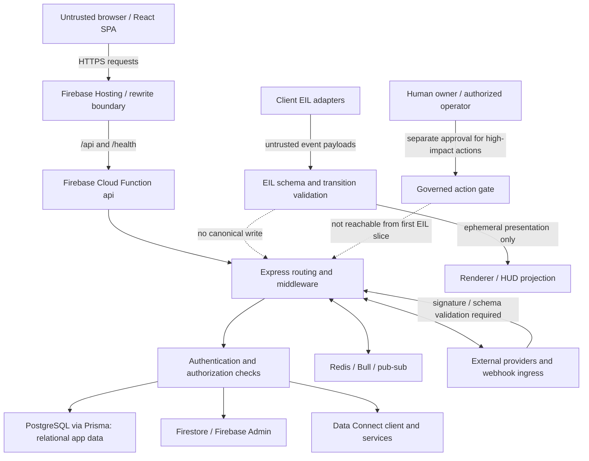

# G5 Planning — Agent 02: Architecture & System-Boundary Baseline

**Status:** Planning deliverable only. No implementation, integration, deployment, or actuation is authorized or implied.
**Baseline commit:** `main@5aade20f5e2cf5d8bfd130217da7e5f6ccc0c7ea` (post-PR #66).
**Authorization:** G5 planning gate granted by human/orchestrator (PR #67, branch `docs/g5-planning-authorization-2026-11-20`).

---

## 1. Purpose

Map the actual system boundaries that any Phase 5 integration must respect. This document describes **what exists**, not what is intended. Every claim cites repository evidence at the baseline SHA.

## 2. Canonical authority chain (verified)

```
Browser (React SPA, dist/spa)
   │  static hosting only — read-only projection
   ▼
Firebase Hosting (feexsystems-prod-508304)
   │  rewrites /api/** and /health/** → Cloud Function `api`
   ▼
Cloud Function `api` = ENTIRE Express 5 app (server/index.ts → onRequest)
   ├── server/routes/* — 391 matched router/app method-call expressions, including middleware mounts; this is not a distinct HTTP endpoint count
   ├── Prisma → PostgreSQL (canonical app data)
   ├── Redis/ioredis + Bull (queues, pub/sub)
   ├── Firestore via firebase-admin (auth middleware, websocket services, world-model)
   ├── Data Connect client (client/lib/dataconnect-client.ts → worldModelClient/worldModelMutations)
   └── WebSocket + SSE services (see §4)
```

Secondary datastore: Firestore (`feexsystems-db` per `firebase.json`) used by `server/lib/firebase-admin.ts`, `auth.middleware.ts`, `firebase-auth.ts`, and websocket services.

## 3. Backend-authority decision — MUST BRANCH

The claimed target boundary "Supabase = backend authority, Firebase = hosting only" is **not current architecture**:

| Claim | Evidence at baseline |
|---|---|
| Supabase has callers | **Zero.** No `@supabase/supabase-js` import exists in `client/`, `server/`, or `shared/`; no `supabase.co`/`SUPABASE_*`/`functions.supabase.co` reference exists in app code or env templates (`.env.example`, `.env.production.template`, `.env.test`); Supabase references exist only in `scripts/deploy-supabase-functions.*`, `scripts/README.md`, and `.github/workflows/deploy.yml`. `supabase/functions/api/index.ts` (~37 ported routes) is an isolated Deno edge function with no consumers. |
| Firebase Functions are deploy-only dead code | `server/functions/*` (~60 TypeScript files, no export named `api`, nothing imports them) are unreferenced; the live function is `api` = whole Express app via `server/node-build.ts` → `server/index.ts:268`. |
| Data Connect is optional | `client/lib/dataconnect-client.ts` is imported by `worldModelClient.ts` and `worldModelMutations.ts` — **live frontend dependency**. |
| Route inventory | Supabase port contains approximately 37 route handlers; the Express grep found 391 router/app method-call expressions including `.use()` middleware mounts. Neither figure is a verified distinct HTTP endpoint count, and direct subtraction is invalid. A per-router endpoint inventory is required for route parity. |

**Phase 5 plans must explicitly branch on the backend-authority decision:**

- **Branch A — status quo:** Express-in-Cloud-Function `api` remains backend; Phase 5 integrates against it.
- **Branch B — Firebase hosting + Supabase backend:** requires the migration programme (route parity, WS/SSE, Redis, Prisma, data migration) BEFORE any integration planning against Supabase is meaningful.
- **Branch C — hybrid/interim:** keep `api` + Firestore, migrate subsets incrementally.

Agent 03/05 must not produce plans that assume Branch B without the migration evidence existing.

## 4. Trust boundaries and authority transitions

The following is the planning trust-boundary model inferred from the inspected application architecture. It is a boundary map, not proof that every control is correctly enforced; enforcement must be verified at the named ingress/ownership point before implementation.



| Boundary | Trust/ownership rule | Required verification before implementation |
|---|---|---|
| Browser/client | Untrusted; user-controlled inputs and client state are never canonical | Validate all incoming events and API payloads; do not trust UI flags or browser storage |
| Firebase Hosting/API ingress | HTTPS hosting/rewrite boundary, not an authorization decision by itself | Confirm authentication/session handling and request limits at Express middleware |
| Express authorization | Server-side authorization boundary for protected routes and mutations | Trace each in-scope route through authentication, authorization, tenant/ownership checks, and error paths |
| PostgreSQL/Prisma | Relational application data ownership | Identify canonical tables, transaction boundaries, migration owner, and write authorization |
| Firestore/Data Connect | Separate current data/services with live consumers | Document per-collection/schema ownership, synchronization, and conflict rules; do not infer a single datastore authority |
| External providers/webhooks | Untrusted ingress/egress; provider payloads and callbacks require verification | Verify signatures, replay/idempotency, schema, secret handling, timeout, and redaction at each provider boundary |
| EIL adapters | Untrusted client events become presentation state only after canonical parsing and transition checks | Reject malformed/stale/unauthorized events; never synthesize evidence or canonical state |
| Evidence boundary | Only source-returned stable references establish provenance | Validate reference identity and disclosure; counts/summaries/provider labels are not evidence references |
| High-impact actions | Separate human/operator authorization boundary; not part of first EIL slice | Require explicit human authorization and the programme's safety/security gates; no LLM/client bypass |

## 5. Hard integration constraints (non-negotiable for Phase 5)

| Capability | Current implementation | Edge-function feasibility |
|---|---|---|
| WebSockets | `ai-websocket`, `deployment-websocket`, `security-websocket`, `team-activity.websocket`, `telemetry-websocket`, `websocket-notification` services + `redis-pubsub` | **No equivalent implementation exists in the current Supabase port** — edge functions cannot hold persistent WS connections; any Branch B plan needs a WS strategy (e.g., separate WS host, gateway, or retained service) |
| SSE streaming | `omni-command/stream`, `world-model-telemetry-stream`, `ai-agents` (`text/event-stream`) | Partial — port does not implement these |
| Redis/Bull | Job queues, caching, pub/sub fan-out to WS | No Redis equivalent on Supabase free tier |
| Prisma/Postgres | Canonical relational store | Port uses supabase-js REST; schema parity unverified |
| Firestore | Auth middleware, WS services, dual-DB architecture (`DUAL-DATABASE-ARCHITECTURE.md`) | Retention or migration decision required |

## 6. Deployment pipeline state (relevant to any G6/G7 planning)

- `deploy.yml` on `main` is valid (repaired by PR #64, `d3bcdf2`).
- Standard deploy: `hosting,functions,dataconnect` + Supabase edge functions; Cloud Functions 403 handling is evidence-classified (billing-evidence → partial `hosting,dataconnect`; unclassified → fail closed).
- `hosting_only` dispatch exists for frontend-only deploys (optional verification still pending).
- G7 exception on record: production was restored via an unrecorded deployment channel (§15.2).

## 7. Boundary rules Phase 5 must preserve

1. Browser remains a read-only projection; server state is canonical.
2. World Model data is canonical; LLM output is interpretation, never mutation without evidence.
3. Evidence-first: every integration claim needs repo/SHA/file-level provenance.
4. No agent self-approves gates; G5 implementation requires separate authorization.
5. Provider-neutral model adapters (`aiService`) — Phase 5 must not hardwire a provider.

## 8. Handoff to Agent 03

Agent 03 should map the integration/execution flows that Phase 5 touches — specifically: which of the 391 routes, WS services, and SSE streams are in-scope for EIL/HoloKai/Omni integration, and which backend branch (§3) each flow assumes. This baseline provides the boundary map; Agent 03 provides the flow map.

---

*Planning artifact. Does not modify code, contracts, or gate status.*

---

## Appendix A — Evidence index (baseline `main@5aade20`)

| Claim | Evidence |
|---|---|
| `api` = whole Express app as Cloud Function | `server/index.ts:268` (`export const api = onRequest(...)`); `server/node-build.ts` emits `dist/server/node-build.mjs` |
| Hosting rewrites `/api`, `/health` → `api` | `firebase.json:46-57` |
| 391 route registrations | `grep -rhoE "(router\|app)\.(get\|post\|put\|patch\|delete\|use)\(" server/` at baseline |
| Zero Supabase callers | No `@supabase/supabase-js`, `supabase.co`, `SUPABASE_*`, or `functions.supabase.co` in `client/`, `server/`, `shared/`, env templates; hits only in `scripts/deploy-supabase-functions.*`, `scripts/README.md`, `.github/workflows/deploy.yml` |
| Supabase port size | `supabase/functions/api/index.ts` — 1,451 lines, single `serve(handler)` at :1451 |
| Data Connect live dependency | `client/lib/dataconnect-client.ts` imported by `client/lib/worldModelClient.ts`, `client/lib/worldModelMutations.ts` (+ test) |
| Dead parallel functions | `server/functions/` — ~60 `.ts` files, no `api` export, no importers |
| WebSocket services | `server/lib/services/{ai,deployment,security,telemetry}-websocket.service.ts`, `team-activity.websocket.ts`, `websocket-notification.service.ts`, `redis-pubsub.service.ts` |
| SSE streams | `server/routes/omni-command.ts:40`, `server/routes/world-model-telemetry-stream.ts:84`, `server/routes/ai-agents.ts:333` (`text/event-stream`) |
| Firestore/Admin | `server/lib/firebase-admin.ts:8-9` (admin app + auth), `databaseURL` → `*-default-rtdb` |
| Deploy workflow | `.github/workflows/deploy.yml` — `hosting_only` input, scope-separated concurrency, evidence-classified 403 handling (PRs #62/#63/#64) |
