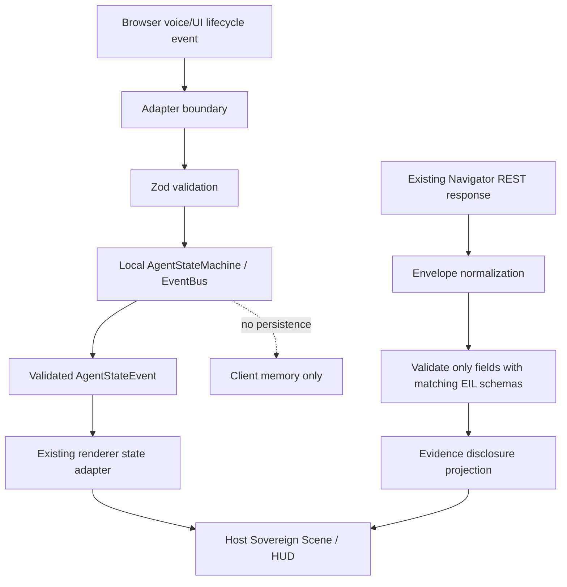

# G5 Planning — Agent 05: EIL Adapter Contracts & First-Slice Boundary

**Status:** Planning deliverable only. No implementation, integration, schema change, deployment, or actuation is authorized or implied.  
**Baseline:** `main@5aade20f5e2cf5d8bfd130217da7e5f6ccc0c7ea`  
**Inputs:** Agent 02 architecture baseline (PR #68) and Agent 03 flow map (PR #69), both independently based on the same pinned baseline and not assumed merged.  
**Scope:** Contract-level adapter design for FEEX WORLD, HoloKai, and the existing Omni/World Model surfaces.

---

## 1. Executive recommendation

**Recommend a client-side first EIL slice, with no server-side EIL state and no new real-time transport.** Treat this as a planning recommendation, not an approved implementation decision.

The first slice can remain local if it is limited to:
- consuming actual browser/client subsystem events;
- validating them against the existing EIL v0.x contract definitions and schemas;
- maintaining ephemeral client-side interaction/state-machine state;
- rendering validated state through the existing host scene;
- carrying only evidence references that the source actually returns;
- displaying unavailable, fallback, simulated, and error states honestly.

It must not:
- create a new EIL persistence service, API router, Socket.IO path, or SSE stream;
- infer `AgentStateEvent` transitions from LLM token generation, animation timers, or optimistic UI state;
- manufacture `EvidenceReference` values from summaries, project counts, confidence guesses, or source labels;
- treat a client-side event as canonical World Model state;
- route interaction events into tool execution, robotics, or external side effects.

**Critical qualification:** the existing HoloKai voice modal already calls the generic `POST /api/world-model/navigator` endpoint. HoloKai is therefore not disconnected from the backend; it has no dedicated HoloKai router or HoloKai-specific API contract in the inspected baseline. Preserve the existing generic navigator integration unless a separate decision authorizes a new interface.

## 2. Canonical contract inventory and discrepancy

The adapter design must consume the repository contracts as they exist at the pinned SHA. Do not copy the earlier proposed architecture RFC types over the live contracts.

| Contract | Existing authority | Adapter use |
|---|---|---|
| `AgentStateEvent` | `contracts/agent-state.ts` + `agentStateEventSchema` | Validated presentation state; evidence required on entry to RESPONDING/EXECUTING |
| `EvidenceReference` / `EvidenceBundle` | `contracts/evidence-reference.ts` + Zod schemas | Evidence identity, provenance, epistemic status and derived disclosure |
| `InteractionEvent` | `contracts/interaction-event.ts` + `interactionEventSchema` | Typed local interaction intent; authorization required before bus delivery |
| `PerceptionEvent` / `GestureEvent` | `contracts/perception-event.ts` + schemas | Optional future input; permission and source confidence must be explicit |
| `EmbodiedActionRequest` / `Observation` | `contracts/embodied-action.ts` + schemas | Out of scope for the first slice; no actuation path |
| `VersionedEnvelope` | `contracts/schema-version.ts` | Required at any future persistence/network boundary |

### 2.1 Schema version conflict — must be reconciled before implementation

At the pinned baseline:
- Contract source-file headers identify several contracts as **v0.1.0**.
- `packages/feex-eil/contracts/schema-version.ts` declares `EIL_SCHEMA_VERSION = "1.0.0"`.
- The package documentation and prior programme records describe the canonical contracts as v0.1.0.

These are conflicting version signals. This plan does **not** choose one, edit the schema version, or reinterpret the file headers. Agent 02 must determine whether this is an intentional package-level 1.0.0 envelope over v0.1.0 contract modules, a stale header, or a versioning defect. Agent 00 should record the decision. Until resolved, adapters must import the existing constants and types rather than hard-code a version string or claim a single canonical version label.

### 2.2 Contract invariants adapters must preserve

1. Validate at every untrusted boundary, including deserialized payloads and API responses.
2. Preserve legal state transitions from `VALID_TRANSITIONS`; do not introduce adapter-specific transitions.
3. Do not set confidence unless a calibrated source supplies it.
4. Require non-empty `evidenceRefs` for RESPONDING and EXECUTING.
5. `EXECUTING` means actual task execution, never model generation or a submitted request.
6. Recompute disclosure from evidence references; do not trust caller-supplied derived flags.
7. Permission is explicit. `DENIED`, `REVOKED`, and `ERROR` are not permission.
8. HIGH-impact or unauthorized interaction must not be routed.
9. Physical execution remains disabled and outside this adapter plan.

## 3. Existing integration surfaces

### 3.1 FEEX WORLD

- `FeexSovereignEngine.tsx` composes the sovereign UI and owns current local interaction/telemetry presentation state.
- `SovereignScene`, `SovereignHUD`, `SovereignControls`, and `SovereignTelemetry` are the likely composition points.
- The EIL renderer is a scene fragment and must remain inside the existing React Three Fiber Canvas; it must not create a second Canvas or WebGL context.
- No current evidence in the inspected files shows FEEX WORLD already emitting canonical EIL state events into the renderer.

### 3.2 HoloKai

- `HoloKaiInterface` is a wrapper around `HoloKaiVoiceModal`.
- `HoloKaiVoiceModal` currently uses browser SpeechRecognition/SpeechSynthesis and posts user queries to `/api/world-model/navigator`.
- The modal unwraps the `{ success, data }` response envelope, reads navigator explanation/summary, projects returned LLM/provider metadata into `DataSourceLabel`, and displays calibrated confidence only if the response supplies a valid [0,1] value.
- Its current local message model is not an `AgentStateEvent` or `EvidenceBundle`. It must not be silently cast to either.
- Existing imports reach into `packages/feex-eil` by relative path for `DataSourceBadge` and `DataSourceLabel`. This is a current coupling point, not proof of a stable cross-repository package API.

### 3.3 Omni-Command

- Existing REST and SSE endpoints are orchestration/trace surfaces, not EIL state streams.
- An SSE trace step or completed LLM response must not be mapped to RESPONDING, SPEAKING, or EXECUTING unless a typed producer event with the required semantics and evidence exists.
- First-slice EIL does not require an Omni-Command transport change.

## 4. Proposed adapter responsibilities

These are logical responsibilities, not approved TypeScript declarations or implementation tasks.

| Adapter boundary | Input | Output / responsibility | Must not do |
|---|---|---|---|
| `FeexWorldEILAdapter` | Actual local UI/runtime events and validated EIL contracts | Feed a local `AgentStateMachine` / `EventBus`; expose read-only validated state to existing scene/HUD | Persist canonical state, mutate World Model, invent telemetry |
| `HoloKaiEILAdapter` | Existing navigator response envelope plus actual browser voice lifecycle callbacks | Normalize the response envelope; preserve `DataSourceLabel`; validate evidence only when actual compatible references are present; expose local presentation state | Add a HoloKai backend route, synthesize evidence refs, treat provider metadata as evidence |
| `OmniEILAdapter` | Existing REST result or SSE trace | Optional display-only trace mapping where event semantics are explicitly defined | Treat arbitrary trace events as canonical agent transitions or action completion |
| `EvidencePresentationAdapter` | Validated `EvidenceReference[]` / `EvidenceBundle` | Derive disclosure with `disclosureForBundle`; expose evidence provenance to HUD/modal | Trust inconsistent derived flags or infer missing references |
| `RendererProjectionAdapter` | Parsed `AgentStateEvent` | Map via existing renderer adapter to visual state | Own state transitions, network calls, permissions, or actions |

### 4.1 Local event flow for the first slice

The diagram is a proposed first-slice flow. The dotted client-memory boundary is ephemeral and must not be described as durable or canonical.

## 5. Evidence mapping rules

The navigator response currently consumed by HoloKai includes fields such as explanation/summary, projects, grounded-evidence count, LLM metadata, fallback indication, optional confidence, and suggestions. The inspected HoloKai consumer does not construct an EIL `EvidenceReference` or `EvidenceBundle`.

Therefore:
- `groundedEvidenceCount > 0` is a count, not a list of evidence references.
- An explanation or summary is content, not provenance.
- `llm.provider`, `llm.model`, and `usedFallback` are source/runtime metadata, not evidence references.
- A valid numeric confidence is not evidence provenance.
- A `DataSourceLabel` describes source freshness/availability, not epistemic status.

Before mapping navigator output to `EvidenceBundle`, Agent 05/02 must inspect the actual server result type and confirm that it returns stable evidence identifiers, entity IDs, source locators, epistemic status, and any required verification metadata. If not, the adapter must leave the evidence bundle absent/unavailable and the UI must say so. Do not fabricate a bundle to satisfy the renderer.

## 6. Transport and persistence decision

**First-slice decision recommendation: no new transport and no server-side EIL persistence.**

| Concern | First-slice treatment | Revisit trigger |
|---|---|---|
| Agent state | Ephemeral local state only, derived from actual client lifecycle events | Cross-device/session continuity or server-owned orchestration requires it |
| Event distribution | Existing in-process `EventBus` | Multiple processes/clients need shared event delivery |
| HoloKai queries | Existing `POST /api/world-model/navigator` | Existing endpoint demonstrably cannot support an approved use case |
| Omni traces | Existing REST/SSE, display-only | A separately specified, versioned EIL event stream is approved |
| Evidence | Consume only real source references | Backend response contract is extended and reviewed |
| Persistence | None in first slice | Retention, ownership, deletion, replay, audit, and migration policies approved |
| WebSockets | None added | Measured product requirement plus transport/security/failure-isolation design |
| Robotics | No action requests or actuation | Separate safety, simulation, security, and operator gates |

A client-side EventBus is not a distributed event bus. It provides no cross-tab, cross-device, cross-instance, durable replay, or server authority guarantee.

## 7. Failure, security, privacy and lifecycle requirements

- Invalid payload: reject at boundary; preserve diagnostic context without rendering it as canonical state.
- Missing evidence: do not emit RESPONDING/EXECUTING state that violates the live contract; do not create placeholder evidence IDs.
- Duplicate event: rely on existing EventBus event-ID deduplication; define ID lifetime/retention before any durable or distributed bus is proposed.
- Out-of-order state: rely on state-machine transition validation and renderer stale-event checks; define timestamp/sequence ordering for any future cross-process transport.
- Browser speech unavailable/permission denied: expose unavailable/error state; do not claim LISTENING.
- Navigator HTTP/provider failure: preserve explicit ERROR/FALLBACK/UNAVAILABLE labels based on actual response; no success-shaped fallback.
- Raw camera frames/biometric media: excluded. No camera activation or remote media processing is part of this plan.
- Secrets: no provider credentials in browser adapters.
- High-impact actions: blocked from this adapter surface; no tool or robotics execution.
- Accessibility: keyboard/pointer remains available; reduced-motion behavior remains respected.

## 8. Contract-level acceptance criteria for a future implementation proposal

These are proposed tests, not results already achieved.

1. Valid and invalid `AgentStateEvent` payloads are accepted/rejected by the canonical parser.
2. Every transition follows `VALID_TRANSITIONS`; invalid transitions leave state unchanged.
3. RESPONDING/EXECUTING without evidence references is rejected.
4. Confidence is omitted when no calibrated source supplies it.
5. Navigator response envelope success/error/legacy shapes are normalized without inventing missing fields.
6. A positive grounded-evidence count without actual references does not produce an `EvidenceBundle`.
7. Disclosure is derived from the references via `disclosureForBundle`, including FICTIONAL and SPECULATIVE cases.
8. Browser speech lifecycle transitions reflect actual SpeechRecognition callbacks and permission state, not button animation or optimistic state.
9. Duplicate interaction event IDs are dispatched at most once by the local EventBus.
10. Unauthorized events do not reach handlers.
11. No network request, database write, WebSocket, SSE, tool call, or robotics action is introduced by the client-only slice.
12. Renderer remains inside the host Canvas and respects reduced-motion settings.

## 9. Decisions and handoffs

| ID | Decision / question | Owner | Status |
|---|---|---|---|
| A05-01 | Is client-only, ephemeral EIL sufficient for the first slice? | Agent 00 + human owner | Recommendation: yes; decision pending |
| A05-02 | Reconcile contract file headers v0.1.0 with `EIL_SCHEMA_VERSION` 1.0.0 | Agent 02 + Agent 00 | Open; blocks versioned adapter implementation |
| A05-03 | Does NavigatorResult expose actual evidence references in a stable, typed shape? | Agent 02/05 | Open; inspect server result and tests |
| A05-04 | Define the exact subset of browser voice lifecycle events that may drive local AgentState transitions | Agent 03/05 | Open |
| A05-05 | Confirm whether FEEX WORLD first slice requires renderer wiring or only contract/event validation | Agent 02/03/00 | Open |
| A05-06 | Decide package import boundary for client consumers (relative source import vs package export) | Agent 02 | Open; no package refactor proposed |
| A05-07 | Is any server-side event history/persistence required? | Agent 00 + human owner | No for first-slice recommendation; revisit only with a concrete requirement |

### Handoff to Agent 09

Build a test strategy around the acceptance criteria in §8. Distinguish:
- pure contract tests;
- adapter normalization tests;
- browser lifecycle/permission tests;
- renderer projection tests;
- negative tests proving no network/persistence/actuation was added.

### Handoff to Agent 00

Review the client-only recommendation, the schema-version discrepancy, and the evidence mapping limitation. Agent 00 must independently recommend whether the first slice is sufficiently bounded. No implementation gate changes follow from this document.

---

## Appendix A — Repository evidence index

All paths below refer to the pinned baseline `5aade20f5e2cf5d8bfd130217da7e5f6ccc0c7ea`.

| Claim | Source |
|---|---|
| Live AgentState fields, transition table, evidence-required states | `packages/feex-eil/contracts/agent-state.ts` |
| EvidenceReference, EvidenceBundle, disclosure derivation | `packages/feex-eil/contracts/evidence-reference.ts` |
| Interaction channels, impact levels, event authorization fields | `packages/feex-eil/contracts/interaction-event.ts` |
| Perception/gesture/permission types | `packages/feex-eil/contracts/perception-event.ts` |
| Action request, observation, safety decision | `packages/feex-eil/contracts/embodied-action.ts` |
| Package schema version literal 1.0.0 | `packages/feex-eil/contracts/schema-version.ts` |
| Runtime validation and schema invariants | `packages/feex-eil/contracts/validation.ts` |
| Local event validation, authorization, deduplication, freeze and dispatch | `packages/feex-eil/interaction/EventBus.ts` |
| State transition and replay behavior | `packages/feex-eil/interaction/agent-state-machine.ts` |
| Renderer public API | `packages/feex-eil/renderer/index.ts` |
| Sovereign runtime composition/local state | `client/components/sovereign/FeexSovereignEngine.tsx` |
| HoloKai interface wrapper | `client/components/sovereign/HoloKaiInterface.tsx` |
| HoloKai browser speech + navigator fetch + response mapping | `client/components/sovereign/HoloKaiVoiceModal.tsx` |
| Existing Navigator GET/POST routes and response envelope | `server/routes/world-model.ts:83-93,165-189` |
| Omni REST/SSE behavior | `server/routes/omni-command.ts` |
| Existing programme record of contract and integration state | `docs/program/FEEX-MASTER-IMPLEMENTATION-REGISTER.md`; `docs/program/FEEX-MIP-2026-LLM-AGENT-EDITION.md` |

*Planning artifact only. No code, canonical contract, backend, deployment, gate, or physical-actuation state is changed.*
